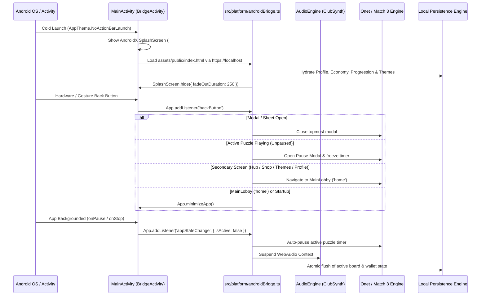

# Connectify Android — Capacitor & Native Android Migration Plan (`ANDROID_MIGRATION_PLAN.md`)

**Document Owner:** Agent 10 — Android & Capacitor Engineer (`@android-eng`)  
**Target Package ID:** `com.connectify.android`  
**App Name:** `Connectify`  
**Source Repository (Read-Only):** `/root/.gemini/antigravity/scratch/connectify-new`  
**Target Repository:** `/root/.gemini/antigravity/scratch/connectify-android`  
**Target SDK / Compile SDK / Min SDK:** `36` / `36` / `24` (Android 7.0+, Android System WebView 111+)

---

## 1. Executive Audit of `connectify-new` Build Setup & Web-to-APK Gaps

### 1.1 Current `connectify-new` Build & Asset Configuration
An audit of `/root/.gemini/antigravity/scratch/connectify-new` (`package.json`, `vite.config.ts`, `tsconfig.json`, `index.html`, `public/`, and `src/`) reveals the following baseline:

| File / Directory | Current Setup in `connectify-new` | Required Adaptation for `connectify-android` |
| :--- | :--- | :--- |
| **`package.json`** | `"name": "connectify-app"`, ESM (`"type": "module"`). Mixes frontend dependencies (`react@^18.2.0`, `react-dom@^18.2.0`, `motion@^12.0.0`, `lucide-react@^0.354.0`, `tailwindcss@^4.0.0`) with unused/legacy server & arcade dependencies (`express`, `jsonwebtoken`, `dotenv`, `esbuild server.ts`, `phaser@3.90.0`, `matter-js@^0.20.0`). | Strip Express/Node server bundling and non-target game engines (`phaser`, `matter-js`). Add Capacitor 8 packages (`@capacitor/core`, `@capacitor/cli`, `@capacitor/android`, `@capacitor/app`, `@capacitor/status-bar`, `@capacitor/haptics`, `@capacitor/splash-screen`) and scripts (`android:sync`, `android:icons`, `android:debug`, `android:release`, `android:key`). |
| **`vite.config.ts`** | Uses `@vitejs/plugin-react` and `@tailwindcss/vite` with a dev-only `noCachePlugin` and `manualChunks` splitting `motion/react` and `@supabase/supabase-js`. | Remove `noCachePlugin` and server port bindings. Configure `base: './'`, `build.outDir: 'dist'`, `build.emptyOutDir: true`, `build.target: 'es2022'`, and deterministic chunking (`vendor-react`, `vendor-motion`, `vendor-capacitor`). Ensure zero mandatory runtime env vars are needed for offline startup. |
| **`tsconfig.json`** | `target: "ES2022"`, `moduleResolution: "bundler"`, `jsx: "react-jsx"`, `include: ["src", "api", "server.ts"]`. | Restrict `include` to `["src", "capacitor.config.ts"]`, remove `api` and `server.ts`, and enforce clean `tsc --noEmit` validation before every Capacitor sync. |
| **`index.html`** | Sets `viewport-fit=cover` and `#fffaf5` background, but loads `Fredoka` and `Outfit` fonts from `https://fonts.googleapis.com` and triggers a 12-second error watchdog (`"Gagal memuat. Cek koneksi internetmu."`) in `#static-loader`. | **Critical Offline Fix:** Self-host `Fredoka` (400–700) and `Outfit` (400–900) `.ttf`/`.woff2` font files in `public/fonts/` with local `@font-face` declarations. Remove external `<link href="https://fonts.googleapis.com/...">` tags. Replace the network error message in `#static-loader` with local boot progress coordinated with `@capacitor/splash-screen`. |
| **`public/asset-cache-sw.js` & `src/lib/assetCache.ts`** | Registers a browser Service Worker (`/asset-cache-sw.js`) that caches `image`, `audio`, and `font` requests up to an arbitrary limit of 240 entries (`if (keys.length > 240) await cache.delete(keys[0])`). | **Critical Native Fix:** `public/` contains 478 asset files (~8.8 MB). In a Capacitor APK, all assets in `dist/` are already packaged on-device inside `android/app/src/main/assets/public/` and served locally via `https://localhost`. Skip Service Worker registration when `Capacitor.isNativePlatform()` is true (and unregister any leftover SW) while keeping `warmImages()` image decoding active. |

---

## 2. Local Machine Android / Java / Gradle Environment Audit & Build Strategy

### 2.1 Hardware, OS & Installed Toolchain Inventory
We inspected the local execution environment and sibling repositories (`/root/.gemini/antigravity/scratch/katakecil`, `/data/data/com.termux/files/home/katakecil-termux`, `/data/data/com.termux/files/home/quiz-github`):

* **Host Architecture & Kernel:** `Linux localhost 6.17.0-PRoot-Distro #1 SMP PREEMPT_DYNAMIC aarch64 GNU/Linux` (Debian 13 Trixie `arm64` environment running atop an Android `aarch64` host with Termux mounted at `/data/data/com.termux/files/usr`).
* **Java Development Kit (JDK 21 — Installed & Verified):**
  * Binary paths: `/data/data/com.termux/files/usr/bin/java`, `/data/data/com.termux/files/usr/bin/javac`, `/data/data/com.termux/files/usr/bin/keytool`
  * `JAVA_HOME`: `/data/data/com.termux/files/usr/lib/jvm/java-21-openjdk`
  * Version: `OpenJDK 21.0.13 (build 21.0.13, 64-Bit Server VM)` (Termux package `openjdk-21` `21.0.13-2` `aarch64`; `openjdk-17` `17.0.21-2` is also installed).
* **Node.js & Package Managers (Installed & Verified):**
  * Debian Node.js `v20.19.2` (`/usr/bin/node`) and Termux Node.js `v24.22.3` (`/data/data/com.termux/files/usr/bin/node`), `npm` `12.2.2`.
* **Android APK Signing & Debug Tools (Installed & Verified):**
  * `apksigner` `37.0.0`: `/data/data/com.termux/files/usr/bin/apksigner` (`/data/data/com.termux/files/usr/share/java/apksigner.jar`)
  * `adb` (`android-tools` `37.0.0p1-3`): `/data/data/com.termux/files/usr/bin/adb`
  * `apktool`: `/data/data/com.termux/files/usr/bin/apktool`
* **Gradle Wrapper (`8.14.3` — Available Locally):**
  * Reusable verbatim from `/root/.gemini/antigravity/scratch/katakecil/android/gradlew` and `/root/.gemini/antigravity/scratch/katakecil/android/gradle/wrapper/gradle-wrapper.jar` (`gradle-8.14.3-bin.zip`, Android Gradle Plugin `8.13.0`).
* **Android SDK (`android.jar`) & Native `aarch64` `aapt2` / `zipalign` Status:**
  * Neither `ANDROID_HOME` nor `aapt2` is pre-extracted in `/root` or `/opt` at baseline, **but all required packages are available in the local Debian/Termux repositories and Google's pure-Java SDK command-line tools**:
    * Termux apt repository (`https://mirror.mwt.me/termux/main` `aarch64`): provides native ARM64 `aapt2` (`16.0.0.4-4`), `aapt` (`16.0.0.4-4`, including `zipalign`), and `d8` (`37.0.0`).
    * Debian Trixie `arm64` repository (`http://deb.debian.org/debian`): provides `aapt` (`1:14~beta1-3`), `zipalign` (`1:10.0.0+r36-1.1`), `apksigner` (`35.0.2-1`), and `android-sdk` (`28.0.2+12`).

### 2.2 How to Build a Working Installable Debug APK Locally on This `aarch64` Machine
Building an Android APK with Gradle on an `aarch64` Linux / Termux / PRoot-Distro machine has one well-known architectural requirement: **Google's Maven repository (`com.android.tools.build:aapt2:<version>-linux`) only publishes `x86_64` binaries**, which fail with `Exec format error` on `aarch64` unless overridden with a native ARM64 `aapt2` binary.

Our local build pipeline (`scripts/build-android.mjs`) handles both `x86_64` (GitHub Actions / desktop Linux) and `aarch64` (this machine) automatically:

#### Step 1: Provision Local Android SDK & Native `aarch64` Build Tools (One-Time Setup)
```bash
# 1. Install native aarch64 aapt2 and zipalign via Termux pkg/apt (or Debian apt)
/data/data/com.termux/files/usr/bin/apt-get update
/data/data/com.termux/files/usr/bin/apt-get install -y aapt aapt2 d8

# 2. Provision Android SDK Platform 36 & Build-Tools 36.0.0 using pure-Java sdkmanager on OpenJDK 21
export JAVA_HOME=/data/data/com.termux/files/usr/lib/jvm/java-21-openjdk
export ANDROID_HOME=/root/android-sdk
mkdir -p "$ANDROID_HOME/cmdline-tools"
curl -fsSL https://dl.google.com/android/repository/commandlinetools-linux-11076708_latest.zip -o /tmp/cmdtools.zip
unzip -q /tmp/cmdtools.zip -d "$ANDROID_HOME/cmdline-tools"
mv "$ANDROID_HOME/cmdline-tools/cmdline-tools" "$ANDROID_HOME/cmdline-tools/latest"
yes | "$ANDROID_HOME/cmdline-tools/latest/bin/sdkmanager" --sdk_root="$ANDROID_HOME" --licenses
"$ANDROID_HOME/cmdline-tools/latest/bin/sdkmanager" --sdk_root="$ANDROID_HOME" \
  "platforms;android-36" \
  "build-tools;36.0.0" \
  "platform-tools"
```

#### Step 2: Automatic `aarch64` `aapt2` Override in `scripts/build-android.mjs`
When `scripts/build-android.mjs` detects `process.arch === 'arm64'` and a local `aapt2` binary (at `/data/data/com.termux/files/usr/bin/aapt2` or `/usr/bin/aapt2`), it automatically appends:
```text
-Pandroid.aapt2FromMavenOverride=/data/data/com.termux/files/usr/bin/aapt2
```
to the `./gradlew` invocation, and constrains memory for Termux/PRoot stability:
```text
./gradlew --no-daemon --max-workers=2 -Pandroid.aapt2FromMavenOverride=/data/data/com.termux/files/usr/bin/aapt2 assembleDebug
```
It also forwards `HTTPS_PROXY` / `HTTP_PROXY` environment variables into `GRADLE_OPTS` (`-Dhttps.proxyHost=...`) exactly as proven in `/root/.gemini/antigravity/scratch/katakecil/scripts/build-android.mjs`.

#### Step 3: Local Build & Verification Commands
```bash
# Build web bundle, generate adaptive icons/splash, sync Capacitor, and compile Debug APK
npm run android:debug

# Output artifact & SHA-256 checksum:
# artifacts/Connectify-1.0.0-debug.apk
# artifacts/Connectify-1.0.0-debug.apk.sha256
```

### 2.3 GitHub Actions Cloud Build Pipeline (`.github/workflows/android-build.yml`)
In Coordination with Agent 13 (`@devops-eng`), the GitHub Actions workflow runs on `ubuntu-latest` (`x86_64`) and executes:
1. `actions/checkout@v4`
2. `actions/setup-node@v4` (Node 22/24 with npm cache)
3. `actions/setup-java@v5` (`temurin` JDK 21 with `gradle` cache)
4. Android SDK setup (`platforms;android-36`, `build-tools;36.0.0`, `platform-tools`)
5. Quality gates: `npm ci`, `npm run typecheck`, `npm test` (unit + economy/progression simulations), `npm run build`
6. Capacitor sync: `npx cap sync android`
7. Gradle APK build (`node scripts/build-android.mjs --debug` or signed release when `CONNECTIFY_KEYSTORE_BASE64` secret is configured)
8. `actions/upload-artifact@v4` uploading `artifacts/*.apk`, `artifacts/*.sha256`, and `artifacts/*.json`.

---

## 3. Exact Capacitor + Vite + TypeScript Configuration for `connectify-android`

### 3.1 `app-version.json` (Single Source of Truth for Versioning)
Located at `/root/.gemini/antigravity/scratch/connectify-android/app-version.json`, read by both the web UI footer (`StartupScreen`), `android/app/build.gradle`, and `scripts/build-android.mjs`:
```json
{
  "version": "1.0.0",
  "versionCode": 1
}
```

### 3.2 `capacitor.config.ts` / `capacitor.config.json`
We provide `capacitor.config.json` (and typed `capacitor.config.ts`) configured for `com.connectify.android` with 100% bundled local assets (no `server.url`):
```json
{
  "appId": "com.connectify.android",
  "appName": "Connectify",
  "webDir": "dist",
  "server": {
    "androidScheme": "https",
    "allowNavigation": []
  },
  "android": {
    "backgroundColor": "#fffaf5",
    "allowMixedContent": false,
    "captureInput": true,
    "minWebViewVersion": 111,
    "webContentsDebuggingEnabled": false
  },
  "plugins": {
    "SplashScreen": {
      "launchShowDuration": 0,
      "launchAutoHide": false,
      "backgroundColor": "#fffaf5",
      "androidSplashResourceName": "splash",
      "androidScaleType": "CENTER_INSIDE",
      "showSpinner": false
    },
    "StatusBar": {
      "overlaysWebView": true,
      "style": "DARK",
      "backgroundColor": "#00000000"
    },
    "SystemBars": {
      "insetsHandling": "css",
      "initialViewportFitValueHint": "cover"
    }
  }
}
```

### 3.3 `vite.config.ts` for `connectify-android`
```ts
import { defineConfig } from 'vite';
import react from '@vitejs/plugin-react';
import tailwindcss from '@tailwindcss/vite';

export default defineConfig({
  base: './',
  plugins: [react(), tailwindcss()],
  build: {
    outDir: 'dist',
    emptyOutDir: true,
    target: 'es2022',
    sourcemap: false,
    assetsInlineLimit: 4096,
    rollupOptions: {
      output: {
        manualChunks: {
          'vendor-react': ['react', 'react-dom'],
          'vendor-motion': ['motion/react'],
          'vendor-capacitor': [
            '@capacitor/core',
            '@capacitor/app',
            '@capacitor/status-bar',
            '@capacitor/haptics',
            '@capacitor/splash-screen'
          ]
        }
      }
    }
  }
});
```

### 3.4 Android Gradle Configuration (`android/`)
The `android/` project follows the Capacitor 8 Android structure:

* **`android/variables.gradle`**:
  ```groovy
  ext {
      minSdkVersion = 24
      compileSdkVersion = 36
      targetSdkVersion = 36
      androidxActivityVersion = '1.10.1'
      androidxAppCompatVersion = '1.7.1'
      androidxCoordinatorLayoutVersion = '1.3.0'
      androidxCoreVersion = '1.15.0'
      androidxFragmentVersion = '1.8.6'
      coreSplashScreenVersion = '1.2.0'
      androidxWebkitVersion = '1.12.1'
      junitVersion = '4.13.2'
      androidxJunitVersion = '1.2.1'
      androidxEspressoCoreVersion = '3.6.1'
      cordovaAndroidVersion = '14.0.1'
  }
  ```
* **`android/settings.gradle`**:
  ```groovy
  include ':app'
  apply from: 'capacitor.settings.gradle'
  ```
* **`android/app/build.gradle`**:
  - Sets `namespace = "com.connectify.android"` and `applicationId "com.connectify.android"`.
  - Reads `versionCode` and `versionName` dynamically from `../app-version.json`.
  - Configures `JavaVersion.VERSION_21` source and target compatibility.
  - Configures `aaptOptions.ignoreAssetsPattern` so modern web bundles and `.webp`/`.woff2` assets inside `src/main/assets/public/` are packaged cleanly without stripping hidden or underscored chunks.
  - Supports environment-driven release signing (`CONNECTIFY_RELEASE_STORE_FILE`, `CONNECTIFY_RELEASE_STORE_PASSWORD`, `CONNECTIFY_RELEASE_KEY_ALIAS`, `CONNECTIFY_RELEASE_KEY_PASSWORD`) with APK Signature Scheme v1, v2, and v3 enabled, while falling back cleanly to debug signing for local testing.

---

## 4. Native Lifecycle Hooks, System Integration & Offline WebView Architecture



### 4.1 Native Bridge Module (`src/platform/androidBridge.ts`)
All Capacitor plugin calls are encapsulated in `src/platform/androidBridge.ts` with safe no-op/web fallbacks when running in standard desktop browsers or unit tests (`JSDOM` / `Vitest`):

1. **App Pause / Resume Lifecycle (`@capacitor/app`)**:
   - **`appStateChange` (`isActive === false`)**:
     - Dispatches a synchronous `connectify:app-pause` custom event and invokes registered pause callbacks.
     - Active **Onet** or **Match 3** rounds immediately pause their countdown timers and transition to the paused state so players never lose time while answering a phone call or switching apps.
     - Calls `ClubSynth.visibility()` / `audioContext.suspend()` so background music and SFX stop immediately on screen lock or app switch.
     - Triggers an immediate synchronous flush of the active game board snapshot and player profile to local storage.
   - **`appStateChange` (`isActive === true`)**:
     - Dispatches `connectify:app-resume`.
     - Restores `AudioContext` only if the user has not muted audio and is not in a paused modal.
     - Re-verifies system bar appearance and safe-area insets.

2. **Hardware & Gesture Back Button Stack (`@capacitor/app`)**:
   - Registers `App.addListener('backButton', ({ canGoBack }) => ...)` with deterministic priority:
     1. **Priority 1 — Active Overlay / Modal Dismissal:** If any modal, drawer, or popup (`SettingsModal`, `TutorialPopup`, `ShopPurchaseConfirm`, `PauseModal`, `DailyRewardPopup`) is open in the UI stack, close only the topmost overlay.
     2. **Priority 2 — Active Gameplay Protection:** If the player is actively playing an **Onet** or **Match 3** level and the game is running, pressing Back opens the in-game **Pause Modal** instead of exiting the board and losing progress.
     3. **Priority 3 — In-Game Pause Modal Back:** If the Pause Modal is already open, pressing Back resumes or prompts to exit to the Level Select / Game Hub.
     4. **Priority 4 — Screen Stack Navigation:** If on any sub-screen (`game-hub`, `toko`, `tema`, `prestasi`, `statistik`, `koleksi`, `settings`, `profile`, `edit-avatar`), navigate back to `home` (`MainLobby`).
     5. **Priority 5 — Root Screen Minimize:** If on `home` (`MainLobby`) or `startup` (`StartupScreen`), invoke `App.minimizeApp()` so Android moves the task to the background cleanly without destroying the WebView session.

3. **StatusBar, Edge-to-Edge & Cutout / Safe-Area Handling (`@capacitor/status-bar` + `MainActivity.java`)**:
   - `MainActivity.java` enables `EdgeToEdge.enable(this)` and configures `WindowCompat.setDecorFitsSystemWindows(getWindow(), false)`.
   - CSS safe-area insets (`env(safe-area-inset-top)`, `env(safe-area-inset-bottom)`, `env(safe-area-inset-left)`, `env(safe-area-inset-right)`) pad the outer `.app-stage` container so camera punch-holes, notches, and gesture navigation bars never overlap HUD counters, timer bars, or bottom navigation buttons.
   - When the user equips a theme in `ThemeProvider`:
     - Light themes (e.g., default `#fffaf5` Cream / Bakery / Vanilla): `StatusBar.setStyle({ style: Style.Light })` (dark status bar icons on light background).
     - Dark themes (e.g., Night / Cyber / Dark palettes): `StatusBar.setStyle({ style: Style.Dark })` (light status bar icons on dark background).

4. **Tactile Haptics Engine (`@capacitor/haptics`)**:
   - Exposes semantic helper `triggerHaptic(event: HapticEvent)` gated by `settings.hapticsEnabled` (default `true`, toggleable in `SettingsScreen`):
     - `'tileTap'`: `Haptics.selectionChanged()` — subtle crisp tick when selecting an Onet tile or starting a Match 3 swap.
     - `'matchPair'`: `Haptics.impact({ style: ImpactStyle.Light })` — light tactile pop on a valid Onet connection or standard 3-tile match.
     - `'comboSpecial'`: `Haptics.impact({ style: ImpactStyle.Medium })` — medium pulse when creating/detonating Match 3 special tiles (Line Bomb, Area Bomb, Rainbow) or hitting an Onet combo streak ($\ge 3\times$).
     - `'megaCascade'`: `Haptics.impact({ style: ImpactStyle.Heavy })` — heavy thud on $5\times+$ cascades or board-clearing combos.
     - `'invalidMove'`: `Haptics.notification({ type: NotificationType.Warning })` — double-pulse warning on invalid path (>2 turns) or non-matching swap.
     - `'shuffle'`: `Haptics.impact({ style: ImpactStyle.Medium })` — tactile feedback when automatic deadlock shuffle or manual Shuffle booster executes.
     - `'levelWin'`: `Haptics.notification({ type: NotificationType.Success })` — celebratory vibration pattern on level completion.
     - `'levelFail'`: `Haptics.notification({ type: NotificationType.Error })` — feedback when timer or moves run out.
   - Falls back gracefully to `navigator.vibrate?.(durationMs)` on Android browsers if the native plugin is unavailable.

5. **SplashScreen & Zero-Flash Boot Sequence (`@capacitor/splash-screen` + `androidx.core:core-splashscreen`)**:
   - Native cold start displays `AppTheme.NoActionBarLaunch` with `#fffaf5` background and the centered Connectify emblem (`@drawable/ic_splash_logo`).
   - Capacitor's `SplashScreen` is configured with `launchAutoHide: false`.
   - As soon as React mounts, hydrates local persistence, and preloads core UI sprites (`BootScreen.tsx` -> `StartupScreen.tsx`), `androidBridge.hideSplashScreen()` calls `SplashScreen.hide({ fadeOutDuration: 250 })` and fades out `#static-loader` simultaneously.
   - A hard safety fallback timer (3,000 ms max) ensures `SplashScreen.hide()` is always called even if an non-critical asset fails to decode.

6. **100% Offline WebView Asset Bundling**:
   - **Self-Hosted Fonts (`public/fonts/`)**: `Fredoka` (`400`, `500`, `600`, `700`) and `Outfit` (`400`, `500`, `600`, `700`, `800`, `900`) are bundled locally in `public/fonts/` and declared in `src/fonts.css`, eliminating the `<link href="https://fonts.googleapis.com/...">` dependency in `index.html`.
   - **Synthesized WebAudio (`ClubSynth.ts`)**: Connectify's audio engine (`ClubSynth`) synthesizes all menu BGM, game BGM, tile click, match chime, combo arpeggio, and error sounds procedurally via the Web Audio API (`AudioContext` oscillators and gain envelopes), requiring zero external MP3 streaming and working 100% offline with minimal APK size overhead.
   - **Bundled WebP/PNG/SVG Art (`public/art/` & `src/assets/`)**: All Onet and Match 3 tile sets (`bakery`, ` emojis`, `fruits`, ` ocean`, `pets`, `sweets`, `vanilla`, `atelier`), backgrounds, chests, avatars, and UI icons are bundled inside `dist/` -> `android/app/src/main/assets/public/`.

### 4.2 Minimal `AndroidManifest.xml` Permissions & Play Protect Compliance
To ensure zero Play Protect warnings and maximum user trust, `android/app/src/main/AndroidManifest.xml` requests **only minimal, non-invasive permissions**:

```xml
<?xml version="1.0" encoding="utf-8"?>
<manifest xmlns:android="http://schemas.android.com/apk/res/android"
    xmlns:tools="http://schemas.android.com/tools">

    <!-- Tactile feedback for tile matches, combos, and UI interactions -->
    <uses-permission android:name="android.permission.VIBRATE" />

    <!-- Optional network access (app is 100% playable offline in Airplane Mode) -->
    <uses-permission android:name="android.permission.INTERNET" />

    <!-- Explicitly strip any unnecessary background/alarm permissions from transitive libraries -->
    <uses-permission android:name="android.permission.SCHEDULE_EXACT_ALARM" tools:node="remove" />
    <uses-permission android:name="android.permission.FOREGROUND_SERVICE" tools:node="remove" />
    <uses-permission android:name="android.permission.READ_EXTERNAL_STORAGE" tools:node="remove" />
    <uses-permission android:name="android.permission.WRITE_EXTERNAL_STORAGE" tools:node="remove" />

    <application
        android:allowBackup="false"
        android:usesCleartextTraffic="false"
        android:hardwareAccelerated="true"
        android:icon="@mipmap/ic_launcher"
        android:roundIcon="@mipmap/ic_launcher_round"
        android:label="@string/app_name"
        android:supportsRtl="true"
        android:theme="@style/AppTheme">

        <activity
            android:name=".MainActivity"
            android:label="@string/title_activity_main"
            android:theme="@style/AppTheme.NoActionBarLaunch"
            android:launchMode="singleTask"
            android:screenOrientation="portrait"
            android:windowSoftInputMode="adjustResize"
            android:configChanges="orientation|keyboardHidden|keyboard|screenSize|locale|smallestScreenSize|screenLayout|uiMode|navigation|density"
            android:exported="true">

            <intent-filter>
                <action android:name="android.intent.action.MAIN" />
                <category android:name="android.intent.category.LAUNCHER" />
            </intent-filter>
        </activity>

        <provider
            android:name="androidx.core.content.FileProvider"
            android:authorities="${applicationId}.fileprovider"
            android:exported="false"
            android:grantUriPermissions="true">
            <meta-data
                android:name="android.support.FILE_PROVIDER_PATHS"
                android:resource="@xml/file_paths" />
        </provider>
    </application>
</manifest>
```

---

## 5. Branding Assets & Adaptive Android Launcher Icon / Splash Screen Pipeline

### 5.1 Audited Branding Assets in `connectify-new`
We inspected all brand and logo files in `/root/.gemini/antigravity/scratch/connectify-new` and verified their exact formats, dimensions, and color modes:

| Source Path in `connectify-new` | Format & Dimensions | Color Mode & Size | Role in `connectify-android` |
| :--- | :--- | :--- | :--- |
| `public/art/premium/brand/mark.webp` | WebP, `640 × 640` | RGBA (Alpha), `46,164 B` | **Primary Master Icon Source**: Used to generate Adaptive Icon foregrounds (`ic_launcher_foreground.png`), legacy launcher icons, and Android 12+ Splash Screen animated/center icon (`ic_splash_logo.png`). |
| `public/brand/logo.webp` | WebP, `512 × 512` | RGBA (Alpha), `22,576 B` | Secondary high-res emblem for in-app Startup/About headers. |
| `public/brand/permen.webp` | WebP, `512 × 512` | RGBA (Alpha), `26,120 B` | Connectify candy/coin emblem for Shop & Economy UI. |
| `public/art/premium/brand/touch-icon.png` | PNG, `180 × 180` | RGBA (Alpha), `33,967 B` | Apple/Web touch icon & `mdpi`/`hdpi` reference. |
| `public/art/premium/brand/favicon.png` | PNG, `64 × 64` | RGBA (Alpha), `6,401 B` | Web favicon inside `dist/`. |
| `public/logo.png` & `src/assets/vanilla/logo/connectify_logo.png` | PNG, `256 × 256` | 8-bit Colormap PNG, `30,813 B` | Legacy fallback logo asset. |
| `public/brand/startup.webp` | WebP, `848 × 1264` | RGB, `68,412 B` | Portrait splash artwork reference. |
| `src/assets/vanilla/background/global_background.webp` | WebP, `1254 × 1254` | RGB, `142,610 B` | Main app stage background texture. |

### 5.2 Adaptive Launcher Icon Specification (Android 8.0+ API 26+)
Android Adaptive Icons (`mipmap-anydpi-v26/ic_launcher.xml` and `ic_launcher_round.xml`) require a `108dp × 108dp` canvas where only the inner `66dp × 66dp` (`61.1%`) circle is guaranteed never to be clipped by OEM masks (circle, squircle, rounded square, teardrop).

Our automated asset generator script (`scripts/generate-android-icons.py` using Python `Pillow`) processes `public/art/premium/brand/mark.webp` (`640×640` RGBA) deterministically:

1. **Foreground Layer (`ic_launcher_foreground.png`)**:
   - Scales `mark.webp` with Lanczos resampling to `62%` of the target `108dp` canvas (leaving a generous `20.5dp` transparent margin on all sides so the emblem's drop-shadow and rounded ears/edges are never clipped).
   - Generated across all density buckets:
     - `mipmap-mdpi`: `108 × 108 px` (inner mark `67 × 67 px`)
     - `mipmap-hdpi`: `162 × 162 px` (inner mark `100 × 100 px`)
     - `mipmap-xhdpi`: `216 × 216 px` (inner mark `134 × 134 px`)
     - `mipmap-xxhdpi`: `324 × 324 px` (inner mark `201 × 201 px`)
     - `mipmap-xxxhdpi`: `432 × 432 px` (inner mark `268 × 268 px`)

2. **Background Layer (`values/ic_launcher_background.xml` & `drawable/ic_launcher_background.xml`)**:
   - Uses Connectify's signature warm cream paper color (`#FFFAF5`) with a subtle warm radial glow (`#FFF0E5`) so the vibrant Connectify Club mark pops with high contrast on both light and dark Android home screens.

3. **Legacy & Round Icons (`ic_launcher.png` & `ic_launcher_round.png`)**:
   - Composited onto a rounded-square (`22%` corner radius) and circular `#FFFAF5` badge with a `#111827` neo-brutalist subtle border matching Connectify's card aesthetic:
     - `mipmap-mdpi`: `48 × 48 px`
     - `mipmap-hdpi`: `72 × 72 px`
     - `mipmap-xhdpi`: `96 × 96 px`
     - `mipmap-xxhdpi`: `144 × 144 px`
     - `mipmap-xxxhdpi`: `192 × 192 px`

4. **Splash Screen Assets (`drawable-nodpi/splash_icon.png` & `drawable/splash.xml`)**:
   - Generates `drawable-nodpi/splash_icon.png` (`288 × 288 px` canvas with `mark.webp` scaled to `192 × 192 px` inside the Android 12 `SplashScreen` icon safe circle).
   - Configures `values/styles.xml` (`AppTheme.NoActionBarLaunch`) with:
     ```xml
     <style name="AppTheme.NoActionBarLaunch" parent="Theme.SplashScreen">
         <item name="windowSplashScreenBackground">#FFFAF5</item>
         <item name="windowSplashScreenAnimatedIcon">@drawable/splash_icon</item>
         <item name="postSplashScreenTheme">@style/AppTheme.NoActionBar</item>
     </style>
     ```

---

## 6. Phase 3 Implementation Checklist & File Ownership (`@android-eng`)

During Phase 3 implementation, `@android-eng` owns and will deliver:
1. `/root/.gemini/antigravity/scratch/connectify-android/capacitor.config.json` & `capacitor.config.ts`
2. `/root/.gemini/antigravity/scratch/connectify-android/app-version.json`
3. `/root/.gemini/antigravity/scratch/connectify-android/src/platform/androidBridge.ts` (Lifecycle, Back button router, StatusBar, Haptics, SplashScreen, WakeLock, Offline SW guard)
4. `/root/.gemini/antigravity/scratch/connectify-android/scripts/generate-android-icons.py` (Adaptive icons & splash generator from `mark.webp`)
5. `/root/.gemini/antigravity/scratch/connectify-android/scripts/build-android.mjs` (Cross-arch `x86_64` + `aarch64` Gradle APK builder with `aapt2FromMavenOverride` and SHA-256 verification)
6. `/root/.gemini/antigravity/scratch/connectify-android/android/` (Complete Capacitor 8 Android Gradle project for `com.connectify.android`, `MainActivity.java`, `AndroidManifest.xml`, `res/mipmap-*`, `res/drawable*`, `res/values*`, and Gradle 8.14.3 wrapper).
