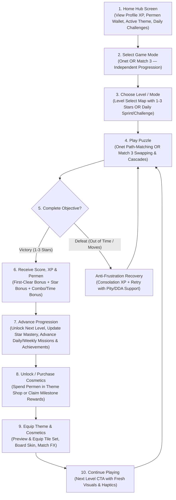

# Connectify Android — Comprehensive Game Design Document (GDD)

**Document Version:** 1.0.0  
**Author:** Agent 02 — Senior Game Designer  
**Source Repository Audited:** `/root/.gemini/antigravity/scratch/connectify-new` (Read-Only)  
**Target Production Project:** `/root/.gemini/antigravity/scratch/connectify-android`  

---

## 1. Executive Summary & Design Vision

**Connectify Android** transforms the web-based multi-minigame prototype (`connectify-new`) into a cohesive, offline-first, 60 FPS native Android puzzle experience powered by two flagship puzzle modes:
1. **Connectify Onet (Link & Split Puzzle)** — A tactile path-matching puzzle featuring classic `<= 2 turns` (`<= 3 segments`) orthogonal link rules enhanced with Connectify's signature **Multi-Cell Split Tiles** (`2×2 -> 1×2 -> 1×1`), **Directional Open-Side Arrows**, and **Dynamic Gravity Shifts**.
2. **Connectify Match 3 (Cascade & Combo Grid Puzzle)** — A full-featured tactile tile-swapping Match 3 puzzle with `Match-3/4/5/L/T` pattern recognition, combinable **Special Tiles** (Line Blaster, Radial Bomb, Rainbow Prism), multi-step **Gravity & Cascades**, **Board Blockers** (Ice, Wood Crate, Double Metal, Stone, Collectible Gems), and **Move-Based / Multi-Objective Levels**.

Both flagship games are unified under a single **Core Metagame Loop**:
- A shared wallet (**Permen / Connect Coins**) and unified **Account XP / Player Level** system.
- A shared **Theme & Cosmetic Collection** where unlocking and equipping a tile theme (e.g., *Summer Club*, *Ocean Friends*, *Forest Tales*, *Candy Parade*, *Cosmic Trip*, *Sakura Atelier*, *Petite Bakery*, *Midnight Galaxy*, *Meadow Atelier*, *Fruit Market*) dynamically skins the tiles, board surfaces, particle bursts, and UI accents across **both** Onet and Match 3.
- Independent per-game level trees with **1–3 Star Mastery**, ensuring players are never forced to play one mode to progress in the other, while rewarding play across both modes.

---

## 2. Audit of Existing Implementations in `connectify-new`

### 2.1 Existing Game Modes in `connectify-new`
An audit of [`src/core/games.ts`](file:///root/.gemini/antigravity/scratch/connectify-new/src/core/games.ts) reveals five game modes in the legacy web repository:
- `onet`: **Onet** ([`src/core/board.js`](file:///root/.gemini/antigravity/scratch/connectify-new/src/core/board.js), [`src/game/hooks/useOnetGame.ts`](file:///root/.gemini/antigravity/scratch/connectify-new/src/game/hooks/useOnetGame.ts), [`src/game/components/OnetBoard.tsx`](file:///root/.gemini/antigravity/scratch/connectify-new/src/game/components/OnetBoard.tsx)) — Retained and upgraded as Flagship Game #1.
- `triple`: **Triple Match** ([`src/game/minigames/TripleGame.tsx`](file:///root/.gemini/antigravity/scratch/connectify-new/src/game/minigames/TripleGame.tsx)) — A 31-line tile-tray picking minigame; replaced/upgraded into the full grid-swapping **Match 3** engine as Flagship Game #2.
- `block`: **Block Puzzle** ([`src/game/block-puzzle/`](file:///root/.gemini/antigravity/scratch/connectify-new/src/game/block-puzzle)) — Excluded as a playable mode in `connectify-android`, **but** its mature data-driven level architecture (`levelConfig.ts`), obstacle semantics (`SPEC.md`), EMA-based Dynamic Difficulty Adjustment (`dda.ts`), and seeded Procedural Content Generation (`pcg.ts`) are directly adapted into the new Match 3 and Onet level systems.
- `memory` (**Memory Flip**) and `star` (**Infinity / Star Patrol**) — Excluded from `connectify-android` to focus product polish and APK size on Onet and Match 3.

---

### 2.2 Audit of Existing Onet Implementation (`connectify-new`)

#### Key Files Inspected
- [`src/core/board.js`](file:///root/.gemini/antigravity/scratch/connectify-new/src/core/board.js#L1-L182): Core board representation, `getPath`, `findHint`, `clearMatchedGroups`, `isBoardSolvable`, `generateBoard`, `constructPairs`, `addDirectionTiles`, `guaranteedShuffle`.
- [`src/core/difficulty.js`](file:///root/.gemini/antigravity/scratch/connectify-new/src/core/difficulty.js#L1-L8): `getOnetDifficulty(level)` scaling tiers, timers, split groups, pair separation, and directional arrow pairs.
- [`src/game/hooks/useOnetGame.ts`](file:///root/.gemini/antigravity/scratch/connectify-new/src/game/hooks/useOnetGame.ts#L1-L104): React state hook managing selection, combo timer, match animations, hints, shuffles, and win/loss reporting.
- [`src/game/components/OnetBoard.tsx`](file:///root/.gemini/antigravity/scratch/connectify-new/src/game/components/OnetBoard.tsx#L1-L75) & [`backup_onet_animation/useOnetGame_animation_logic.ts`](file:///root/.gemini/antigravity/scratch/connectify-new/backup_onet_animation/useOnetGame_animation_logic.ts#L1-L55): Responsive grid sizing (`ResizeObserver`), SVG path drawing, `TileBurst` particles, and split-half clip-path animations.

#### Strengths of Existing Onet Implementation
1. **Padded Border Grid for Outer-Rim Pathfinding**:
   - The board is allocated as `(ROWS + 2) × (COLS + 2)` (`12 × 8` for a `10 × 6` playfield), where indices `r = 0`, `r = ROWS + 1`, `c = 0`, and `c = COLS + 1` form a permanent `0`-filled empty border ring. This allows `getPath` to naturally route 1-turn and 2-turn connections outside the visible tile grid without special-case boundary logic.
2. **Signature Multi-Cell Split Tile Mechanic (`2×2 -> 1×2 -> 1×1`)**:
   - Tiles can occupy `1×1`, `1×2` (horizontal domino), `2×1` (vertical domino), or `2×2` (quad cube) footprints using a master cell + `isSlave: true` pointer cells (`masterR`, `masterC`).
   - Matching two identical `2×2` tiles does not immediately empty the cells; instead, `clearMatchedGroups` splits each `2×2` into two `1×2` (or `2×1`) dominoes (`split_to_1x2`, +200 score). Matching two dominoes splits them into two `1×1` unit tiles (`split_to_1x1`, +150 score).
   - Child tile IDs are assigned deterministically (`pool[(parentIndex + 1 + depth * 2 + i * (depth + 2)) % pool.length]`) so both parents produce matching child pairs without runtime randomness—preserving determinism for daily challenges and solvability checks.
3. **Constructive Solvable Board Generation (`constructPairs` + `addDirectionTiles`)**:
   - Rather than generating purely random boards that frequently deadlock, `constructPairs` peels valid paths from a probe board while preferring pairs separated by Manhattan distance `>= difficulty.separation`.
   - `addDirectionTiles` simulates a full solution (`findHint` -> `clearMatchedGroups`) and attaches `openSide` (`up`, `right`, `down`, `left`) constraints strictly along the verified solution path, guaranteeing that directional arrows never render a board unsolvable.
4. **Automatic Free Shuffle on Deadlock**:
   - When `countRemaining(board) > 0` and `!findHint(board)`, `useOnetGame.ts` automatically triggers `guaranteedShuffle` at no booster cost (`"Jalur habis. Papan diacak gratis!"`), preventing soft-locks when players exhaust their paid Shuffle boosters.

#### Weaknesses & Bugs Identified in Existing Onet Implementation
1. **Critical Bug in `guaranteedShuffle` Emergency Fallback with Multi-Cell Tiles**:
   - In [`src/core/board.js`](file:///root/.gemini/antigravity/scratch/connectify-new/src/core/board.js#L157-L177), `guaranteedShuffle` only collects `1×1` tiles (`rows * cols === 1`) for its first 5 shuffle attempts and `constructPairs`. If the remaining board has a deadlock involving `2×2` or `1×2` master/slave groups, it falls through to lines 171–176 ("Emergency recovery only"), which iterates over all non-zero cells (including `isSlave` cells!) and overwrites `board[p.r][p.c] = { id, openSide: null }` without clearing slave cells or maintaining even pair counts if an odd number of slave/master cells were counted.
   - **Design Fix**: `guaranteedShuffle` must preserve multi-cell groups intact during normal shuffles, and if an emergency rebuild is required when only multi-cell groups remain deadlocked, it must cleanly swap master footprints of identical dimensions or decompose/re-pair master footprints atomically while keeping `isSlave` pointers 100% consistent.
2. **No Level Select, No Star Mastery, and Fixed `10×6` Grid**:
   - `connectify-new` forces players to play `currentLevel = highestLevel` linearly with no Level Select screen, no 1–3 Star mastery ratings, and a hardcoded `10×6` (60-cell) grid even on Level 1.
   - **Design Fix**: Introduce a structured Level Select progression with 1–3 Star ratings per level and scaled board dimensions (`6×4` for early onboarding -> `8×6` intermediate -> `10×6` standard -> `10×6` with obstacles/shifts & `12×6` expert).
3. **Zero Direct Currency Reward on Level Completion**:
   - In [`src/core/economy.js`](file:///root/.gemini/antigravity/scratch/connectify-new/src/core/economy.js#L17), `calcWinPermen = () => 0`, meaning winning a level gives `0 Permen` directly (only XP and mission progress). If a player finishes their daily missions, playing levels yields zero currency toward themes or boosters.
   - **Design Fix**: Award direct **Permen (Connect Coins)** on every level completion (First-Clear Bonus + Star Rating Bonus + Combo/Time Performance Bonus, with anti-farming diminishing returns on replayed levels).
4. **`onNextLevel` Button in `OnetModals.tsx` Navigates to Hub Instead of Next Level**:
   - In [`src/game/GameplayScreen.tsx`](file:///root/.gemini/antigravity/scratch/connectify-new/src/game/GameplayScreen.tsx#L25), `onNextLevel={() => navigate('game-hub')}` kicks the player back to the Game Hub after every single win instead of advancing directly to `Level N + 1`.
   - **Design Fix**: Victory Modal must offer an immediate primary **"Next Level" (`Lanjut Level N+1`)** CTA that loads the next level seamlessly, alongside **"Replay"** and **"Level Map / Hub"**.

---

### 2.3 Audit of Existing Match 3 (`TripleGame.tsx` & `block-puzzle`) in `connectify-new`

#### Strengths to Reuse
1. **Rich Tile Art & Theme Registry ([`src/core/tileCatalog.js`](file:///root/.gemini/antigravity/scratch/connectify-new/src/core/tileCatalog.js), [`src/core/theme/registry.ts`](file:///root/.gemini/antigravity/scratch/connectify-new/src/core/theme/registry.ts))**:
   - Over 10 complete tile art sets (`sweets`/vanilla, `meadow`, `ocean`, `forest`, `candy`, `space`, `sakura`, `bakery`, `galaxy`, `fruit`, plus seasonal & reward editions), each with 10–16 crisp WebP/PNG icons and coordinated color palettes.
2. **Obstacle, Mission, DDA, and PCG Systems ([`src/game/block-puzzle/core/`](file:///root/.gemini/antigravity/scratch/connectify-new/src/game/block-puzzle/core))**:
   - Well-tested 3-mission/3-star schema (`levelConfig.ts`), 5-tier blocker hierarchy (`ice`, `wood`, `metal-2`, `metal-1`, `stone`, `gem`), EMA skill tracking + 3-loss pity bracket (`dda.ts`), and deterministic seeded procedural level generation (`pcg.ts`).

#### Weaknesses of `TripleGame.tsx`
1. **Not a Grid-Swapping Match 3 Game**:
   - [`src/game/minigames/TripleGame.tsx`](file:///root/.gemini/antigravity/scratch/connectify-new/src/game/minigames/TripleGame.tsx) is a 31-line stack-to-tray matching mini-round (`12` stacks of `3` tiles, `7`-slot tray, `120s` timer, hardcoded `level: 1`).
   - It lacks a 2D grid, adjacent tile swapping, `Match-3/4/5/L/T` detection, special tile creation, booster combinations, gravity refills, cascade combos, blockers, move-limited levels, and level progression.
2. **Design Fix**:
   - Replace `TripleGame.tsx` with a dedicated, production-grade **Match 3 Engine** (`8×8` grid with customizable cell masks, full swap & match-shape detection, special tile combos, gravity/cascades, blocker interactions, and data-driven + procedural levels).

---

## 3. Complete Core Gameplay Loop

Connectify Android weaves **core puzzle mastery** and **cosmetic collection** into a tight, self-reinforcing loop that works 100% offline.

### Step-by-Step Core Loop Breakdown
1. **Select Game (`Home Hub -> Onet or Match 3`)**:
   - From the Home Screen, the player sees their **Account Level & XP Bar**, **Permen (Connect Coins) balance**, **Daily Login Streak Card**, a one-tap **"Continue Playing" (`Lanjut Main`)** CTA for their most recent game, and dedicated cards for **Onet** and **Match 3**.
2. **Choose Level (`Level Select Map / Daily Challenge`)**:
   - Entering Onet or Match 3 opens that mode's Level Select view displaying unlocked levels, 1–3 Star mastery badges, personal best scores, level objective previews (e.g., *Clear Board & Split 2×2 Tiles* in Onet; *Collect 12 Gems & Break 8 Ice in 22 Moves* in Match 3), and the **Daily Challenge** entry.
3. **Play Puzzle (`In-Game HUD & Tactile Board`)**:
   - The active board renders using the player's equipped **Theme** (tile icons, board frame/cell skin, background tint, and match burst particles).
   - Real-time HUD displays current score, 1–3 Star progress bar, remaining time (Onet) or remaining moves (Match 3), active combo multiplier, level objectives, and available boosters.
4. **Complete Objective (`Win / Loss Evaluation`)**:
   - Completing the primary objective triggers the Victory sequence (board celebration burst, remaining time/moves conversion bonus, 1–3 Star tally).
   - Running out of time (Onet) or moves (Match 3) before completing the primary objective triggers the Defeat modal with consolation XP, objective progress summary, and immediate **Retry** (backed by Pity/DDA after 3 consecutive losses).
5. **Receive Score, XP, and Currency (`Reward Engine`)**:
   - Every completed level awards:
     - **Final Score** (recorded to per-level personal best and global cumulative score).
     - **Account XP** (`100` base win XP + Star Bonus + Flawless/Combo Bonus; `15–40` consolation XP on loss).
     - **Permen (Connect Coins)** (First-Clear reward + New Star delta reward + performance bonus, or reduced replay reward on already-mastered levels).
6. **Advance Progression (`Levels, Missions & Achievements`)**:
   - Unlocks `Level N + 1` in the active game mode.
   - Advances active **Daily Challenges**, **Weekly Challenges**, and multi-tier **Achievements**.
   - Checks for **Account Level-Up** (`xpForLevel` threshold) and awards milestone bonuses.
7. **Unlock / Purchase Cosmetics (`Theme Shop & Milestones`)**:
   - Players spend earned Permen in the unified **Theme & Cosmetic Shop** (or unlock reward-tier cosmetics via level/achievement milestones) to acquire new **Tile Themes**, **Tile Surface Skins** (`1×1`, `1×2`, `2×2`, Match 3 frames), and **Victory/Match Particle Effects**.
8. **Equip Theme (`Live Preview & Instant Skinning`)**:
   - Players preview any theme in the Shop/Collection modal and tap **Equip (`Pakai`)** to immediately apply it across Onet and Match 3.
9. **Continue Playing (`Frictionless Next-Level Flow`)**:
   - Tapping **Next Level** from the Victory modal (or **Continue Playing** from the Hub) launches the next puzzle with zero unnecessary screen hops.

---

## 4. Detailed Onet Gameplay Design

### 4.1 Core Grid & Coordinate System
- **Padded Matrix Structure**:
  - A board of playable dimensions `R × C` is represented as a 2D matrix of size `(R + 2) × (C + 2)`.
  - Playable cells occupy `1 <= r <= R` and `1 <= c <= C`.
  - Border ring cells (`r = 0`, `r = R + 1`, `c = 0`, `c = C + 1`) are always empty (`0`) and serve as valid traversal conduits for paths that route around the outer perimeter of the board.
- **Dynamic Grid Sizes by Progression Tier**:
  - **Tier 1 — Onboarding (Levels 1–5)**: `6 × 4` playable grid (`24` cells = `12` pairs). Large touch targets (`>= 64dp`), ideal for learning 0/1/2-turn paths and the first `1×2` split tile.
  - **Tier 2 — Focus (Levels 6–15)**: `8 × 6` playable grid (`48` cells = `24` unit equivalents). Introduces `2×2` quad split tiles and initial directional `openSide` arrows.
  - **Tier 3 — Challenging (Levels 16–30)**: `10 × 6` playable grid (`60` cells = `30` unit equivalents, matching `connectify-new`'s classic dimensions). Combines `2×2` and `1×2` split groups, directional arrows, and initial board gravity shifts.
  - **Tier 4 — Expert & Master (Levels 31+)**: `10 × 6` (60 cells) and `12 × 6` (72 cells) grids with higher pair separation, multi-group split chains, directional arrow pairs, and alternating gravity shift rules.

### 4.2 Tile Types & Multi-Cell Split Mechanics
1. **Standard Unit Tile (`1×1`)**:
   - Occupies 1 cell (`groupRows = 1, groupCols = 1`).
   - Matching two identical `1×1` tiles clears both cells to `0` (`action = 'clear'`).
2. **Domino Split Tile (`1×2` Horizontal or `2×1` Vertical)**:
   - Occupies 2 adjacent cells: top-left cell is the **Master** (`isSlave: false, groupRows, groupCols`), and the second cell is the **Slave** (`isSlave: true, masterR, masterC`).
   - Tapping either the Master or Slave cell selects the Master tile (`if (t.isSlave) { r = t.masterR; c = t.masterC; }`).
   - **Match Rule**: Two domino tiles can match **only** if they have the same `id` AND identical dimensions (`groupRows === b.groupRows && groupCols === b.groupCols`).
   - **Split Resolution (`split_to_1x1`)**: Matching two `1×2` (or `2×1`) dominoes splits each domino in-place into two `1×1` unit tiles (`child_0` and `child_1`). Corresponding children of both matched parents share the same deterministic tile ID (`child_0` of Parent A matches `child_0` of Parent B; `child_1` of Parent A matches `child_1` of Parent B), while `child_0 !== child_1`.
3. **Quad Split Tile (`2×2`)**:
   - Occupies 4 cells (`2 rows × 2 cols`): top-left `(r, c)` is Master; `(r, c+1)`, `(r+1, c)`, and `(r+1, c+1)` are Slaves.
   - Carries a `splitAxis` property (`'horizontal' | 'vertical'`), which is identical across a matched `2×2` pair.
   - **Split Resolution (`split_to_1x2`)**: Matching two `2×2` tiles splits each along `splitAxis` into two `1×2` horizontal dominoes (if `splitAxis === 'horizontal'`) or two `2×1` vertical dominoes (if `splitAxis === 'vertical'`).
4. **Directional Open-Side Tiles (`openSide: 'up' | 'right' | 'down' | 'left' | null`)**:
   - Applied exclusively to `1×1` unit tiles from Level 8+.
   - A tile with `openSide = 'up'` can **only** have a connection path exit its cell in the `'up'` direction (`dr = -1, dc = 0`), and when reached as a destination, the incoming segment must enter from its `'up'` face (`opposite === 'up'`, meaning the path step moved `'down'` into the tile).

### 4.3 Pathfinding Rules (`<= 2 Turns` / `<= 3 Straight Segments`)
Two tiles $A$ at $(r_1, c_1)$ and $B$ at $(r_2, c_2)$ can be connected if and only if:
1. **Identity & Footprint Parity**:
   $$\text{canMatch}(A, B) \iff A \neq \text{null} \land B \neq \text{null} \land (r_1, c_1) \neq (r_2, c_2) \land A.\text{id} = B.\text{id} \land \text{groupSize}(A) = \text{groupSize}(B)$$
2. **Orthogonal BFS with Turn Count $\le 2$**:
   - Let $\text{Starts} = \text{getTileCells}(r_1, c_1, A)$ and $\text{Ends} = \text{getTileCells}(r_2, c_2, B)$.
   - Allowed pass-through cells are empty cells (`board[r][c] === 0` within `0 <= r <= R + 1, 0 <= c <= C + 1`) unioned with $\text{Starts} \cup \text{Ends}$.
   - State in BFS queue: `(r, c, dir, turns, points)` where `dir` $\in \{0:\text{up}, 1:\text{right}, 2:\text{down}, 3:\text{left}, -1:\text{initial}\}$.
   - **Departure Constraint**: On the first step (`cur.dir === -1`), if $A.\text{openSide}$ is set, `dir.name` must equal $A.\text{openSide}$.
   - **Turn Increment**:
     $$\text{nextTurns} = \text{cur.turns} + (\text{cur.dir} \neq -1 \land \text{cur.dir} \neq \text{dir} ? 1 : 0)$$
     If $\text{nextTurns} > 2$, prune branch immediately.
   - **Arrival Constraint**: When $(r, c) \in \text{Ends}$, if $B.\text{openSide}$ is set, `dir.opposite` must equal $B.\text{openSide}$. If satisfied, return `{ path: points }`.
   - **Visited Pruning**: Maintain `seen.get("${r},${c},${dir}")` storing minimum turns to reach `(r, c)` facing `dir`. Prune if `seen <= nextTurns`.

### 4.4 Guaranteed Solvable Board Generation & Deadlock Prevention
1. **Constructive Generation (`generateBoard(themeKey, level, rng)`)**:
   - **Step 1 (Place Split Footprints on Exposed Edges)**: Place `difficulty.groups` pairs of `2×2` or `1×2`/`2×1` tiles on exposed board edges/corners with matching `id` and `splitAxis`.
   - **Step 2 (Constructive Peeling — `constructPairs`)**: Fill all remaining `1×1` positions with probe tokens. Iteratively select pairs `(a, b)` that have a valid `getPath` on the probe board, prioritizing pairs with Manhattan distance $d = |a.r - b.r| + |a.c - b.c| \ge \text{difficulty.separation}$, assign a matching tile ID from the theme pool, and clear `(a, b)` from the probe board.
   - **Step 3 (Full Solvability Verification — `isBoardSolvable`)**: Simulate solving the board from start to finish (`findHint` -> `clearMatchedGroups`, including all `2×2 -> 1×2 -> 1×1` splits and any level gravity shifts) up to 150 steps. Retry up to 4 times with the RNG if needed.
   - **Step 4 (Safe Arrow Injection — `addDirectionTiles`)**: Replay the verified solution sequence step by step; for up to `difficulty.arrowPairs` `1×1` pairs, inspect the actual first step and last step of `hint.path` and assign `openSide` to match the exact entry/exit faces used in the valid solution. This mathematically guarantees arrows never break solvability.
2. **Deadlock Detection (`findHint(board)`)**:
   - Runs automatically after every tile clear/split (and after any gravity shift settles).
   - Scans all active Master tiles `(r, c)` in row-major order; returns the first pair `{ p1, p2, path }` where `canMatch(A, B)` and `getPath(board, p1.r, p1.c, p2.r, p2.c).path` is truthy, or `null` if no legal move exists.
3. **Shuffle Rules (`guaranteedShuffle` — Upgraded & Bug-Fixed)**:
   - **Trigger 1 — Automatic Free Deadlock Shuffle**: If `countRemaining(board) > 0` and `findHint(board) === null`, lock input for `700ms`, display toast `"Jalur habis! Papan diacak gratis"`, and execute `guaranteedShuffle` **without** deducting a Shuffle booster or resetting the player's combo timer.
   - **Trigger 2 — Player-Initiated Paid/Inventory Shuffle Booster**: Player taps the **Shuffle (`Acak`)** button, consuming 1 Shuffle from inventory (or purchasing with Permen).
   - **Fixed Multi-Cell Safe Algorithm**:
     1. Strip temporary `openSide` constraints so arrows can be re-derived along the new solution path.
     2. Permute all `1×1` tiles among `1×1` positions AND permute multi-cell master groups of identical `(rows, cols)` dimensions among existing footprints (up to 8 attempts), checking `isBoardSolvable(board)`.
     3. If still unsolvable, run `constructPairs` on all `1×1` positions while keeping multi-cell groups in place; if multi-cell groups themselves block all paths, relocate multi-cell pairs to exposed corners/edges first, rebuild `slave` cells cleanly via `placeGroup`, and run `constructPairs` on the remaining `1×1` cells.
     4. Re-apply `addDirectionTiles` up to the remaining proportion of `arrowPairs` so level difficulty identity is preserved.

### 4.5 Onet Gravity Shift Mechanics (Intermediate / Advanced Tiers)
To keep Onet fresh across 100+ levels, levels can configure a `gravityMode`:
- `'none'` (Levels 1–10, default): Tiles remain stationary when neighbors are cleared.
- `'down'` (Levels 11+ selected levels): After a `1×1` clear, `1×1` tiles in affected columns slide down to fill empty cells below them (multi-cell `1×2` and `2×2` groups act as anchored blocks until split into `1×1` tiles).
- `'up'` / `'left'` / `'right'` (Levels 18+ selected levels): `1×1` tiles slide toward the designated board edge after each clear.
- `'split_horizontal'` (Levels 25+ selected levels): Left half of the board (`c <= COLS/2`) slides left; right half (`c > COLS/2`) slides right.

### 4.6 Onet Timers, Scoring, Combos, Hints & Boosters
- **Level Timer**:
  - Standard Levels: Configurable via `getOnetDifficulty(level).time`:
    $$\text{Time}_{\text{sec}} = \max(75, 150 - (\text{level} - 1) \times 2)$$
    (Adjusted by grid size: `90s` for `6×4` onboarding levels, `120s–150s` for `8×6` and `10×6` levels, never dropping below `75s`).
  - Daily Sprint Mode: Fixed `90s` (`DAILY_CHALLENGE_TIME = 90`).
  - **Urgency State**: When `time <= 15s`, the HUD timer pulses coral-red (`hud-timer urgent`) with a subtle tick cue.
  - **Auto-Pause**: Automatically pauses when the app enters background (`visibilitychange` / Android `onPause`) or when the Pause modal is opened.
- **Combo System**:
  - **Combo Window**: `4,000ms` (`4.0 seconds`) between consecutive valid matches.
  - If `now - lastMatchTimestamp < 4000`, `combo = combo + 1`; otherwise `combo = 1`.
  - When a free auto-shuffle (`!findHint`) occurs, `lastMatchTimestamp` is extended by `+1000ms` so an involuntary shuffle animation never unfairly breaks a player's active combo chain.
- **Scoring Formula**:
  - **1×1 Standard Clear**: $\text{Base} = 100\text{ pts}$
  - **1×2 / 2×1 Domino Split (`split_to_1x1`)**: $\text{Base} = 150\text{ pts}$
  - **2×2 Quad Split (`split_to_1x2`)**: $\text{Base} = 200\text{ pts}$
  - **Combo Bonus per Match**: $+ (\text{combo} - 1) \times 15\text{ pts}$ (upgraded from `+10` to reward sustained chains).
  - **Time Remaining Victory Bonus**: $+\text{remainingSeconds} \times 20\text{ pts}$ added upon clearing the board.
- **Boosters & Hints**:
  1. **Hint (`Petunjuk`)**: Highlights both tiles of a valid pair (`hintTiles.p1`, `hintTiles.p2`) with a pulsing golden-butter outline until the player makes their next match.
  2. **Shuffle (`Acak`)**: Immediately invokes `guaranteedShuffle` with a card-cascade spring animation, clearing any active selection/hint.
  3. **Time Freeze / +15s (`+Waktu` — Optional In-Round Booster)**: Adds `+15 seconds` to the clock and freezes countdown for `5 seconds` (available as an emergency booster or pre-defeat continue option).

### 4.7 Onet Level Objectives & 1–3 Star Mastery
Every Onet level awards **1 to 3 Stars** upon board clear:
- **1 Star (Primary Objective)**: Clear all tiles on the board before the timer reaches `0`.
- **2 Stars (Secondary Objective)**: Reach the level's **Target Score** OR complete a level-specific mechanic goal (e.g., *Achieve Combo $\ge \times 5$*, *Finish with $\ge 25\%$ time remaining*).
- **3 Stars (Mastery Objective)**: Finish with **$\ge 45\%$ time remaining** OR **Flawless Clear** ($\le 2$ invalid path taps) + Target Score.

---

## 5. Detailed Match 3 Gameplay Design

### 5.1 Core Grid, Tile Pool & Board Topology
- **Grid Dimensions**:
  - Standard `8 × 8` matrix (`64` cells, `0 <= r < 8, 0 <= c < 8`).
  - Supports **Cell Masks (`cellMask[r][c]`)** so levels can carve custom board silhouettes (e.g., diamond corners removed, central `2×2` courtyard hole, bridge layouts) while maintaining a consistent `8×8` coordinate space.
- **Theme-Driven Tile Colors (`4 to 6` Active Tile Types per Level)**:
  - Each level selects $K \in \{4, 5, 6\}$ distinct tile icons from the player's equipped **Theme** (`activeTheme.assets.tiles`), mapped to high-contrast semantic color slots (Coral Red, Ocean Blue, Mint Green, Butter Gold, Berry Purple, Cream Orange) so tiles are instantly distinguishable both by silhouette/artwork and background tint.
  - Onboarding Levels (1–5) use `4` tile types for effortless cascading; Intermediate Levels (6–25) use `5` tile types; Advanced/Expert Levels (26+) use `5` or `6` tile types.

### 5.2 Swap Validation & Input Rules
1. **Touch Gesture & Tap-to-Swap Support**:
   - Players can **drag/swipe** a tile `(r1, c1)` toward an orthogonally adjacent cell `(r2, c2)` ($|r_1 - r_2| + |c_1 - c_2| = 1$), OR **tap** `(r1, c1)` to select it and **tap** an adjacent `(r2, c2)` to swap.
2. **Cells Eligible for Swapping**:
   - Both `(r1, c1)` and `(r2, c2)` must be playable non-empty cells that are **not** locked by a stationary blocker (`Wood Crate`, `Metal-1/2`, `Stone`, or `Ice-Locked` overlay if configured).
3. **Valid Swap Condition**:
   - A swap between $A$ at $(r_1, c_1)$ and $B$ at $(r_2, c_2)$ is **VALID** if and only if:
     1. Swapping $A$ and $B$ forms at least one horizontal or vertical run of $\ge 3$ matching tile colors, **OR**
     2. Either $A$ or $B$ is a **Rainbow Prism (Color Bomb)** swapped with any colored tile or another special tile, **OR**
     3. Both $A$ and $B$ are **Special Tiles** (`Line Blaster`, `Radial Bomb`, or `Rainbow Prism`) being combined.
4. **Invalid Swap Handling (Zero Move Penalty)**:
   - If the swap is invalid, animate both tiles swapping across (`140ms`) and immediately spring-bouncing back to their original positions (`160ms`) with a horizontal shake and light error haptic buzz.
   - **Never deduct a move** on an invalid swap.

### 5.3 Match-3 / 4 / 5 / L / T Detection & Special Tile Spawning
After a valid swap or gravity refill, the engine scans all horizontal and vertical runs of $\ge 3$ identical `colorId` tiles and merges intersecting runs of the same color into connected **Match Clusters**.

| Match Pattern | Geometry Criteria | Special Tile Spawned | Spawn Position Rule | Base Match Score |
| :--- | :--- | :--- | :--- | :--- |
| **Match-3** | Exactly 3 tiles in a horizontal or vertical line (no same-color intersection) | *None* (Standard Clear) | N/A | $60\text{ pts}$ ($20 \times 3$) |
| **Match-4 (Horizontal)** | 4 tiles in a single row | **Vertical Line Blaster** (`striped_v`) | Swapped destination cell (or center-left cell during cascade) | $120\text{ pts}$ |
| **Match-4 (Vertical)** | 4 tiles in a single column | **Horizontal Line Blaster** (`striped_h`) | Swapped destination cell (or center-top cell during cascade) | $120\text{ pts}$ |
| **L-Shape / T-Shape / Cross** | Connected cluster containing both a horizontal run $\ge 3$ AND a vertical run $\ge 3$ of the same color ($5\text{ or }6\text{ tiles}$, max line $< 5$) | **Radial Bomb (Wrapped Bomb)** (`bomb_3x3`) | Intersection cell of the horizontal and vertical runs (or swapped cell) | $200\text{ pts}$ |
| **Match-5+ Line** | $\ge 5$ tiles in a straight horizontal or vertical line (even if also intersecting a perpendicular run) | **Rainbow Prism (Color Bomb)** (`rainbow`) | Swapped destination cell (or middle cell of the 5-tile line) | $300\text{ pts}$ |

> [!IMPORTANT]
> **Precedence Rule for Overlapping Clusters:** When evaluating a connected same-color cluster, always check `maxStraightRun >= 5` (**Rainbow Prism**) first, then `hasHorizontalRun >= 3 && hasVerticalRun >= 3` (**Radial Bomb**), then `maxStraightRun === 4` (**Line Blaster**), and finally `Match-3`. A single connected cluster spawns at most **one** Special Tile at the player's swap destination cell `(r2, c2)` (or `(r1, c1)` if that cell belonged to the cluster; or the geometric intersection/center cell during free cascades).

### 5.4 Special Tile Activation & Booster Combination Matrix

#### Single Special Tile Activation (Triggered when matched in a 3+ run or hit by another blast)
1. **Horizontal Line Blaster (`striped_h`)**: Fires a high-velocity beam left and right across row `r`, clearing all tiles and damaging all blockers in row `r` ($+40\text{ pts}$ per cell cleared).
2. **Vertical Line Blaster (`striped_v`)**: Fires a beam up and down across column `c`, clearing all tiles and damaging all blockers in column `c` ($+40\text{ pts}$ per cell cleared).
3. **Radial Bomb (`bomb_3x3`)**: Detonates a `3×3` area (`r-1..r+1, c-1..c+1`) centered on `(r, c)`, dealing 1 damage to blockers and clearing tiles ($+50\text{ pts}$ per cell), plus a `150pt` detonation bonus.
4. **Rainbow Prism (`rainbow`)**: When swapped with a standard tile of color `C` (or hit by a blast, in which case it picks the most populous color `C` on the board), zaps every tile of color `C` on the board with lightning arcs ($+60\text{ pts}$ per tile).

#### Two-Special-Tile Swap Combination Matrix
Swapping any two adjacent Special Tiles triggers an immediate **Combo Fusion** regardless of tile colors:

| Swap Combination | Fusion Name | Board Effect & Choreography | Combo Bonus Score |
| :--- | :--- | :--- | :--- |
| **Line Blaster + Line Blaster** (`striped_* + striped_*`) | **Cross Laser (`+`)** | Fires both a full **Horizontal Beam** across row `r2` AND a full **Vertical Beam** down column `c2` simultaneously. | $+350\text{ pts}$ + cell clears |
| **Line Blaster + Radial Bomb** (`striped_* + bomb_3x3`) | **Mega 3-Row / 3-Col Beam** | Expands into a giant `3×3` core and fires **3 full rows** (`r2-1, r2, r2+1`) AND **3 full columns** (`c2-1, c2, c2+1`) across the board. | $+600\text{ pts}$ + cell clears |
| **Radial Bomb + Radial Bomb** (`bomb_3x3 + bomb_3x3`) | **Super Shockwave (`5×5`)** | Detonates a massive **`5×5` area** (`r2-2..r2+2, c2-2..c2+2`) around the swap point, dealing up to 2 layers of blocker damage in the inner `3×3` core. | $+500\text{ pts}$ + cell clears |
| **Rainbow Prism + Standard Tile (`C`)** | **Chromatic Purge** | Fires lightning beams to every tile of color `C` on the board, clearing all of them simultaneously. | $+400\text{ pts}$ + cell clears |
| **Rainbow Prism + Line Blaster (`C`)** | **Prism Laser Storm** | Transforms every tile of the Line Blaster's color `C` on the board into a `Horizontal` or `Vertical Line Blaster` (alternating) and detonates them in a rapid wave (`60ms` stagger). | $+900\text{ pts}$ + cell clears |
| **Rainbow Prism + Radial Bomb (`C`)** | **Prism Cluster Barrage** | Transforms every tile of the Radial Bomb's color `C` on the board into a `Radial Bomb` and detonates all of them in a staggered chain. | $+1,000\text{ pts}$ + cell clears |
| **Rainbow Prism + Rainbow Prism** | **Supernova Board Wipe** | Sweeps a shockwave across the **entire playable board**, clearing every standard and special tile and dealing 1 layer of damage to every blocker on the board. | $+1,500\text{ pts}$ + cell clears |

#### Chain Reaction Rule (Blast-Triggered Specials)
If a Special Tile's blast wave hits another unactivated Special Tile on the board, that second Special Tile does **not** vanish silently—it queues its own activation in the current blast wave (`80ms` stagger, guarded by a `visitedSpecialCells` set to prevent infinite recursion).

### 5.5 Cascade, Gravity & Refill State Machine
Every valid move executes a deterministic, non-blocking async step loop while `inputLocked = true`:
1. **Step 1 — Swap / Booster Trigger (`150ms`)**: Animate swap or direct booster activation. Decrement `movesRemaining` by `1` (for standard/combo swaps).
2. **Step 2 — Match & Special Blast Resolution (`220ms`)**:
   - Clear matched tiles, spawn any earned Special Tile (`striped_h`, `striped_v`, `bomb_3x3`, `rainbow`) at its designated cell, and apply adjacent/direct damage to board blockers.
   - Increment `cascadeDepth` (`1` for initial match, `2` for first cascade after drop, `3` for second cascade, etc.).
3. **Step 3 — Column-wise Gravity Drop (`180ms` + `25ms` per cell fallen)**:
   - For each column `c` from bottom (`r = 7`) to top (`r = 0`):
     - Stationary blockers (`Wood Crate`, `Metal-1/2`, `Stone`) act as solid shelves that cannot fall and block tiles above them from falling directly through (unless a diagonal slide rule is triggered, or column refill spawns above open segments).
     - Mobile tiles and mobile collectibles (`Gem`) fall straight down into empty playable cells below them within the same column segment.
4. **Step 4 — Top-of-Column Spawn Refill**:
   - Any empty playable cells remaining above settled tiles are filled with newly spawned tiles dropping from above the top edge (`r < 0`), using the level's seeded/weighted tile generator.
5. **Step 5 — Cascade Re-Evaluation**:
   - Scan the settled board for new `Match-3/4/5/L/T` formations.
   - If matches exist (and `cascadeDepth < MAX_CASCADE_ITERATIONS`, where `MAX_CASCADE_ITERATIONS = 12` safety cap), loop back to **Step 2** with increased combo multiplier.
   - If no matches remain:
     - Check **Deadlock Detection** (`hasValidMatch3Move(board)`). If no valid move exists, execute a free **Guaranteed Match-3 Reshuffle** (`600ms`).
     - Unlock player input (`inputLocked = false`) and evaluate Win/Loss state.

### 5.6 Match 3 Combo Multipliers & End-of-Level Bonus
- **Cascade Combo Multiplier**:
  $$\text{Multiplier}(\text{cascadeDepth}) = 1.0 + 0.25 \times (\text{cascadeDepth} - 1)$$
  - Cascade 1 (Initial Swap): $\times 1.00$
  - Cascade 2: $\times 1.25$
  - Cascade 3: $\times 1.50$
  - Cascade 4: $\times 1.75$
  - Cascade 5+: $\times 2.00 + 0.50 \times (\text{cascadeDepth} - 5)$ (capped at $\times 4.00$)
- **End-of-Level "Bonus Time!" Sequence**:
  - When all level objectives are met while `movesRemaining > 0`:
    1. Each remaining move converts a random standard tile on the board into a `Line Blaster` or `Radial Bomb` and awards $+150\text{ pts}$ per unused move.
    2. All Special Tiles remaining on the board detonate in a rapid celebratory chain, adding their blast scores toward the player's **2-Star** and **3-Star** thresholds!

### 5.7 Match 3 Obstacles / Blockers & Level Objectives
Directly adapting and expanding the proven obstacle types from `connectify-new/SPEC.md`:

| Blocker / Element | Mobility | Matchable? | How to Clear / Collect | Layers (HP) |
| :--- | :--- | :--- | :--- | :--- |
| **Ice Overlay (`ice`)** | Stationary cell overlay (tile sits *inside/on* Ice) | Yes (the tile inside can be swapped/matched) | Match the tile on the Ice cell OR hit with any Special Tile blast. | 1 (or 2 for Thick Ice) |
| **Wood Crate (`wood`)** | Stationary blocker (occupies cell) | No | Make any orthogonal adjacent match (`|dr| + |dc| === 1`) OR hit with any Special Tile blast. | 1 |
| **Metal Box (`metal-2` -> `metal-1`)** | Stationary armored blocker | No | Make an adjacent match OR hit with a Special Tile blast. Degrades from `metal-2` to `metal-1`, then shatters on the 2nd hit. | 2 |
| **Stone Block (`stone`)** | Stationary permanent obstacle | No | Cannot be destroyed by adjacent matches; cleared **only** by Special Tile blasts (`Line Blaster`, `Radial Bomb`, `Hammer`/`Bomb` booster) or worked around. | Indestructible by normal match (1 hit via Blast/Booster) |
| **Collectible Gem (`gem`)** | Mobile (obeys gravity) | No (or Special Drop) | Drop to the bottom collection row (`r = 7`) OR break via adjacent match / Special Tile blast (configurable per level). | 1 |

#### Level Objective Types (1 to 2 Primary Goals per Level)
- `score`: Reach target score within `maxMoves`.
- `clear_ice`: Break all `N` Ice overlays on the board.
- `destroy_wood`: Smash all `N` Wood Crates on the board.
- `destroy_metal`: Shatter all `N` Metal Boxes on the board.
- `collect_gems`: Collect `N` Gems.
- `collect_tiles`: Clear `N` tiles of specific target color(s) (e.g., *Collect 25 Strawberries & 25 Blueberries*).

### 5.8 Valid Initial Board Generation & Deadlock Detection (Match 3)
1. **Pre-Match-Free, Move-Guaranteed Initial Board (`generateMatch3Board`)**:
   - Place level obstacles (`ice`, `wood`, `metal-2`, `stone`, `gem`) according to `LevelConfig`.
   - Fill playable cells top-to-bottom, left-to-right: for each cell `(r, c)`, exclude any tile color `C` where `board[r][c-1] === C && board[r][c-2] === C` OR `board[r-1][c] === C && board[r-2][c] === C`. This guarantees **zero pre-existing 3-in-a-row matches** at level start.
   - Verify `findMatch3Hint(board) !== null` (at least one legal swap exists). If `null`, inject a guaranteed 1-move triad pattern `(C, C, X, C)` on an open row/column.
2. **Deadlock Detection (`findMatch3Hint(board)`)**:
   - Evaluates every playable cell `(r, c)`:
     - If `(r, c)` is a `Rainbow Prism` adjacent to any swappable tile, return that swap immediately.
     - If `(r, c)` and an orthogonal neighbor `(r', c')` are both Special Tiles, return that swap immediately.
     - Otherwise, virtually swap `(r, c)` with `(r, c+1)` and `(r+1, c)` and check if either creates a run of $\ge 3$ matching colors.
   - If `findMatch3Hint(board)` returns `null` after cascades settle:
     - Display toast `"Tidak ada langkah! Papan diacak gratis"` and shuffle all non-blocker tiles using the pre-match-free + guaranteed-triad generator at **zero move/booster cost**.

### 5.9 Match 3 In-Game Boosters & Hints
Reusing the shared inventory items from [`src/core/economy.js`](file:///root/.gemini/antigravity/scratch/connectify-new/src/core/economy.js#L7):
1. **Auto-Hint & Paid Hint (`Petunjuk`)**:
   - **Passive Idle Nudge (Free)**: If the player makes no input for `6.0 seconds`, gently pulse one tile of a valid move (`findMatch3Hint(board)`).
   - **Active Hint Booster (`hint`)**: Highlights the exact two cells to swap (`p1 <-> p2`) with directional arrows and shows the resulting match/special tile preview.
2. **Hammer (`Palu` — `hammer`)**:
   - Tap **Hammer**, then tap any single cell `(r, c)` on the board to immediately smash 1 tile or deal 1 layer of damage to any blocker (`Ice`, `Wood`, `Metal`, `Stone`) **without consuming a move**.
3. **Area Bomb (`Bom` — `bomb`)**:
   - Tap **Bomb**, then tap any cell `(r, c)` on the board to detonate a `3×3` area centered on `(r, c)` **without consuming a move**.
4. **Board Shuffle (`Acak` — `shuffle`)**:
   - Rearranges all movable tiles on the board into a new pre-match-free configuration with at least 2 valid moves **without consuming a move**.

---

## 6. Player Goals, Daily Challenges & Anti-Frustration Guarantees

### 6.1 Multi-Horizon Player Goals
| Horizon | Session / Timeframe | Concrete Player Goals in Connectify Android | Rewards & Feedback |
| :--- | :--- | :--- | :--- |
| **Short-Term Goals** *(Micro Loop)* | **1–5 Minutes** *(1–2 Levels)* | - Clear the current Onet or Match 3 level. - Trigger a high Onet combo (`x6+`) or fuse two Match 3 Special Tiles (`Rainbow + Blaster`). - Earn 3 Stars on the current level. - Complete 1 Daily Mission (e.g., *Clear 2 Onet Levels*, *Break 8 Ice in Match 3*). | - Victory confetti burst & star tally. - Immediate **Permen** + **Account XP** grant. - Unlock `Level N+1`. |
| **Medium-Term Goals** *(Session / Daily Loop)* | **15–30 Minutes / 1–7 Days** | - Complete all Daily Missions and the **Daily Sprint / Challenge**. - Maintain the **7-Day Login Streak** (`5 -> 10 Permen/day` + XP). - Reach the next **5-Level Chapter Milestone** (Levels 5, 10, 15, 20...). - Save `60–150 Permen` to purchase a new **Tile Theme** or **Skin Pack** in the Shop. | - New Theme unlocked & equipped across both games. - Account Rank promotion (*Teman Baru -> Pencari Pasangan -> Peracik Kombo*). - Weekly Mission chest/bonus claims. |
| **Long-Term Goals** *(Macro / Retention Loop)* | **2–4+ Weeks** *(30+ Days)* | - Master **50+ Levels** in both Onet and Match 3 with full `3-Star` ratings. - Unlock all **Standard, Premium, and Milestone Reward Themes** (`Sakura`, `Bakery`, `Galaxy`, `Meadow`, `Fruit`). - Complete Tier 3–5 **Mastery Achievements** (*Flawless Victory*, *Speedrun*, *Combo Master*, *Grand Collector*) and reach **Account Level 50 (*Legenda Connectify*)**. | - Exclusive Reward Edition Themes (`reward_sakura`, `reward_galaxy`, etc.), prestige avatars/frames, and 100% Collection completion badge. |

### 6.2 Daily Challenges & Missions System
1. **Daily Onet Sprint & Daily Match 3 Puzzle**:
   - Deterministic date-seeded boards (`seededRandom("daily:" + getTodayKey() + ":" + gameMode)`) so every player faces the exact same layout each day (`00:00 WIB / UTC+7` boundary).
   - **Onet Daily Sprint**: 90-second high-intensity board at Tier 2–3 difficulty (`level = 6 + (dayIndex % 10)`).
   - **Match 3 Daily Puzzle**: Curated 20-move blocker & gem puzzle with bonus Permen + XP on first daily completion.
2. **Scoped Daily & Weekly Missions**:
   - Adapted from [`src/core/misiHarian.js`](file:///root/.gemini/antigravity/scratch/connectify-new/src/core/misiHarian.js) and [`src/core/misiMingguan.js`](file:///root/.gemini/antigravity/scratch/connectify-new/src/core/misiMingguan.js), pruned exclusively to **Onet**, **Match 3**, and **Shared Hub** goals so no mission ever references removed modes (`memory`, `star`, `block`).
   - Unclaimed completed missions from a prior day/week are automatically archived into `pendingMissions` (`checkDailyMissions`) so players never lose an earned reward if they forget to tap Claim before midnight.

### 6.3 Anti-Frustration Guarantees & Dynamic Difficulty Adjustment (DDA)
Connectify Android is designed to feel **fair, generous, and never pay-to-win**:
1. **100% Solvable Board Guarantee (Onet)**:
   - Every Onet board is constructed via reverse path-peeling (`constructPairs`) and verified from start to finish by `isBoardSolvable(board)` before the level begins. Directional arrows (`openSide`) are only placed along an already-verified solution path.
2. **Free Automatic Reshuffle on Deadlock (Onet & Match 3)**:
   - If a player ever reaches a board state with zero legal moves in either Onet (`!findHint(board)`) or Match 3 (`!findMatch3Hint(board)`), the game **automatically reshuffles the board for free** without consuming any paid Shuffle item, without costing a move, and without breaking the player's combo chain.
3. **Zero Penalty on Accidental / Invalid Inputs**:
   - Tapping an unconnectable pair in Onet only triggers a `400ms` visual shake and increments `mistakes` for the optional Flawless bonus—it never deducts time or score.
   - Swiping an invalid pair in Match 3 springs back smoothly and **never deducts a move**.
4. **3-Loss Pity System & EMA Skill-Based DDA**:
   - Adapted from [`src/game/block-puzzle/core/dda.ts`](file:///root/.gemini/antigravity/scratch/connectify-new/src/game/block-puzzle/core/dda.ts):
   - Each game mode tracks a persistent `skillScore` ($0\text{--}100$, EMA $\alpha = 0.3$) and `consecutiveFailures` on the current level:
     - **After 2 Consecutive Losses on Level $N$ (`easy` assist)**:
       - *Onet*: $+12\text{ seconds}$ bonus starting time and $-1$ pair separation distance.
       - *Match 3*: $+3$ bonus starting moves and $+15\%$ higher chance for top-spawning refills to create 4-in-a-row special tile opportunities.
     - **After 3+ Consecutive Losses on Level $N$ (`pity` bracket)**:
       - *Onet*: $+25\text{ seconds}$ bonus starting time, reduced directional arrow pairs (`-50%`), and closer pair placement.
       - *Match 3*: $+5$ bonus starting moves, removal of up to `30%` of non-objective blockers (`stone`/`extra wood`), and a free starting **Line Blaster** placed on the board.
5. **Graceful Offline-First Persistence & Mid-Round Resume**:
   - If a player receives a phone call, switches apps, or closes the app mid-level, the timer automatically pauses and the active board state (`board`, `score`, `time`/`movesRemaining`, `objectives`, `runId`) is saved locally so they can resume without losing progress or spent boosters.

---

## 7. Cross-System Integration Contracts

To ensure seamless collaboration across engineering modules in Phase 3 & Phase 4:
- **Shared Theme Contract (`ThemeProvider`)**: Both `OnetBoard` and `Match3Board` consume `activeTheme.assets.tiles` (keyed by tile ID) and `equippedCosmetic(profile, slot)` (`tile1`, `tile2`, `tile4`, `arrow`, `effect`, `onetAnimation`) so equipping any theme in the Shop immediately updates both games.
- **Unified Reward Payload (`RewardEngine.processWin`)**:
  - `game`: `'onet' | 'match3'`
  - `runId`: UUID v4 (idempotency guard via `processedRuns`)
  - `level`: `number`
  - `isWinner`: `boolean`
  - `stars`: `0 | 1 | 2 | 3`
  - `score`: `number`
  - `isFlawless`: `boolean`
  - `highestCombo`: `number`
  - `timeElapsed`: `number` (ms)
  - `remainingTime` (Onet) / `remainingMoves` (Match 3): `number`
  - `matches`: `number`
  - `splits` (Onet) / `specialsTriggered` & `blockersCleared` (Match 3): `number`
  - `isDailyChallenge`: `boolean`
