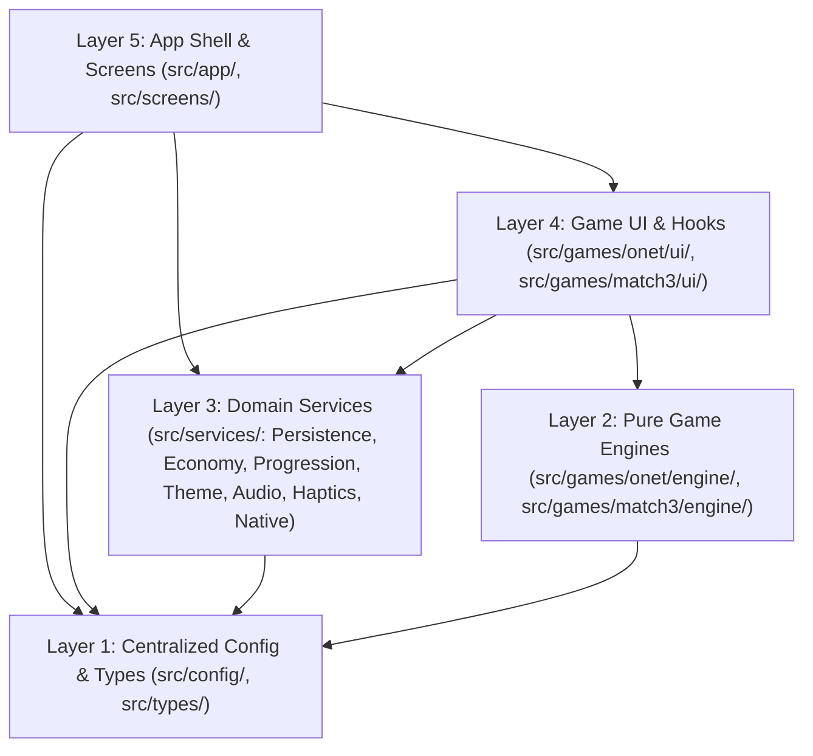

# Connectify Android — Technical Architecture & Module Ownership Plan

**Document Owner:** Agent 01 — Executive Game Producer & Lead Architect (`@architect`)  
**Target Repository:** `/root/.gemini/antigravity/scratch/connectify-android`  
**Package ID:** `com.connectify.android`  
**Scope:** Strictly **Onet Connect** & **Match 3 Puzzle** (100% Offline-First Android APK via Capacitor)

---

## 1. Architectural Vision & Core Principles

`connectify-android` transforms the web-only, multi-game `connectify-new` portal into a streamlined, high-polish, offline-first Android puzzle game featuring **two co-equal puzzle engines** (**Onet** and **Match 3**) unified under one progression, currency, and cosmetic theme ecosystem.

### 1.1 Five Architectural Pillars
1. **Strict Scope Discipline (Onet + Match 3 Only):** Zero legacy arcade/shooter/multiplayer bloat (`phaser`, `matter-js`, `@supabase/supabase-js`, `express`, `block-puzzle`, `memory`, `triple`, `star-patrol`, `multiplayer` are completely excluded).
2. **Pure, Deterministic Game Engines Separated from React UI:** All Onet pathfinding/generation/shuffle and Match 3 swap/match/special/cascade/deadlock algorithms live in pure TypeScript modules (`src/games/onet/engine/` and `src/games/match3/engine/`) with zero DOM, React, or `localStorage` dependencies—enabling 1,000+ board stress tests in Node/Vitest at >10,000 boards/sec.
3. **100% Offline-First Authoritative Local Persistence:** Boot never waits on network or login (`BootScreen` -> `StartupScreen` -> `HomeScreen` in `< 800ms`). All state mutations execute synchronously against `LocalPersistenceEngine` with dual-slot atomic `localStorage` (`primary` + `backup` + `wal`) + `IndexedDB` mirror, checksum verification, and idempotent `opId`/`runId` transaction deduplication.
4. **Centralized Configuration System (`src/config/`):** All gameplay curves, grid dimensions, level definitions, economy prices/rewards/diminishing-return rules, XP/rank formulas, mission/achievement tables, theme catalogs, and animation/audio timings live in typed, centralized config modules—eliminating scattered magic numbers.
5. **Collision-Free Parallel File Ownership:** Every directory and file in `src/`, `public/`, `scripts/`, `tests/`, and `android/` has a single designated Phase 3/4 owner so all engineers can build in parallel without merge conflicts.

---

## 2. Layered Module Architecture & Dependency Rules

The codebase enforces a strict **unidirectional dependency hierarchy** (top layers may import from lower layers; lower layers must **never** import from upper layers):



### 2.1 Layer Contracts & Boundaries

| Layer | Directory | Permitted Dependencies | Forbidden Dependencies |
| :--- | :--- | :--- | :--- |
| **Layer 1: Config & Types** | `src/config/`, `src/types/` | Pure TS constants, `seededRandom`, math helpers | React, DOM, Storage, Capacitor, Game Engines |
| **Layer 2: Pure Engines** | `src/games/onet/engine/`, `src/games/match3/engine/` | Layer 1 (`src/config/`, `src/types/`) | React, DOM, Audio, Storage, Persistence |
| **Layer 3: Shared Services** | `src/services/` (`persistence`, `economy`, `progression`, `theme`, `audio`, `haptics`, `native`) | Layer 1, Browser/Capacitor APIs | Layer 4 Game UI, Layer 5 Screens |
| **Layer 4: Game Modules (UI/Hooks)** | `src/games/onet/components/`, `src/games/onet/hooks/`, `src/games/match3/components/`, `src/games/match3/hooks/` | Layers 1, 2, 3, React, Motion, Lucide, Shared UI Primitives | Cross-importing between `onet/` and `match3/` |
| **Layer 5: App Shell & Screens** | `src/app/`, `src/screens/`, `src/components/` | Layers 1, 3, 4, React, Motion, Lucide | Direct `localStorage` calls (must go through `PersistenceContext`) |

---

## 3. Centralized Configuration System Design (`src/config/`)

All tunable game balance, economy, progression, theme, and timing values are consolidated under `src/config/`:

| Config File | Owner | Key Exports & Responsibilities |
| :--- | :--- | :--- |
| `src/config/app.config.ts` | `@architect` | App metadata (`APP_ID = 'com.connectify.android'`), version binding from `app-version.json`, supported `GameId = 'onet' | 'match3'`, `GAME_METADATA` (display names, palettes, cover sprites, rules copy). |
| `src/config/onet.config.ts` | `@onet-eng` | `ONET_GRID_TIERS` (configurable rows/cols per level bracket, e.g., `6×4`, `8×5`, `10×6`, `10×8`), `getOnetLevelConfig(level)` (time limit, multi-cell `2×2`/`1×2` group count, `separation`, `arrowPairs`, star time/score thresholds), scoring constants (`100` base, `150` `1×2` split, `200` `2×2` split, combo window `4000ms`), and Daily Sprint config (`90s`). |
| `src/config/match3.config.ts` | `@match3-eng` | `MATCH3_LEVELS` (manual levels 1–20 + seeded PCG generator for levels 21+), grid sizes (`7×7`, `8×8`, `9×9`), tile variety (`5–6` tile IDs from active theme), obstacle definitions (`ice`, `wood`, `metal-2`, `metal-1`, `stone`, `gem`), special tile rules (4-match Line, L/T Area Bomb, 5-match Rainbow), DDA parameters (`EMA alpha = 0.3`, `pity` at 3 retries), and 1–3 star objective thresholds. |
| `src/config/economy.config.ts` | `@economy-designer` | Currency identity (`Permen` / `Connect Coins`), `BOOSTER_PRICES` (`hint: 8`, `shuffle: 12`, `hammer: 14`, `bomb: 18`), `THEME_PRICES` & rarity tiers (`Common/Free`, `Classic`, `Atelier`, `Seasonal`, `Milestone`), `COSMETIC_PRICES`, level-win base & star bonus coin formulas, anti-farming diminishing-returns curve on replayed levels, daily cap/soft-cap rules, and `WIB (UTC+7)` daily reset helper. |
| `src/config/progression.config.ts` | `@progression-designer` | `XP_CURVE` (`xpForLevel`, `getLevelFromXP`, `XP_RANKS`), per-level XP payouts for Onet & Match 3 (ensuring XP parity), `LOGIN_STREAK_SCHEDULE`, `DAILY_MISSIONS_POOL` & `WEEKLY_MISSIONS_POOL` (scoped strictly to `'onet'` and `'match3'`), `ACHIEVEMENTS_CATALOG` (`'hub'`, `'onet'`, `'match3'`), and milestone art reward rules (`ART_REWARDS`). |
| `src/config/themes.config.ts` | `@art-director` | Unified `THEME_CATALOG` (all 19 themes from `connectify-new` adapted to support **both Onet and Match 3**), `TILE_SETS`, `COSMETICS_CATALOG` (tile skins, board surfaces, match particles, victory bursts, avatars, frames), and asset paths under `/art/`. |
| `src/config/audioFeel.config.ts` | `@game-feel` | `AUDIO_DEFAULTS`, `CLUBSYNTH_TEMPOS` (`menu: 84 BPM`, `game: 102 BPM`), `SFX_PATTERNS` (all 11 legacy + new Onet/Match 3 SFX), `ONET_TIMINGS` (`500ms` total path+burst window), `MATCH3_TIMINGS` (`180ms` swap spring, `320ms` invalid bounce, `sqrt(dropRows)*95ms` cascade drop), and `HAPTIC_PATTERNS` (`35ms` cascade throttle). |

---

## 4. Exact Directory & File Ownership Map (Phase 3 & Phase 4)

To guarantee **zero file edit collisions** during Phase 3 & Phase 4 parallel execution, every file/directory in `/root/.gemini/antigravity/scratch/connectify-android` is assigned to a single exclusive owner:

```text
connectify-android/
├── package.json                                  [Owner: @android-eng]
├── tsconfig.json                                 [Owner: @architect]
├── vite.config.ts                                [Owner: @android-eng]
├── capacitor.config.ts                           [Owner: @android-eng]
├── app-version.json                              [Owner: @devops-eng]
├── index.html                                    [Owner: @android-eng]
├── .github/workflows/android-build.yml           [Owner: @devops-eng]
├── android/                                      [Owner: @android-eng (Capacitor + Gradle)]
├── scripts/
│   ├── build-android.mjs                         [Owner: @android-eng]
│   ├── generate-android-icons.mjs                [Owner: @android-eng]
│   ├── migrate-assets.mjs                        [Owner: @art-director]
│   ├── simulate-economy.mjs                      [Owner: @economy-designer]
│   └── simulate-progression.mjs                  [Owner: @progression-designer]
├── public/
│   ├── fonts/                                    [Owner: @art-director (Fredoka & Outfit woff2/ttf)]
│   └── art/                                      [Owner: @art-director (Migrated Onet/Match3/Shared WebP & PNGs)]
├── tests/
│   ├── setup.ts                                  [Owner: @qa-verifier]
│   ├── onet/                                     [Owner: @qa-verifier (ONET-PF-*, ONET-BG-* 1000-board tests)]
│   ├── match3/                                   [Owner: @qa-verifier (M3-SW-*, M3-SP-*, M3-NM-* tests)]
│   ├── economy/                                  [Owner: @qa-verifier (ECON-* atomic & parity tests)]
│   ├── progression/                              [Owner: @qa-verifier (PROG-* XP/star/rollover tests)]
│   └── persistence/                              [Owner: @qa-verifier (PERS-* WAL/recovery tests)]
└── src/
    ├── main.tsx                                  [Owner: @architect]
    ├── types/
    │   ├── game.types.ts                         [Owner: @architect (Shared GameId, LevelRecord, ResultPayload)]
    │   ├── onet.types.ts                         [Owner: @onet-eng]
    │   ├── match3.types.ts                       [Owner: @match3-eng]
    │   ├── persistence.types.ts                  [Owner: @data-eng (SaveEnvelopeV1, Mutations, Schemas)]
    │   ├── economy.types.ts                      [Owner: @economy-designer]
    │   └── theme.types.ts                        [Owner: @art-director]
    ├── config/
    │   ├── app.config.ts                         [Owner: @architect]
    │   ├── onet.config.ts                        [Owner: @onet-eng]
    │   ├── match3.config.ts                      [Owner: @match3-eng]
    │   ├── economy.config.ts                     [Owner: @economy-designer]
    │   ├── progression.config.ts                 [Owner: @progression-designer]
    │   ├── themes.config.ts                      [Owner: @art-director]
    │   └── audioFeel.config.ts                   [Owner: @game-feel]
    ├── utils/
    │   ├── random.ts                             [Owner: @architect (mulberry32 / seededRandom)]
    │   └── time.ts                               [Owner: @architect (WIB UTC+7 day/week keys)]
    ├── services/
    │   ├── persistence/
    │   │   ├── LocalPersistenceEngine.ts         [Owner: @data-eng]
    │   │   ├── StorageDriver.ts                  [Owner: @data-eng (WAL + localStorage + IndexedDB)]
    │   │   ├── ChecksumEngine.ts                 [Owner: @data-eng]
    │   │   ├── SchemaMigrator.ts                 [Owner: @data-eng]
    │   │   ├── CloudSyncAdapter.ts               [Owner: @data-eng (Optional interface)]
    │   │   └── PersistenceContext.tsx            [Owner: @data-eng]
    │   ├── economy/
    │   │   ├── EconomyEngine.ts                  [Owner: @economy-designer]
    │   │   └── ShopCatalogService.ts             [Owner: @economy-designer]
    │   ├── progression/
    │   │   ├── ProgressionEngine.ts              [Owner: @progression-designer]
    │   │   ├── MissionEngine.ts                  [Owner: @progression-designer]
    │   │   ├── AchievementEngine.ts              [Owner: @progression-designer]
    │   │   ├── LoginStreakEngine.ts              [Owner: @progression-designer]
    │   │   └── RewardEngine.ts                   [Owner: @progression-designer]
    │   ├── theme/
    │   │   ├── ThemeContext.tsx                  [Owner: @art-director]
    │   │   └── ArtRewardsService.ts              [Owner: @art-director]
    │   ├── audio/
    │   │   ├── ClubSynth.ts                      [Owner: @game-feel]
    │   │   └── AudioContext.tsx                  [Owner: @game-feel]
    │   ├── haptics/
    │   │   └── HapticsEngine.ts                  [Owner: @game-feel]
    │   └── native/
    │       └── CapacitorBridge.ts                [Owner: @android-eng (Lifecycle, BackButton, StatusBar, SplashScreen)]
    ├── games/
    │   ├── onet/
    │   │   ├── engine/
    │   │   │   ├── pathfinding.ts                [Owner: @onet-eng (<=2 turn BFS + openSide)]
    │   │   │   ├── boardGenerator.ts             [Owner: @onet-eng (Constructive solvable gen + splits)]
    │   │   │   ├── shuffler.ts                   [Owner: @onet-eng (Deadlock-safe guaranteedShuffle)]
    │   │   │   └── onetScoring.ts                [Owner: @onet-eng (Score, combo, 1-3 stars)]
    │   │   ├── hooks/
    │   │   │   └── useOnetGame.ts                [Owner: @onet-eng]
    │   │   └── components/
    │   │       ├── OnetScreen.tsx                [Owner: @onet-eng]
    │   │       ├── OnetBoard.tsx                 [Owner: @onet-eng]
    │   │       ├── OnetPathLayer.tsx             [Owner: @game-feel (SVG rounded path & dual rings)]
    │   │       └── OnetBoosterDock.tsx           [Owner: @onet-eng]
    │   └── match3/
    │       ├── engine/
    │       │   ├── boardGenerator.ts             [Owner: @match3-eng (0 pre-match + >=1 move)]
    │       │   ├── matchDetector.ts              [Owner: @match3-eng (3/4/5/L/T pattern classifier)]
    │       │   ├── specialTiles.ts               [Owner: @match3-eng (Line/Bomb/Rainbow & combos)]
    │       │   ├── cascadeResolver.ts            [Owner: @match3-eng (Gravity, refill, obstacles)]
    │       │   ├── deadlockDetector.ts           [Owner: @match3-eng (findValidSwaps + shuffle)]
    │       │   ├── levelGenerator.ts             [Owner: @match3-eng (PCG + DDA + 1-3 star eval)]
    │       │   └── match3Scoring.ts              [Owner: @match3-eng]
    │       ├── hooks/
    │       │   └── useMatch3Game.ts              [Owner: @match3-eng]
    │       └── components/
    │           ├── Match3Screen.tsx              [Owner: @match3-eng]
    │           ├── Match3Board.tsx               [Owner: @match3-eng]
    │           ├── Match3Tile.tsx                [Owner: @game-feel (Swap spring, drop & special FX)]
    │           └── Match3BoosterDock.tsx         [Owner: @match3-eng]
    ├── styles/
    │   ├── tokens.css                            [Owner: @art-director (Colors, fonts, Club tokens)]
    │   ├── animations.css                        [Owner: @game-feel (Particles, bursts, keyframes)]
    │   └── app.css                               [Owner: @ui-eng (Safe areas, layouts, responsive grids)]
    ├── components/
    │   ├── common/                               [Owner: @ui-eng (KineticButton, KineticCard, KineticModal, CurrencyPill, DynamicIcon, MobileNav)]
    │   ├── fx/
    │   │   ├── TileBurst.tsx                     [Owner: @game-feel]
    │   │   ├── GameParticles.tsx                 [Owner: @game-feel]
    │   │   └── VictoryBurst.tsx                  [Owner: @game-feel]
    │   └── game-hud/                             [Owner: @ui-eng (GameHeader, GameResultModal, PauseModal, StarRatingBar)]
    ├── app/
    │   ├── App.tsx                               [Owner: @architect (Provider tree + Native lifecycle wiring)]
    │   ├── NavigationContext.tsx                 [Owner: @ui-eng (History stack + Android Back handler)]
    │   └── Router.tsx                            [Owner: @ui-eng]
    └── screens/
        ├── BootScreen.tsx                        [Owner: @ui-eng]
        ├── StartupScreen.tsx                     [Owner: @ui-eng]
        ├── HomeScreen.tsx                        [Owner: @ui-eng]
        ├── LevelSelectScreen.tsx                 [Owner: @ui-eng]
        ├── ShopScreen.tsx                        [Owner: @ui-eng]
        ├── ThemePreviewModal.tsx                 [Owner: @ui-eng]
        ├── CollectionScreen.tsx                  [Owner: @ui-eng]
        ├── DailyChallengesModal.tsx              [Owner: @ui-eng]
        ├── ProfileScreen.tsx                     [Owner: @ui-eng]
        ├── LedgerScreen.tsx                      [Owner: @ui-eng]
        └── SettingsModal.tsx                     [Owner: @ui-eng]
```

### 4.1 Cross-Module Integration Rules
- **No direct edits across ownership boundaries:** For example, `@ui-eng` consumes `useTheme()` from `ThemeContext.tsx` (`@art-director`) and `usePersistence()` from `PersistenceContext.tsx` (`@data-eng`), while `@onet-eng` and `@match3-eng` emit `GameResultPayload` into `PersistenceContext.recordGameResult()` rather than mutating economy or progression directly.
- **Integration Stubs First (Phase 3 Day 1):** `@architect` and Layer 1/Layer 3 leads (`@data-eng`, `@economy-designer`, `@progression-designer`, `@art-director`) publish typed interfaces and barrel exports early in Phase 3 so Layer 4 (`@onet-eng`, `@match3-eng`, `@game-feel`) and Layer 5 (`@ui-eng`) compile cleanly throughout development.

---

## 5. Key Cross-Cutting Data Flows

### 5.1 Unified Game Round Lifecycle (Onet & Match 3)
1. **Level Entry:** `LevelSelectScreen` displays unlocked levels (`1..highestUnlocked`), earned stars (`0..3`), best score, and active theme. Player taps Level `N` -> `NavigationContext` pushes `'play-onet'` or `'play-match3'` with `{ level, mode: 'normal' | 'daily' }`.
2. **Board Initialization & Resume:** Game hook (`useOnetGame` / `useMatch3Game`) checks `PersistenceContext.getActiveSession(gameId)`. If an active matching level snapshot exists, it resumes seamlessly; otherwise it calls the pure `boardGenerator` with `levelConfig` and persists initial `ActiveSessionState`.
3. **Move & Auto-Save:** Every valid match/swap updates pure board state, scores/objectives, triggers `AudioContext` SFX + `HapticsEngine`, and writes a lightweight snapshot to `PersistenceContext.saveActiveSession(...)` so an OS background kill loses zero progress.
4. **Pause & Lifecycle:** Android `appStateChange` (`isActive === false`), `visibilitychange`, or hardware `backButton` pauses the timer, suspends `ClubSynth` Web Audio, flushes the active session, and opens `PauseModal`.
5. **Round Completion & Atomic Reward Commit:**
   - Pure scoring evaluates `stars (0..3)` and constructs `GameResultPayload { game, runId, level, isWinner, isFlawless, score, stars, timeElapsed, matches, splits, highestCombo, blockersCleared, isDailyChallenge }`.
   - `PersistenceContext.commitGameResult(payload)` invokes `RewardEngine` + `EconomyEngine` + `ProgressionEngine` inside a single atomic transaction keyed by `runId` (preventing duplicate claims), clears `activeSession`, updates `perGameProgression`, awards `Permen` coins + `XP`, updates Daily/Weekly Missions & Achievements, and writes WAL -> Primary -> Backup + IndexedDB.
   - `GameResultModal` animates earned stars, XP bar progress, Connect Coins earned (including diminishing-return indicator if replaying an already-cleared level), and provides **Next Level**, **Retry**, or **Level Select** CTAs.

---

## 6. Capacitor Android Integration Plan

Full Gradle/SDK toolchain details are documented in `ANDROID_MIGRATION_PLAN.md` (`@android-eng`) and `DEVOPS_AND_RELEASE_PLAN.md` (`@devops-eng`). Architecturally, the Capacitor Android shell integrates at four clean touchpoints:

1. **Capacitor Configuration (`capacitor.config.ts`):**
   - `appId: 'com.connectify.android'`
   - `appName: 'Connectify'`
   - `webDir: 'dist'`
   - `android.backgroundColor: '#fffaf5'` (matches `#static-loader` to eliminate white/black flash on launch)
   - `plugins.SplashScreen`: `launchAutoHide: false` so `BootScreen` hides the native splash only after local save hydration and core WebP preloading complete.
2. **Native Bridge (`src/services/native/CapacitorBridge.ts`):**
   - **Hardware Back Button (`App.addListener('backButton')`):**
     - If any modal (`PauseModal`, `SettingsModal`, `ThemePreviewModal`, `DailyChallengesModal`) is open -> close the top modal.
     - If in active gameplay (`play-onet` / `play-match3`) -> pause game & open `PauseModal`.
     - If on a secondary screen (`level-select`, `ledger`, etc.) -> pop `NavigationContext` stack.
     - If on a non-home root tab -> switch to `HomeScreen`.
     - If on `HomeScreen` -> prompt/confirm exit or call `App.minimizeApp()`.
   - **App Pause / Resume (`App.addListener('appStateChange')`):** Automatically suspends `ClubSynth` BGM/SFX, pauses active game countdown timers, and flushes `LocalPersistenceEngine` when `isActive === false`.
   - **Edge-to-Edge Safe Areas & StatusBar:** Uses `@capacitor/status-bar` (`Style.Light` / `Style.Dark` synced with Dark Mode) + CSS `env(safe-area-inset-*)` on top HUDs and bottom navigation/booster docks.
3. **Offline Asset Bundling:**
   - Self-host `Fredoka` and `Outfit` fonts in `public/fonts/` so zero external network requests occur.
   - Disable browser Service Worker registration when `Capacitor.isNativePlatform()` is true; Capacitor serves all bundled `dist/` assets directly from `android/app/src/main/assets/public/` via `https://localhost`.
4. **Minimal Android Permissions (`AndroidManifest.xml`):**
   - Retain only `VIBRATE` (for haptics compatibility); **remove** unnecessary `INTERNET` permissions if purely offline (or keep minimal standard Capacitor `INTERNET` only for `https://localhost` WebView scheme with `usesCleartextTraffic="false"`). No camera, location, contacts, or storage runtime permissions required.
