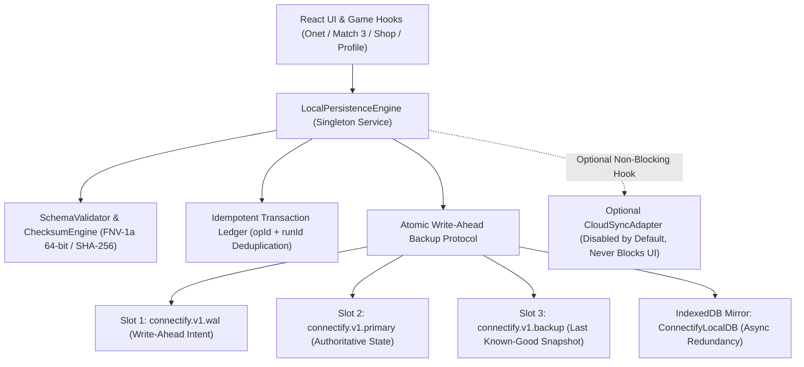
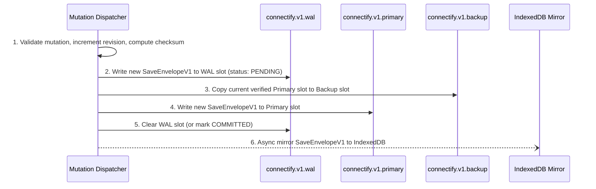

# Connectify Android — Data & Persistence Technical Specification (`DATA_PERSISTENCE_SPEC.md`)

**Author:** Agent 11 — Game Data & Persistence Engineer (`@data-eng`)  
**Target Project:** `/root/.gemini/antigravity/scratch/connectify-android`  
**Source Audit Target:** `/root/.gemini/antigravity/scratch/connectify-new` (Read-Only)  
**Architecture Paradigm:** 100% Offline-First, Deterministic Authoritative Local Persistence Engine (Zero Mandatory Login, Optional Cloud Sync Hook)

---

## 1. Comprehensive Audit of `connectify-new` Persistence, Server & Supabase Dependencies

### 1.1 Supabase, Backend, and Network Dependencies in `connectify-new`

A full audit of `/root/.gemini/antigravity/scratch/connectify-new` identified all server-side, Supabase, and network-coupled modules that previously gated boot, authentication, profile state, economy mutations, and multiplayer:

| File / Directory | Role in `connectify-new` | Coupling & Offline Failure Mode | Disposition in `connectify-android` |
| :--- | :--- | :--- | :--- |
| `src/lib/supabase.ts` | Instantiates `@supabase/supabase-js` client (`storageKey: 'cde-auth-token-v1'`). Throws immediately on module import if `VITE_SUPABASE_URL` or `VITE_SUPABASE_ANON_KEY` are missing. | **Hard crash on boot** without environment variables or network configuration. | **Removed from critical path.** Replaced by optional `CloudSyncAdapter` interface (no-op when unconfigured). |
| `src/lib/api.ts` | Wrapper `apiFetch()` that reads `REACT_APP_BACKEND_URL`, queries `supabase.auth.getSession()`, and attaches `Bearer <access_token>` to `window.fetch`. | Throws `'Alamat server belum dikonfigurasi'` or fails when offline. | **Removed.** All state mutations execute synchronously/atomically against the local persistence engine. |
| `src/screens/BootScreen.tsx` | Preloads assets, then subscribes to `supabase.auth.onAuthStateChange` and calls `CDEAuth.restoreSession()`. Redirects unauthenticated users to `LoginScreen`. | Forces mandatory login screen (`navigate('login')`) if no Supabase session exists. | **Replaced.** BootScreen initializes `PersistenceEngine.init()` locally in `< 15ms` and navigates directly to Home/Hub without login gates. |
| `src/core/cde/auth/CDEAuth.ts` | Implements `smartLogin`, `login`, `checkUsernameExists`, `generateRecoveryCode`, `recoverAccount`, `logout` via Supabase Auth (`pseudoEmail = ${cleanName}@connectify.com`) and `/api/cde`. | Requires live Supabase Auth & `/api/cde` endpoints to create or load a player profile. | **Replaced** by instant local profile auto-provisioning on first launch (`local-player-v1`), with optional local profile export/import backup codes. |
| `src/core/cde/CDE.ts` | Cloud Data Engine (`CDEngine`). Requires `supabase.auth.getSession()` during `initialize()`. Queues mutations (`CDEOperation`) in IndexedDB `outbox` and POSTs them to `/api/cde?action=mutate_state`. | Cannot initialize without a prior authenticated session (`error: 'No authenticated session'`); `commitMutation()` throws `'OFFLINE'` when `navigator.onLine === false`. | **Replaced** by `LocalPersistenceEngine` — executes deterministic, validated transactions locally with immediate atomic commit, write-ahead backup, and idempotency log. |
| `src/core/cde/persistence/CDEIndexedDB.ts` | Opens IndexedDB `CDE_DB` (v1) with stores `profileCache`, `outbox`, and `metadata`. | Used only as a cache/outbox for cloud state; cleared on schema mismatch. | **Upgraded** into a dual-layer persistence driver (`StorageDriver`: synchronous `localStorage` primary/backup slots + asynchronous IndexedDB mirror for large snapshots). |
| `src/core/cde/migration/V2MigrationAdapter.ts` | Migrates `localStorage.getItem('SC_BACKUP_${username}')` via POST `/api/cde?action=migrate_v2` (short-circuited at line 11). | Relied on `/api/cde` server endpoint. | **Replaced** by local `SchemaMigrator` capable of importing legacy `connectify-new` local data if present, plus v1 -> vN schema migrations. |
| `api/cde.ts` & `api/supabase.ts` | Express/Vercel serverless handler for `provision`, `get_profile`, `mutate_state`, `mutate_permen`, `generate_recovery`, `recover_account`, `check_username`. | Requires Node server + Supabase Service Role key. | **Eliminated** as a runtime server dependency; its validation and idempotency rules are embedded directly into `LocalPersistenceEngine`. |
| `api/multiplayer.ts` & `src/core/hooks/useMultiplayer.ts` | Polls `/api/multiplayer` backed by Supabase table `mp_rooms` for real-time 2-player Onet / Block Puzzle lobbies. | Out of scope for single-player offline Android APK (`connectify-android` focuses exclusively on Onet & Match 3). | **Excluded** per architecture scope. |
| `MultiplayerBankEngine.ts` | In-memory server wager offer & pool manager (`offers`, `banks` Maps) for multiplayer currency stakes. | Wagers were already disabled (`403 WAGER_DISABLED` in `api/multiplayer.ts`); not used in single-player. | **Excluded.** All currency operations go through the unified local `WalletService` / `PersistenceEngine`. |
| `server.ts` | Express wrapper serving `/api/cde`, `/api/multiplayer`, and injecting `window.ENV` into `dist/index.html`. | Not used in Capacitor Android WebView bundle. | **Excluded** from Android build (Vite builds static assets bundled into Capacitor Android APK). |
| `supabase/*.sql` & `supabase/migrations/*.sql` | PostgreSQL tables (`cde_accounts`, `cde_profiles`, `cde_operations_log`, `cde_recovery_codes`, `mp_rooms`) and PL/pgSQL RPCs (`cde_mutate_state`, `cde_mutate_permen`). | Server database schema. | **Ported conceptually** to local TypeScript transaction rules: atomic revision increment, non-negative balance check, and `cde_operations_log` idempotency keys. |
| `backend/tests/*.py` | Pytest suite testing HTTP endpoints `/api/cde` and `/api/multiplayer`. | Requires running Python + Express + Supabase. | **Replaced** by deterministic Vitest/Node unit & integration tests testing `PersistenceEngine` directly. |

---

### 1.2 Audit of Existing Browser Storage (`localStorage`, `sessionStorage`, `indexedDB`) in `connectify-new`

Every storage key used across `connectify-new` was cataloged:

1. **`localStorage` Keys:**
   - `'cde-auth-token-v1'` (`src/lib/supabase.ts:14`): Supabase JWT session persistence.
   - `'pkmnPlayerName'` (`src/core/cde/CDE.ts:117`, `CDEAuth.ts:22`): Cached player username string.
   - `'sweetConnectAudioSettings'` (`src/core/audio/AudioEngine.tsx:4,16`, `SettingsScreen.tsx:39`): JSON `{ muteMusic: boolean, muteSfx: boolean, musicVol: number, sfxVol: number }`.
   - `'connectify-dark'` (`src/core/theme/ThemeProvider.tsx:14,20`): `'true' | 'false'` dark mode toggle.
   - `'SC_BACKUP_${playerName}'`, `'sweet_connect_${playerName}'`, `'sweetConnectSave'` (`V2MigrationAdapter.ts:20`, `SettingsScreen.tsx:35-38`): Legacy V1/V2 save keys cleaned up on reset.
2. **`sessionStorage` Keys:**
   - `'active-game'` (`src/GameContext.tsx:26,28`): Last selected game ID (`'onet'` etc.).
   - `'game-hub-tab'` (`src/GameContext.tsx:28`, `GameHubScreen.tsx:19,22`): Active tab in Game Hub.
   - `'shop-tab'` (`src/components/ShopPanel.tsx:19,41`): Active category tab in Shop.
3. **`indexedDB` Databases:**
   - `'CDE_DB'` (version `1`, `src/core/cde/persistence/CDEIndexedDB.ts:3-37`):
     - Object store `profileCache` (`keyPath: 'account_id'`) -> stores `CDEProfile` (`{ account_id, permen, profile_data: { profile, game }, revision }`).
     - Object store `outbox` (`keyPath: 'opId'`, indexes: `accountId`, `status`) -> stores queued `CDEOperation` records.
     - Object store `metadata` (`keyPath: 'accountId'`) -> stores `{ accountId, schemaVersion: 1, lastSync }`.

---

### 1.3 Audit of Existing Profile, Economy, Progression & Game Save State in `connectify-new`

1. **Profile & Progression State (`src/core/profile/defaultProfile.ts`, `src/core/progression.js`, `src/core/reward.js`):**
   - `accountXP`: Numeric XP (`xpForLevel(level) = 100 * (level - 1) + 25 * (level - 1) * (level - 2)`).
   - `currentLevel` / `highestLevel`: Onet level progression (integer >= 1).
   - `blockPuzzleLevel` / `highestBlockPuzzleLevel`: Block Puzzle level progression (replaced by Match 3 progression in `connectify-android`).
   - `winStreak`: Consecutive wins counter.
   - `processedRuns`: Array of up to 200 `runId` UUIDs to prevent duplicate win rewards (`RewardEngine.processWin`).
   - `achievements`: Map of `{ [achievementId: string]: number }` tracking claimed tier index (`0..tiers.length`).
   - `activeMissions` (Daily), `activeWeeklyMissions` (Weekly), `pendingMissions` (Unclaimed completed missions from prior periods), `dailyMissionsDate`, `weeklyMissionsWeek`, `dailyChallengeKeys`, `dailyChallengeDate`.
   - `loginReward`: `{ day: 'YYYY-MM-DD', streak: number }`.
   - `artCheckInDay`: `'YYYY-MM-DD'` tracking total login days for art reward unlocks.
   - `statistics`: Object tracking `totalGames`, `totalWins`, `totalScore`, `highestScore`, `highestCombo`, `totalMatches`, `totalSplits`, `totalPlayTimeMs`, `totalPermenEarned`, `totalFlawless`, `speedrunLevels`, `survivorLevels`, `nearDeathEscapes`, `onetGames`, `onetWins`, `onetHighScore`, `onetMatches`, `onetPlayTimeMs`, `onetBestCombo`, etc.
2. **Bank / Currency & Inventory State (`src/core/economy.js`, `api/cde.ts`):**
   - Authoritative balance stored in `CDEProfile.permen` (mapped to `profile.coins` in `ProfileContext.tsx`).
   - Daily income tracking in `profile.economy`: `{ version: 3, day: 'YYYY-MM-DD', earned: number }`.
   - Transaction history in `profile.ledger`: Array of `{ id: opId, amount: delta, source: type, label: string, balance: number, at: ISOString }` (capped at 200 entries).
   - Consumable boosters on profile: `hints` (default 3), `shuffles` (default 3), `hammers` (default 3), `bombs` (default 3).
   - Themes & Cosmetics: `unlockedThemes: string[]` (default `['sweets', 'meadow']`), `activeTheme: string` (default `'sweets'`), `ownedCosmetics: string[]`, `equippedCosmetics: Record<string, string | null>`, `avatarCollection: string[]`, `activeAvatarId: string`.
3. **Critical Gap in `connectify-new` — No Active In-Progress Game Save State:**
   - In `connectify-new`, `useOnetGame.ts` holds `board`, `score`, `combo`, `time`, `level`, and `run.current` purely in React `useState`/`useRef`. If the Android OS kills the WebView or the user closes the app mid-level, **all in-progress puzzle state is lost**.
   - Furthermore, `connectify-new` does not store per-level star ratings (`1..3` stars) or per-level high scores for Onet or Match 3.
   - `connectify-android` solves both gaps with dedicated `perGameProgression` (per-level stars, high scores, attempts, best times) and `activeSession` (deterministic mid-round snapshot saved on every move and Android lifecycle `pause`/`visibilitychange`).

---

## 2. Offline-First Persistence Architecture (`LocalPersistenceEngine`)

### 2.1 Replacement of Server/Supabase Dependencies

Every server/Supabase dependency in `connectify-new` is replaced by a **100% offline-first, deterministic local persistence engine** located in `src/core/persistence/`:



#### Key Architectural Guarantees:
1. **Zero Mandatory Login / Instant Boot:**
   - On first launch, `LocalPersistenceEngine.initialize()` synchronously checks local storage slots. If no save exists, it deterministically generates a fresh `SaveEnvelopeV1` with a local UUID (`playerId: crypto.randomUUID()`), default starting balance, default unlocked themes (`['sweets', 'meadow']`), and Level 1 unlocked in both Onet and Match 3.
   - No network request, Supabase token, or login screen is ever required to boot or play.
2. **Authoritative Local Mutation Pipeline:**
   - All economy, progression, inventory, and setting mutations pass through `LocalPersistenceEngine.dispatch(mutation: PersistenceMutation)` which executes synchronously in memory, validates preconditions (e.g., non-negative Connect Coins balance, valid item price, level unlock rules), checks the idempotency log (`opId` / `runId`), increments the monotonic `revision` counter, computes the integrity checksum, and commits via the atomic Write-Ahead Backup protocol.
3. **Optional Cloud Sync Hook (`CloudSyncAdapter`):**
   - An interface `ICloudSyncAdapter` is exposed for future optional backup/restore (or JSON file export/import via Android Share sheet), never required at runtime:
   ```ts
   export interface ICloudSyncAdapter {
     readonly isConfigured: boolean;
     pushSnapshot(envelope: SaveEnvelopeV1): Promise<{ syncedAt: number; remoteRevision: number } | null>;
     pullSnapshot(): Promise<SaveEnvelopeV1 | null>;
   }
   ```

---

## 3. Authoritative Local Storage Schema, Integrity Validation & Crash Recovery

### 3.1 Storage Keys & Redundant Slots

To guarantee zero data loss even if the Android WebView process is terminated mid-write by the OS (`SIGKILL` / low-memory killer) or battery loss, the engine uses a **3-slot atomic rotation in `localStorage`** backed by an **asynchronous IndexedDB mirror** (`ConnectifyLocalDB`):

| Storage Key / Store | Medium | Purpose |
| :--- | :--- | :--- |
| `connectify.v1.primary` | `localStorage` | Primary authoritative JSON `SaveEnvelopeV1`. |
| `connectify.v1.backup` | `localStorage` | Previous known-good JSON `SaveEnvelopeV1` (verified before `primary` is overwritten). |
| `connectify.v1.wal` | `localStorage` | Write-Ahead Log slot written *before* `primary` is mutated and cleared (`COMMITTED`) after `primary` write succeeds. |
| `connectify.v1.session` | `localStorage` | Fast-path slot for high-frequency active in-progress board state (`ActiveGameSessionState`) to avoid serializing the entire profile on every single tile tap, while also syncing into `SaveEnvelopeV1.data.activeSession` on pause/checkpoint. |
| `ConnectifyLocalDB` (`snapshots` store) | `IndexedDB` | Asynchronous deep backup of the verified `SaveEnvelopeV1`. Used for automatic self-healing if a user or OS cleaner wipes `localStorage` but leaves `IndexedDB` intact (or vice versa). |

---

### 3.2 Envelope Structure & Integrity Checksum (`SaveEnvelopeV1`)

Every persisted payload is wrapped in a versioned, checksummed `SaveEnvelopeV1`:

```ts
export const CURRENT_SCHEMA_VERSION = 1 as const;

export interface SaveEnvelopeV1 {
  /** Magic header to identify valid Connectify save payloads */
  magic: 'CONNECTIFY_SAVE';
  /** Monotonically increasing schema version for deterministic migrations */
  schemaVersion: 1;
  /** Monotonically increasing state revision counter (increments by +1 on every mutation) */
  revision: number;
  /** Wall-clock timestamp (ms since epoch) of the commit */
  updatedAt: number;
  /** Deterministic integrity checksum of canonicalized `data` + `schemaVersion` + `revision` */
  checksum: string;
  /** Authoritative game data payload */
  data: ConnectifySaveDataV1;
}
```

#### Deterministic Checksum Algorithm (`computeEnvelopeChecksum`):
To validate integrity synchronously in `< 1ms` on every read/write without async WebCrypto latency blocking `pagehide`/`pause` hooks:
- We serialize ` payload = "${envelope.schemaVersion}:${envelope.revision}:" + canonicalJsonStringify(envelope.data) ` (where object keys are sorted lexicographically so key ordering never causes false positives).
- We compute a dual **64-bit FNV-1a + DJB2 hex digest** (`16-char hex`) with a static domain salt (`"CONNECTIFY_ANDROID_V1_SALT"`):
```ts
export function computeChecksum(schemaVersion: number, revision: number, data: unknown): string {
  const canonical = `${schemaVersion}:${revision}:${canonicalizeJson(data)}:CONNECTIFY_ANDROID_V1_SALT`;
  let h1 = 0x811c9dc5;
  let h2 = 0x01000193;
  for (let i = 0; i < canonical.length; i++) {
    const ch = canonical.charCodeAt(i);
    h1 ^= ch;
    h1 = Math.imul(h1, 0x01000193);
    h2 = Math.imul(h2 ^ ch, 0x5bd1e995);
  }
  const hex1 = (h1 >>> 0).toString(16).padStart(8, '0');
  const hex2 = (h2 >>> 0).toString(16).padStart(8, '0');
  return `fnv1a64:${hex1}${hex2}`;
}
```
- **Verification Rule:** On load, `verifyEnvelope(raw)` parses JSON, validates structural invariants (`schemaVersion`, `revision >= 1`, `profile.coins >= 0`), recomputes `computeChecksum()`, and asserts `recomputed === envelope.checksum`. Any mismatch flags the slot as `CORRUPTED`.

---

### 3.3 Atomic Write-Ahead Backup Protocol (Crash Recovery)

Every state mutation follows a strict 5-step atomic commit sequence:



#### Boot Recovery & Self-Healing State Machine:
When `LocalPersistenceEngine.initialize()` runs at boot:
1. Read `WAL`, `Primary`, and `Backup` from `localStorage`.
2. **Case A — Interrupted Write Recovery (`WAL` is valid and `WAL.revision > Primary.revision`):**
   - A crash occurred between Step 2 and Step 4.
   - Verify `WAL` checksum & schema invariants. If valid, promote `WAL` -> `Primary` and `Backup`, clear `WAL`, and record a `recoveredFromWal` telemetry flag.
3. **Case B — Normal Boot (`Primary` is valid and checksum matches):**
   - Use `Primary`. Ensure `Backup` is synchronized if `Backup` is missing or older. Clear any leftover `WAL`.
4. **Case C — Corrupted Primary Recovery (`Primary` fails JSON parse, schema validation, or checksum):**
   - Log corruption warning.
   - Verify `Backup` slot checksum & schema invariants.
   - If `Backup` is valid: restore `Backup` -> `Primary` immediately (zero progress loss beyond the single failed write).
5. **Case D — Both `Primary` and `Backup` in `localStorage` Missing or Corrupted:**
   - Query `ConnectifyLocalDB` (`IndexedDB` mirror). If a valid `SaveEnvelopeV1` exists in IndexedDB, restore it to both `Primary` and `Backup`.
6. **Case E — Legacy `connectify-new` Data Present (`CDE_DB` or `SC_BACKUP_*`) or Fresh Install:**
   - Run `LegacyConnectifyNewImporter` (if legacy keys exist) or initialize a clean `SaveEnvelopeV1` (revision `1`) and persist to all slots.

---

### 3.4 Schema Versioning & Migration Pipeline

The persistence engine supports deterministic forward migrations (`v1 -> v2 -> ... -> vN`) and legacy `connectify-new` import:

```ts
export interface SchemaMigration<From = any, To = any> {
  fromVersion: number;
  toVersion: number;
  migrate(oldData: From): To;
}
```

- **Legacy v0 (`connectify-new`) -> v1 Migration:**
  - Inspects `localStorage.getItem('sweetConnectAudioSettings')`, `localStorage.getItem('connectify-dark')`, `localStorage.getItem('pkmnPlayerName')`, and `IndexedDB('CDE_DB')` (`profileCache`).
  - Maps `permen` -> `profile.coins` (Connect Coins), `accountXP` -> `profile.xp`, `highestLevel` -> `progression.onet.unlockedLevel`, `unlockedThemes` -> `inventory.unlockedThemes`, `activeTheme` -> `inventory.equippedThemeId`, `hints`/`shuffles`/`hammers`/`bombs` -> `inventory.boosters`, `achievements` -> `achievements.claimedTiers`, and audio/theme preferences -> `settings`.
- **Future v1 -> v2+ Migrations:**
  - Registered in `MIGRATION_REGISTRY: Record<number, SchemaMigration>`.
  - Before applying a migration, the raw pre-migration JSON is archived in `localStorage.setItem('connectify.pre_migration_backup', raw)` so a migration failure can never destroy user data.

---

### 3.5 Idempotent Transaction Log (`IdempotencyLedger`)

To prevent duplicate reward grants or double-billing on rapid taps, UI retries, or app restarts mid-celebration:

1. **Every economy/progression mutation requires a deterministic or UUID `transactionId` (`opId`) and optional `sourceKey` (`runId`, `missionId:date`, `achievementId:tier`, `loginReward:date`):**
   - **Level Completion (`PROCESS_GAME_RESULT`):** Keyed by `runId` (generated once when a level board is initialized: `onet_run_${uuid}` or `match3_run_${uuid}`).
   - **Daily Challenge Completion (`CLAIM_DAILY_CHALLENGE`):** Keyed by `daily_challenge:${YYYY-MM-DD}:${gameId}`.
   - **Daily Mission Claim (`CLAIM_MISSION_REWARD`):** Keyed by `mission:${periodKey}:${missionId}`.
   - **Achievement Tier Claim (`CLAIM_ACHIEVEMENT_REWARD`):** Keyed by `achievement:${achievementId}:tier_${tierIndex}`.
   - **Daily Login Streak Claim (`CLAIM_LOGIN_REWARD`):** Keyed by `login_reward:${YYYY-MM-DD}`.
   - **Shop Purchase (`PURCHASE_SHOP_ITEM`):** Keyed by `purchase:${opId}` (and for non-consumable themes/cosmetics, additionally guarded by `inventory.unlockedThemes.includes(themeId)` / `inventory.ownedCosmetics.includes(itemId)`).
   - **Booster Consumption (`CONSUME_BOOSTER`):** Keyed by `consume:${runId}:${moveIndex}:${boosterType}`.

2. **Idempotency Check & Ring Buffer Retention:**
   - `ConnectifySaveDataV1.transactionLog` stores:
     - `processedKeys: string[]` — Last `500` unique `sourceKey` / `opId` strings (O(1) lookup via in-memory `Set<string>` hydrated on boot).
     - `ledger: WalletTransactionEntry[]` — Last `200` human-readable financial ledger entries for the Wallet/Ledger UI.
   - If `processedKeys.includes(mutation.idempotencyKey)` is true:
     - The engine **returns `{ status: 'IDEMPOTENT_NOOP', state: currentState }` without mutating coins, XP, or inventory**.

---

## 4. Authoritative Data Structures (`ConnectifySaveDataV1`)

Below is the complete TypeScript specification for all persisted domains in `connectify-android`.

```ts
export type GameModeId = 'onet' | 'match3';

export interface ConnectifySaveDataV1 {
  profile: SharedPlayerProfileState;
  progression: {
    onet: GameModeProgressionState;
    match3: GameModeProgressionState;
  };
  activeSession: {
    onet: ActiveOnetSessionState | null;
    match3: ActiveMatch3SessionState | null;
    lastPlayedGame: GameModeId;
  };
  inventory: PlayerInventoryAndThemesState;
  achievements: PlayerAchievementsState;
  dailyChallenges: DailyChallengesAndMissionsState;
  settings: PlayerSettingsState;
  statistics: GlobalAndPerGameStatistics;
  transactionLog: TransactionLedgerState;
}
```

---

### 4.1 Shared Player Profile & Economy State (`SharedPlayerProfileState`)

```ts
export interface SharedPlayerProfileState {
  /** Stable local UUID generated on first install */
  playerId: string;
  /** Display name configurable in Profile screen (default: 'Player') */
  playerName: string;
  /** Equipped avatar ID (default: 'avatar_male') */
  avatarId: string;
  /** Equipped avatar background hex color (default: '#bde0fe') */
  avatarBackground: string;
  /** Equipped portrait frame ID (default: null) */
  frameId: string | null;

  /** Total cumulative Player XP (never decreases) */
  xp: number;
  /** Derived Player Level from XP curve (cached for fast UI display, verified on mutation) */
  level: number;
  /** Current rank title (e.g., 'Teman Baru', 'Pencari Pasangan', 'Master Puzzle') */
  rankTitle: string;

  /** Authoritative Connect Coins (Permen) balance. Invariant: integer >= 0 */
  coins: number;
  /** Lifetime Connect Coins earned across all sources */
  lifetimeCoinsEarned: number;
  /** Lifetime Connect Coins spent in shop */
  lifetimeCoinsSpent: number;

  /** Current consecutive win streak across Onet & Match 3 */
  currentWinStreak: number;
  /** Best all-time consecutive win streak */
  bestWinStreak: number;

  /** Daily login streak state (reset boundary: local midnight / WIB 00:00) */
  loginStreak: {
    lastClaimedDate: string | null; // 'YYYY-MM-DD'
    lastCheckInDate: string | null; // 'YYYY-MM-DD'
    currentStreak: number;          // 1..N
    bestStreak: number;
    totalLoginDays: number;
  };

  /** Daily economy tracking for anti-farming / daily cap telemetry */
  dailyEconomy: {
    dateKey: string;                // 'YYYY-MM-DD'
    coinsEarnedToday: number;
    levelCompletionCountsToday: Record<string, number>; // e.g., { 'onet:1': 3 } for diminishing returns
  };

  /** Timestamps */
  createdAt: number;
  lastActiveAt: number;
}
```

---

### 4.2 Per-Game Progression (`Onet` & `Match 3`)

Each game (`onet` and `match3`) maintains independent progression so players can progress freely in either game mode without one gating the other:

```ts
export interface LevelMasteryRecord {
  /** Level number (1-indexed) */
  level: number;
  /** Whether this level has been cleared at least once */
  completed: boolean;
  /** Best star rating earned on this level (0 = not won, 1..3 = stars earned) */
  stars: 0 | 1 | 2 | 3;
  /** Highest score achieved on this level */
  highScore: number;
  /** Fastest completion time in milliseconds (for Onet / timed levels) */
  bestTimeMs: number | null;
  /** Fewest moves used to win (for Match 3) */
  bestMovesRemaining: number | null;
  /** Number of times the level was started/attempted */
  attempts: number;
  /** Number of times the level was won */
  wins: number;
  /** Consecutive losses on this specific level (used for anti-frustration / pity assist) */
  consecutiveFailures: number;
  /** Timestamp of first completion */
  firstClearedAt: number | null;
  /** Timestamp of most recent completion */
  lastClearedAt: number | null;
}

export interface GameModeProgressionState {
  gameId: GameModeId;
  /** Currently selected level to play (1 <= currentLevel <= highestUnlockedLevel) */
  currentLevel: number;
  /** Highest unlocked level (starts at 1; increments when level == highestUnlockedLevel is won) */
  highestUnlockedLevel: number;
  /** Total stars earned across all levels in this game mode (sum of stars in levels map) */
  totalStars: number;
  /** All-time high score across any level in this game mode */
  allTimeHighScore: number;
  /** Dynamic Difficulty Adjustment (DDA) skill score (0..100, default 50) */
  skillRating: number;
  /** Sparse map of level number -> mastery record */
  levels: Record<number, LevelMasteryRecord>;
}
```

**Progression Invariants Enforced by `LocalPersistenceEngine`:**
1. `highestUnlockedLevel >= 1` and `1 <= currentLevel <= highestUnlockedLevel`.
2. Winning level `L` unlocks `L + 1` (`highestUnlockedLevel = Math.max(highestUnlockedLevel, L + 1)`).
3. `levels[L].stars = Math.max(levels[L]?.stars ?? 0, earnedStars)` — stars and `highScore` are monotonically non-decreasing (replaying a level with a lower score never downgrades previously earned stars or high score).
4. Winning level `L` resets `levels[L].consecutiveFailures = 0`; losing increments `levels[L].consecutiveFailures += 1`.

---

### 4.3 Active In-Progress Game State (Resume After App Background / Kill)

When a player is mid-level in Onet or Match 3 and switches apps, locks their phone, or Android terminates the background activity, the exact board state is persisted and restored on launch or via the Home Screen **"Continue Playing"** CTA.

```ts
export interface BaseActiveSessionState {
  /** Unique run UUID used as idempotency key when the level finishes */
  runId: string;
  gameId: GameModeId;
  level: number;
  isDailyChallenge: boolean;
  dailyChallengeDateKey: string | null;
  /** Theme active when the session started */
  themeId: string;
  /** Current score accumulated in this run */
  score: number;
  /** Current combo chain */
  combo: number;
  /** Highest combo achieved so far in this run */
  highestCombo: number;
  /** Elapsed active play time in milliseconds */
  elapsedMs: number;
  /** Mistake / invalid move count in this run (for flawless calculation) */
  mistakes: number;
  /** Boosters used during this run (for mission/achievement tracking & anti-exploit) */
  boostersUsed: Record<string, number>;
  /** PRNG state seed so subsequent shuffles/refills remain deterministic */
  rngState: number;
  /** Timestamp when session started */
  startedAt: number;
  /** Timestamp of last checkpoint save */
  savedAt: number;
}

/** Onet Active Session Snapshot */
export interface OnetTileCellSnapshot {
  id: string;
  icon: string;
  footprint: '1x1' | '1x2' | '2x1' | '2x2';
  isSlave?: boolean;
  masterR?: number;
  masterC?: number;
  shiftDirection?: 'up' | 'down' | 'left' | 'right' | 'none';
  obstacleType?: 'none' | 'ice' | 'locked';
}

export interface ActiveOnetSessionState extends BaseActiveSessionState {
  gameId: 'onet';
  /** Remaining timer in seconds (float or integer) */
  remainingTimeSec: number;
  /** Initial level time in seconds */
  totalTimeSec: number;
  /** 2D Grid of remaining tiles (null = empty cell) */
  board: (OnetTileCellSnapshot | null)[][];
  /** Number of pairs matched so far */
  matchesCompleted: number;
  /** Number of multi-tile splits triggered so far */
  splitsCompleted: number;
  /** Currently selected tile coordinate, if any */
  selectedCoord: { r: number; c: number } | null;
}

/** Match 3 Active Session Snapshot */
export type Match3SpecialType = 'none' | 'striped_h' | 'striped_v' | 'wrapped' | 'color_bomb';
export type Match3BlockerType = 'none' | 'ice_1' | 'ice_2' | 'wood' | 'stone' | 'honey';

export interface Match3CellSnapshot {
  tileId: string | null;          // e.g. tile color/icon ID, null if empty/hole
  special: Match3SpecialType;
  blocker: Match3BlockerType;
  isHole?: boolean;               // true if board mask excludes this cell
}

export interface Match3ObjectiveProgress {
  type: 'score' | 'collect_tile' | 'clear_blocker' | 'use_special';
  targetId?: string;              // tileId or blockerType
  current: number;
  target: number;
}

export interface ActiveMatch3SessionState extends BaseActiveSessionState {
  gameId: 'match3';
  /** Moves remaining before out-of-moves defeat */
  movesRemaining: number;
  /** Initial move limit for the level */
  totalMoves: number;
  /** 2D Grid of Match 3 cells settled after the last completed cascade */
  board: Match3CellSnapshot[][];
  /** Real-time progress toward level objectives */
  objectives: Match3ObjectiveProgress[];
  /** Star score thresholds for [1-star, 2-star, 3-star] */
  starThresholds: [number, number, number];
  /** Total cascades triggered in this run */
  cascadesTriggered: number;
}
```

#### Lifecycle Persistence Rules for Active Game Sessions:
1. **Checkpoint on Settled Move:** Whenever a valid Onet match/split completes or a Match 3 swap + cascade settles, `PersistenceEngine.saveActiveSession(session)` writes to `connectify.v1.session` (debounced at `<= 100ms`, immediate on lifecycle pause).
2. **Immediate Flush on Android Background / App Kill Signals:**
   - Listener bound to `document.addEventListener('visibilitychange')` (when `document.visibilityState === 'hidden'`), `window.addEventListener('pagehide')`, and Capacitor `@capacitor/app` `App.addListener('appStateChange', ({ isActive }) => !isActive && flush())` / `App.addListener('pause')`.
   - Synchronously serializes the active game state (if `gameState === 'playing'` and board has settled) and flushes `SaveEnvelopeV1` to `localStorage`.
3. **Clear on Terminal State:** As soon as a run transitions to `won`, `lost`, or `abandoned` (user explicitly quits level), `activeSession[gameId]` is atomically cleared (`null`) in the same transaction that records `PROCESS_GAME_RESULT`.

---

### 4.4 Owned & Equipped Themes, Cosmetics & Booster Inventory (`PlayerInventoryAndThemesState`)

```ts
export type BoosterId =
  | 'hint'            // Onet: highlights a valid connectable pair
  | 'shuffle'         // Onet & Match 3: shuffles board guaranteeing valid moves
  | 'hammer'          // Match 3 / Onet: clears a single target tile/pair
  | 'bomb'            // Match 3: clears 3x3 area
  | 'extra_time'      // Onet: +15 seconds
  | 'extra_moves'     // Match 3: +5 moves
  | 'color_burst';    // Match 3: clears all tiles of one chosen color

export interface EquippedThemeConfig {
  /** Global default theme ID (e.g. 'sweets', 'ocean', 'forest', 'candy', 'sakura', 'bakery', 'galaxy', 'fruit', 'meadow') */
  globalThemeId: string;
  /** Optional per-game override; if null, uses `globalThemeId` */
  onetThemeOverride: string | null;
  match3ThemeOverride: string | null;
}

export interface EquippedCosmeticSlots {
  tile1: string;          // default: 'tile1_pearl'
  tile2: string;          // default: 'tile2_pearl'
  tile4: string;          // default: 'tile4_pearl'
  arrow: string;          // default: 'arrow_pearl'
  block: string;          // default: 'block_pearl'
  effect: string;         // default: 'effect_blossom'
  onetAnimation: string | null;
  match3Animation: string | null;
  frame: string | null;
}

export interface PlayerInventoryAndThemesState {
  /** Theme IDs unlocked via free starter set, shop purchase, or milestone rewards */
  unlockedThemes: string[];           // default: ['sweets', 'meadow']
  /** Newly unlocked theme IDs not yet viewed in Collection screen (for "NEW" badge) */
  unseenThemes: string[];
  /** Equipped theme configuration (global + optional per-game override) */
  equippedThemes: EquippedThemeConfig;

  /** Owned cosmetic item & skin pack IDs */
  ownedCosmetics: string[];           // default: ['tilepack_pearl', 'effect_blossom']
  /** Equipped cosmetic slot mapping */
  equippedCosmetics: EquippedCosmeticSlots;

  /** Unlocked avatar IDs */
  unlockedAvatars: string[];          // default: ['avatar_male', 'avatar_female']

  /** Consumable booster inventory counts (Invariant: integer >= 0, max 999) */
  boosters: Record<BoosterId, number>;
}
```

---

### 4.5 Achievements, Daily Challenges & Missions

```ts
export interface PlayerAchievementsState {
  /** Map of achievementId -> highest claimed tier index (0 = none claimed, 1 = Tier 1 claimed, etc.) */
  claimedTiers: Record<string, number>;
  /** Timestamps of when each `${achievementId}:${tierIdx}` was claimed */
  claimHistory: Record<string, number>;
}

export interface MissionProgressRecord {
  id: string;
  game: GameModeId | 'hub';
  type: string;
  title: string;
  desc: string;
  difficulty: 'Mudah' | 'Menengah' | 'Sulit' | 'Sangat Sulit';
  target: number;
  progress: number;
  rewardCoins: number;
  rewardXp: number;
  claimed: boolean;
  claimedAt?: number;
}

export interface DailyChallengesAndMissionsState {
  /** Current date key ('YYYY-MM-DD' in local/WIB timezone) for daily missions */
  dailyDateKey: string;
  /** Current ISO week key ('YYYY-Www') for weekly missions */
  weeklyPeriodKey: string;
  /** Active daily missions for today (Onet + Match 3 scoped) */
  dailyMissions: MissionProgressRecord[];
  /** Whether the all-daily-missions completion bonus chest/reward was claimed today */
  dailyAllCompletedBonusClaimed: boolean;
  /** Active weekly missions */
  weeklyMissions: MissionProgressRecord[];
  /** Completed but unclaimed missions archived from previous days/weeks so players never lose earned rewards */
  unclaimedArchive: (MissionProgressRecord & { savedFromPeriod: string; scope: 'daily' | 'weekly' })[];

  /** Daily Challenge Puzzle state per game */
  dailyPuzzle: {
    dateKey: string; // 'YYYY-MM-DD'
    onetCompleted: boolean;
    onetScore: number;
    match3Completed: boolean;
    match3Score: number;
  };
}
```

---

### 4.6 Settings & Preferences (`PlayerSettingsState`)

Consolidates the previously fragmented `localStorage.getItem('sweetConnectAudioSettings')`, `localStorage.getItem('connectify-dark')`, and `profile.settings` into one authoritative object:

```ts
export interface PlayerSettingsState {
  audio: {
    muteMusic: boolean;     // default: false
    muteSfx: boolean;       // default: false
    musicVolume: number;    // 0..100, default: 60
    sfxVolume: number;      // 0..100, default: 85
  };
  haptics: {
    enabled: boolean;       // default: true (controls Android Vibration / Capacitor Haptics)
    intensity: 'light' | 'medium' | 'strong'; // default: 'medium'
  };
  display: {
    darkMode: boolean;      // default: false
    reducedMotion: boolean; // default: false
    highContrastTiles: boolean; // default: false
    showTimerWarning: boolean;  // default: true
    showHintPromptAfterIdleSec: number; // default: 12 (0 = off)
  };
  locale: 'id-ID' | 'en-US'; // default: 'id-ID'
}
```

---

### 4.7 Global & Per-Game Statistics (`GlobalAndPerGameStatistics`)

```ts
export interface GlobalAndPerGameStatistics {
  // Global aggregates
  totalGamesPlayed: number;
  totalWins: number;
  totalLosses: number;
  totalScore: number;
  highestSingleScore: number;
  highestCombo: number;
  totalPlayTimeMs: number;
  totalFlawlessWins: number;
  totalDailyMissionsCompleted: number;
  totalWeeklyMissionsCompleted: number;
  totalDailyChallengesWon: number;
  totalThemesUnlocked: number;
  totalBoostersUsed: number;

  // Onet-specific metrics
  onet: {
    gamesPlayed: number;
    wins: number;
    highScore: number;
    bestCombo: number;
    totalPairsMatched: number;
    totalSplits: number;
    totalPlayTimeMs: number;
    speedrunWinsUnder45s: number;
    survivorWinsOver50PctTime: number;
    nearDeathWinsUnder1s: number;
    hintsUsed: number;
    shufflesUsed: number;
  };

  // Match 3-specific metrics
  match3: {
    gamesPlayed: number;
    wins: number;
    highScore: number;
    bestCombo: number;
    totalTilesCleared: number;
    totalCascades: number;
    specialTilesCreated: number;
    specialCombosTriggered: number;
    blockersCleared: number;
    totalPlayTimeMs: number;
    boostersUsed: number;
  };
}
```

---

### 4.8 Idempotent Transaction Log (`TransactionLedgerState`)

```ts
export type TransactionSourceType =
  | 'LEVEL_WIN_REWARD'
  | 'DAILY_CHALLENGE_REWARD'
  | 'CLAIM_DAILY_MISSION'
  | 'CLAIM_WEEKLY_MISSION'
  | 'CLAIM_DAILY_BONUS'
  | 'CLAIM_ACHIEVEMENT'
  | 'CLAIM_LOGIN_REWARD'
  | 'PURCHASE_THEME'
  | 'PURCHASE_COSMETIC'
  | 'PURCHASE_BOOSTER'
  | 'LEVEL_UP_MILESTONE'
  | 'STARTER_GRANT';

export interface WalletTransactionEntry {
  /** Unique operation/transaction ID */
  id: string;
  /** Deterministic idempotency key (e.g., `win:run_123`, `mission:2026-11-12:d_onet_pairs`) */
  idempotencyKey: string;
  /** Signed integer amount (+ for income, - for spend) */
  amount: number;
  /** Resulting Connect Coins balance after transaction (Invariant: >= 0) */
  balanceAfter: number;
  /** Categorized transaction type */
  source: TransactionSourceType;
  /** Localized human-readable description for Wallet/Ledger UI */
  label: string;
  /** ISO 8601 timestamp */
  timestampIso: string;
  /** Epoch milliseconds */
  timestampMs: number;
}

export interface TransactionLedgerState {
  /** Ring buffer (max 500) of processed idempotency keys to block duplicate claims across restarts */
  processedKeys: string[];
  /** Ring buffer (max 200) of financial ledger entries for player inspection & CSV export */
  ledger: WalletTransactionEntry[];
}
```

---

## 5. Public TypeScript API of `LocalPersistenceEngine`

All game engines (`Onet`, `Match 3`), Economy/Shop modules, Progression modules, and React contexts interact with persistence exclusively through a clean, strongly typed API in `src/core/persistence/PersistenceEngine.ts`:

```ts
export interface MutationResult<T = ConnectifySaveDataV1> {
  success: boolean;
  idempotent: boolean;
  error?: string;
  revision: number;
  data: T;
}

export interface IPersistenceEngine {
  /** Initialize storage, verify checksums, recover from WAL/Backup if needed, and run migrations */
  initialize(): Promise<ConnectifySaveDataV1>;

  /** Synchronous read of current authoritative state */
  getState(): Readonly<ConnectifySaveDataV1>;

  /** Subscribe to state changes (compatible with React `useSyncExternalStore`) */
  subscribe(listener: () => void): () => void;

  /** Execute an atomic, idempotent state transaction */
  executeTransaction(tx: {
    idempotencyKey: string;
    type: TransactionSourceType | 'STATE_UPDATE';
    label?: string;
    mutate: (draft: ConnectifySaveDataV1) => { coinsDelta?: number; xpDelta?: number } | void;
  }): MutationResult;

  /** High-frequency checkpoint for active in-progress Onet or Match 3 board state */
  saveActiveSession(gameId: GameModeId, session: ActiveOnetSessionState | ActiveMatch3SessionState | null): void;

  /** Retrieve active in-progress session for resume prompt */
  getActiveSession(gameId?: GameModeId): ActiveOnetSessionState | ActiveMatch3SessionState | null;

  /** Immediate synchronous flush on Android lifecycle pause / pagehide */
  flushNow(): void;

  /** Export verified save envelope as base64/JSON backup string for local user backup */
  exportBackupPayload(): string;

  /** Import and verify a backup payload string */
  importBackupPayload(rawPayload: string): MutationResult;

  /** Factory reset all local data (clears primary, backup, WAL, session, and IndexedDB mirror) */
  resetAllData(): Promise<ConnectifySaveDataV1>;
}
```

---

## 6. Verification & QA Test Matrix for Persistence Engine

To support Agent 12 (`@qa-verifier`), the persistence engine is designed for 100% deterministic unit and integration testing under Vitest/Node:

1. **Cold Boot Auto-Provisioning Test:** Calling `initialize()` on an empty storage creates a valid v1 `SaveEnvelopeV1` with `revision: 1`, valid `fnv1a64` checksum, `coins >= 0`, `unlockedThemes: ['sweets', 'meadow']`, and Onet/Match 3 Level 1 unlocked.
2. **Idempotent Reward Deduplication Test:** Dispatching `PROCESS_GAME_RESULT` or `CLAIM_MISSION_REWARD` twice with the same `runId` / `idempotencyKey` (including after simulated app restart) grants Connect Coins and XP **exactly once**, returning `idempotent: true` on the duplicate call.
3. **Zero-Negative Balance Enforcement Test:** Attempting `PURCHASE_SHOP_ITEM` when `coins < price` throws/returns `INSUFFICIENT_FUNDS`, leaving `coins`, `revision`, and `inventory` untouched.
4. **Corrupted Primary Slot Auto-Recovery Test:** Corrupting `connectify.v1.primary` in `localStorage` (e.g., truncated JSON or tampered `coins: 999999` with invalid checksum) causes `initialize()` to detect the checksum mismatch and automatically restore the last verified state from `connectify.v1.backup`.
5. **Interrupted Write (WAL) Recovery Test:** Simulating a crash where `connectify.v1.wal` has `revision: 15` (valid checksum) while `connectify.v1.primary` still has `revision: 14` causes `initialize()` to promote `WAL` to `Primary` and clear `WAL`.
6. **Mid-Game Session Resume Test:** Saving an `ActiveOnetSessionState` or `ActiveMatch3SessionState`, simulating app kill + `initialize()`, restores the exact 2D board, remaining timer/moves, score, combo, and `runId`.
7. **Legacy `connectify-new` Migration Test:** Populating `sweetConnectAudioSettings`, `connectify-dark`, and legacy profile data migrates cleanly to Schema v1 without data loss.
