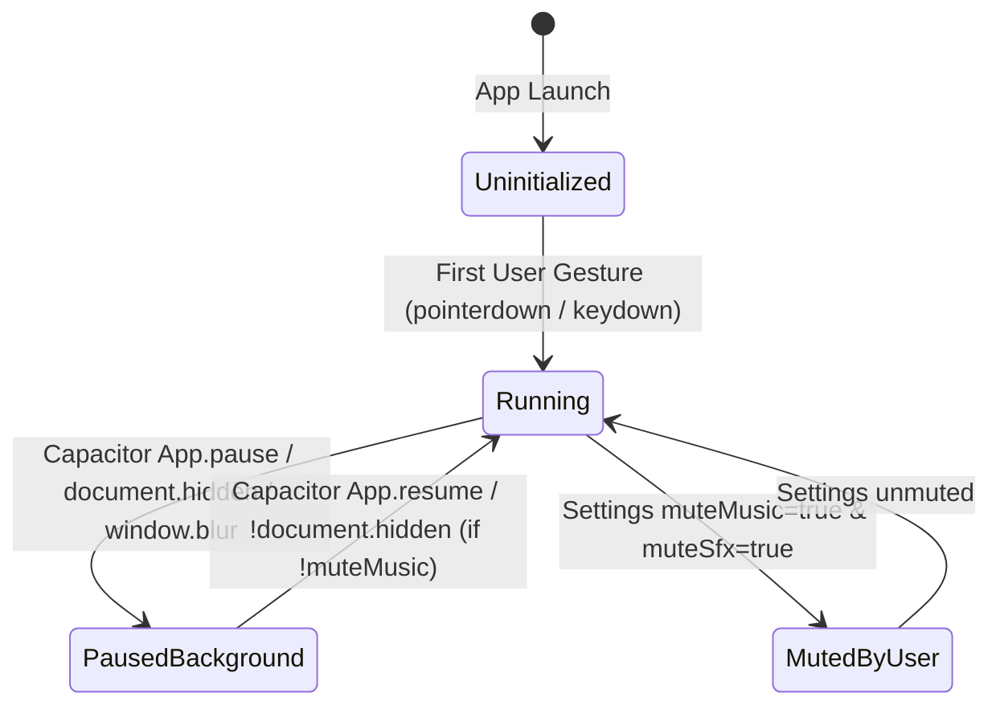

# Connectify Android — Game Feel, Animation & Audio Specification

**Author:** AGENT 09 — Game Feel, Animation & Audio Specialist (`@game-feel`)  
**Source Repository Audited:** `/root/.gemini/antigravity/scratch/connectify-new` (READ-ONLY)  
**Target Android Repository:** `/root/.gemini/antigravity/scratch/connectify-android`  
**Target Games:** Onet Connect & Match 3  

---

## 1. Executive Summary & Audit Findings

An exhaustive audit of `/root/.gemini/antigravity/scratch/connectify-new` revealed the following architecture for audio, animations, particles, and haptics:

1. **Zero Static Audio Files (`0 bytes` of `.mp3`/`.wav`/`.ogg`):**
   - `connectify-new` uses a **100% procedural Web Audio API synthesizer** (`src/core/audio/ClubSynth.ts` wrapped by `src/core/audio/AudioEngine.tsx`).
   - All background music (BGM) and sound effects (SFX) are synthesized in real time on the device using `AudioContext`, `OscillatorNode`, `GainNode`, and `DynamicsCompressorNode`. This results in zero audio asset download overhead, zero decoding latency, and instant offline playback on Android WebView.
   - Static audio icon assets exist in `src/assets/vanilla/logo/` (`music_on.png`, `sound_on.png`, `sound_off.png`) and UI icons in `public/art/premium/ui/`.
2. **Two Distinct Onet Animation Systems (`OnetBoard.tsx` vs `backup_onet_animation/`):**
   - **Current Production (`src/game/components/OnetBoard.tsx` + `TileBurst.tsx`):** Uses a `480ms` match resolution window (`470ms` white outer path + `460ms` themed inner path + `460ms` green target rect outline), multi-footprint tile splitting (`2x2 -> 1x2 -> 1x1`) with clip-path half-tile separation (`duration: 0.46s`), and `TileBurst.tsx` (ring expansion + 8 deterministic particles or cosmetic sprite particles + 4 clip-path image shards on `1x1` clear).
   - **Backup Restoration System (`backup_onet_animation/OnetBoard.tsx`, `ConnectAnimationSnippet.tsx`, `useOnetGame_animation_logic.ts`, `src/game/components/OnetBoard.backup.tsx`):** Uses a `600ms` choreographed sequence featuring directional rounded-rectangle SVG rings (`generateRingPath` starting from the exit/entry edge `getStartSide`) around Tile A (`0–100ms`), a smooth quadratic-bezier rounded polyline (`generateRoundedPath`, `100–280ms`, ease `[0.22, 1, 0.36, 1]`), Tile B ring draw (`280–380ms`), and synchronized ring pulse + tile pop/shrink (`380–580ms`).
   - **Target Synthesis for Connectify Android:** We will combine the **best of both systems**—preserving the `backup_onet_animation` directional rounded-corner SVG path (`generateRoundedPath` + `generateRingPath` dual-ring choreography) alongside the production `TileBurst` particle/shard system, multi-tile split animation (`split-tile-half`), and equipped cosmetic particle support (`GameParticles.tsx`).
3. **Match 3 Absence in `connectify-new`:**
   - `connectify-new` currently implements Onet (`src/game/GameplayScreen.tsx`), Block Puzzle (`src/game/block-puzzle/`), Memory Flip (`src/game/minigames/MemoryGame.tsx`), Triple Match tile-stack (`src/game/minigames/TripleGame.tsx`), and Star Patrol / Infinity (`src/game/star-patrol/`).
   - A true grid-swap **Match 3** engine is being built for `connectify-android`. Section 4 defines the complete, frame-accurate timing, spring physics, cascade gravity acceleration, and special tile FX choreography for Match 3, plus new procedural SFX patterns in `ClubSynth` for swaps, cascade combos, and special tile detonations.
4. **Haptics Audit:**
   - Currently, `connectify-new` has only a single haptics call across the entire codebase: `if(profile.settings?.haptics!==false) navigator.vibrate?.(12);` at `src/game/hooks/useOnetGame.ts:67`, and no haptics toggle in `SettingsScreen.tsx`.
   - Section 5 defines a complete Android Haptics system bridging `@capacitor/haptics` with `navigator.vibrate` fallback and a dedicated user toggle in Settings.

---

## 2. Complete Inventory of Existing Audio, Particles & Animation Systems

### 2.1 Web Audio Synthesizer & Sound Manager (`src/core/audio/`)

| File | Responsibility | Key Implementation Details |
| :--- | :--- | :--- |
| `src/core/audio/ClubSynth.ts` | Procedural Web Audio synthesizer for BGM & SFX | Uses `window.AudioContext || webkitAudioContext`, routes `music` (`GainNode`) and `sfx` (`GainNode`) through a `DynamicsCompressorNode` (`threshold: -18dB`, `ratio: 3:1`) to `context.destination`. |
| `src/core/audio/AudioEngine.tsx` | React Context provider (`AudioProvider`) & hook (`useAudio`) | Persists `AudioSettings` to `localStorage` under key `'sweetConnectAudioSettings'` (`defaults: { musicVol: 45, sfxVol: 65, muteMusic: false, muteSfx: false }`). Auto-unlocks audio on `pointerdown` / `keydown` and auto-plays `'click'` SFX when clicking any `button,[role="button"]`. Suspends/resumes on `document.visibilitychange`. |

#### 2.1.1 Existing Background Music (BGM) Tracks in `ClubSynth.ts`

`ClubSynth.schedule()` runs on a `100ms` `setInterval` lookahead scheduler (`while (this.next < c.currentTime + 0.18)`), stepping through a 16-step sequence (`n = step % 16`) across a 4-bar chord progression (`bar = Math.floor(step / 16) % 4`, C major -> A minor -> F major -> G major: `[[48,55,64], [45,52,60], [41,48,57], [43,50,59]]`).

| Scene Key | Triggered On Screens (`src/App.tsx:20`) | Tempo (BPM) | Eighth-Note Beat (`60/tempo/2`) | 16-Step MIDI Melody Array (`0` = rest) | Voicing & Envelope |
| :--- | :--- | :--- | :--- | :--- | :--- |
| `'menu'` | Lobby, GameHub, Shop, Collection, Profile, Settings, Achievements, Themes | `84 BPM` | `357.1ms` (`0.357s`) | `[72, 0, 76, 79, 0, 76, 74, 0, 72, 76, 0, 81, 79, 0, 76, 74]` (C5–E5–G5–E5–D5–C5–E5–A5–G5–E5–D5) | Lead: `'triangle'` (`dur: 0.6s`, `vol: 0.09`) + delayed echo `'sine'` at `+0.65 * beat` (`dur: 0.45s`, `vol: 0.025`). Chords every 8 steps (`dur: beat*7`, `vol: 0.055`). Bass pulse `58Hz` every 4 steps (`dur: 0.13s`, `vol: 0.1`). |
| `'game'` | `play` (Onet), `block-puzzle`, `memory`, `triple`, `star-patrol`, `multiplayer` | `102 BPM` | `294.1ms` (`0.294s`) | `[72, 79, 76, 0, 74, 81, 79, 0, 76, 79, 84, 0, 81, 79, 74, 0]` (C5–G5–E5–D5–A5–G5–E5–G5–C6–A5–G5–D5) | Same multi-voice arrangement at `102 BPM` for energetic puzzle focus. |
| `'off'` | `boot`, `login` | — | — | Muted (`music.gain.setTargetAtTime(0, now, 0.15)`) | Scheduler halts when `scene === 'off'`. |

**Gain Scaling Constants (`ClubSynth.apply`):**
- **Music Bus Gain:** `muteMusic || scene === 'off' ? 0 : (musicVol / 100) * 0.38` (smoothed with `setTargetAtTime(..., now, 0.15)`).
- **SFX Bus Gain:** `muteSfx ? 0 : (sfxVol / 100) * 0.65` (smoothed with `setTargetAtTime(..., now, 0.03)`).
- **Per-Note ADSR Envelope (`ClubSynth.note`):** Linear attack from `0` to `volume` in `15ms` (`start + 0.015`), exponential decay to `0.0001` at `start + duration`, oscillator stop at `start + duration + 0.03`.

#### 2.1.2 Existing Sound Effects (SFX) Inventory in `ClubSynth.ts`

Every SFX pattern in `ClubSynth.sound(key)` is an array of frequencies (in Hz) arpeggiated at **`65ms` intervals** (`t + i * 0.065`):

| SFX Key | Frequencies (Hz) | Musical Notes | Note Duration | Note Volume | Waveform | Where Triggered in `connectify-new` |
| :--- | :--- | :--- | :--- | :--- | :--- | :--- |
| `'click'` | `[660]` | E5 | `55ms` (`0.055s`) | `0.06` | `'triangle'` | Global `pointerdown`/`keydown` on `button,[role="button"]` (`AudioEngine.tsx:11`), `StartupScreen.tsx:35`, `MissionPanel.tsx:39`, `MemoryGame.tsx:27` |
| `'place'` | `[240, 360]` | B3 -> F#4 | `180ms` (`0.18s`) | `0.14` | `'triangle'` | Block Puzzle piece placement (`useBlockPuzzle.ts:417`) |
| `'match'` | `[659, 880]` | E5 -> A5 (Perfect 4th) | `180ms` (`0.18s`) | `0.14` | `'triangle'` | Onet pair match (`useOnetGame.ts:67`), Star Patrol enemy kill & pickup (`StarScene.ts:62,74`) |
| `'split'` | `[440, 659, 988]` | A4 -> E5 -> B5 | `180ms` (`0.18s`) | `0.14` | `'triangle'` | Onet large tile (`2x2` or `1x2`/`2x1`) splitting into smaller pairs (`useOnetGame.ts:71`) |
| `'clear'` | `[523, 659, 784]` | C5 -> E5 -> G5 (C Maj triad) | `180ms` (`0.18s`) | `0.14` | `'triangle'` | Block Puzzle single-line clear (`useBlockPuzzle.ts:313`) |
| `'combo'` | `[659, 784, 988, 1319]` | E5 -> G5 -> B5 -> E6 | `180ms` (`0.18s`) | `0.14` | `'triangle'` | Block Puzzle multi-line clear (`useBlockPuzzle.ts:313`), Settings audio preview (`SettingsScreen.tsx:130`) |
| `'win'` | `[523, 659, 784, 1047, 1319]` | C5 -> E5 -> G5 -> C6 -> E6 | `450ms` (`0.45s`) | `0.14` | `'triangle'` | Onet level win (`useOnetGame.ts:46`), Block Puzzle win (`useBlockPuzzle.ts:108`) |
| `'lose'` | `[440, 349, 294]` | A4 -> F4 -> D4 (Descending) | `180ms` (`0.18s`) | `0.14` | `'triangle'` | Onet timeout loss (`useOnetGame.ts:46`), Block Puzzle game over (`useBlockPuzzle.ts:161`) |
| `'wrong'` | `[185, 165]` | F#3 -> E3 (Low dissonance) | `180ms` (`0.18s`) | `0.14` | `'sine'` | `audio.playWrong()` helper (`AudioEngine.tsx:18`) — *Note: currently not called on Onet invalid path! Must be wired in Phase 3.* |
| `'shuffle'` | `[392, 494, 587]` | G4 -> B4 -> D5 (G Maj triad) | `180ms` (`0.18s`) | `0.14` | `'triangle'` | Onet board shuffle (`useOnetGame.ts:101`) |
| `'purchase'` | `[784, 988, 1175]` | G5 -> B5 -> D6 | `180ms` (`0.18s`) | `0.14` | `'triangle'` | Shop item purchase (`ShopPanel.tsx:25`) |

> **Audit Bug Identified — Unmapped SFX Keys:**
> Several components call `audio.playSfx(...)` with keys that do not exist in `ClubSynth.patterns` and therefore silently fall back to `patterns.click` (`[660]`):
> - `'uiReward'` in `AchievementPanel.tsx:20` and `LoginRewardCard.tsx:15`
> - `'uiMatch'` in `MemoryGame.tsx:29`
> - `'error'` in `StarScene.ts:66`
> In `connectify-android`, `ClubSynth.patterns` will explicitly define `'uiReward'`, `'error'`, and all new Match 3 & Onet SFX keys so no event degrades to a generic click.

---

### 2.2 Particle & Visual Effect Assets Inventory (`public/art/premium/effects/`)

All particle/effect sprites are lightweight WebP assets in `/public/art/premium/effects/`:

| Asset Path | Cosmetic ID(s) (`src/core/cosmetics.js`) | Motion Class | Accent Color | Usage |
| :--- | :--- | :--- | :--- | :--- |
| `/art/premium/effects/blossom.webp` | `effect_blossom` (Default Victory Effect) | `celebrate` | `#f59bb5` | `VictoryBurst.tsx` (24 falling petals on win modal) |
| `/art/premium/effects/stars.webp` | `effect_stars` | `celebrate` | `#ffd783` | `VictoryBurst.tsx` (24 falling stars on win modal) |
| `/art/premium/effects/confetti.webp` | `effect_confetti` | `celebrate` | `#71d1b2` | `VictoryBurst.tsx` (24 falling confetti ribbons on win modal) |
| `/art/premium/effects/autumn.webp` | `anim_onet_autumn`, `anim_block_autumn` | `motion-drift` | `#ce7c35` | `GameParticles.tsx` (8 radially drifting autumn leaves on match) |
| `/art/premium/effects/magic.webp` | `anim_onet_magic`, `anim_block_magic` | `motion-orbit` | `#a178cb` | `GameParticles.tsx` (8 orbiting arcane sparkles on match) |
| `/art/premium/effects/pixel.webp` | `anim_onet_pixel`, `anim_block_pixel` | `motion-pop` | `#438bc1` | `GameParticles.tsx` (8 stepped 8-bit pop particles on match) |
| `/art/premium/effects/snow.webp` | `anim_onet_snow`, `anim_block_snow` | `motion-bloom` | `#53b4cb` | `GameParticles.tsx` (8 blooming frost crystals on match) |

---

### 2.3 Existing Animation Components & CSS Keyframes Inventory

| Component / File | Animation System | Timing, Easing & Visual Behavior |
| :--- | :--- | :--- |
| `src/game/components/TileBurst.tsx` | Onet match particle burst + tile shatter | **1. Burst Ring (`.burst-ring`):** `34x34px` circle, `scale: 0.2 -> 1.4` (`2.0` if multi-cell tile `tier > 1`), `opacity: 0.8 -> 0`, `duration: 450ms` (`0.45s`).<br>**2. Deterministic Particles (8x `.burst-particle`):** When no custom `onetAnimation` cosmetic is equipped, spawns 8 shapes (`circle`, `4-point star`, `rounded-rect`, `triangle`) radially (`distance = size * (0.38 + (i%3)*0.12)`), `y: +9px` gravity drift, `scale: [0, 1, 0]`, `rotate: ±120deg`, `duration: 470ms` (`0.47s`), `delay: (i%2)*20ms`.<br>**3. Image Shards (4x `.image-shard`):** On `1x1` tiles (`tier === 1`), splits the tile image into 4 `clip-path` quadrants that fly outward `±0.3 * size` in X/Y with `rotate: ±22deg`, `scale: 0.9 -> 0.4`, `opacity: 0.9 -> 0`, `duration: 440ms` (`0.44s`). |
| `src/components/GameParticles.tsx` + `src/seasonal-club.css:16-20` | Cosmetic sprite burst (8 sprites) | Spawns `count=8` `19x19px` `` elements at `angle = i/count * 2π`, `--dx: cos(angle)*42px`, `--dy: sin(angle)*38px`, `--spin: ±130deg`, staggered `animation-delay: i * 12ms` (`0.012s`), `duration: 460ms` (`0.46s`, `ease-out`). Supports 4 CSS keyframe motions: `particle-drift` (+20px Y gravity), `particle-orbit` (`-90deg -> +100deg` spiral), `particle-pop` (`steps(5)` retro), and `particle-bloom` (`scale(0 -> 1.4)` + `60deg` rotation). |
| `src/components/VictoryBurst.tsx` + `src/club-v3.css:13-15` | Fullscreen victory rain (24 sprites) | Fixed overlay (`z-index: 300`), 24 `<i>` elements (`25x25px` bitmap sprites) distributed horizontally at `left: 3 + (i * 23) % 91%`, `animation: celebrate 2.3s cubic-bezier(0.15, 0.7, 0.45, 1) both`, staggered `animation-delay: (i % 6) * 90ms` (`0.09s`), falling from `-20px` to `90dvh` with `340deg` rotation. |
| `src/game/components/MatchCountdown.tsx` | `3 -> 2 -> 1 -> GO!` overlay | `AnimatePresence mode="wait"` spring pop per second: `initial: { scale: 0.5, opacity: 0 }`, `animate: { scale: 1.2, opacity: 1 }`, `exit: { scale: 2, opacity: 0 }`, `transition: { type: 'spring', stiffness: 400, damping: 20, duration: 0.3 }`. |
| `src/designs/KineticComponents.tsx` & `KineticPopups.tsx` | Tactile Neo-Brutalist / Club UI buttons & modals | **Buttons:** `whileHover: { scale: 1.02 }`, `whileTap: { scale: 0.95 }`, active press translates `(2px, 3px)` and collapses hard drop shadow.<br>**Modals (`KineticModal` / `OnetModals`):** `initial: { scale: 0.92, y: 15, opacity: 0 }`, `animate: { scale: 1, y: 0, opacity: 1 }`, `exit: { scale: 0.94, y: 16, opacity: 0 }`, `transition: { type: 'spring', damping: 23, stiffness: 320 }`. |
| `src/index.css:230`, `src/seasonal-club.css:29` | Accessibility (`prefers-reduced-motion`) | Uses `useReducedMotion()` from `motion/react` and `@media (prefers-reduced-motion: reduce)` to suppress bursts, particle loops, and long transitions when requested by Android system accessibility settings. |

---

## 3. Onet Connect — Timing, Easing & Choreography Specification

To maximize tactile satisfaction ("juice") while keeping input snappy and non-blocking, Connectify Android standardizes the Onet animation pipeline by merging the **rounded-path & dual-ring SVG choreography** from `backup_onet_animation/` with the **particle/shard burst & split-domino physics** from `src/game/components/OnetBoard.tsx`.

### 3.1 Master Timing Table (Onet Connect)

| Animation Event | Trigger Condition | Delay (`ms`) | Duration (`ms`) | Easing / Spring Curve | Transform / Visual Properties |
| :--- | :--- | :--- | :--- | :--- | :--- |
| **Tile Tap Scale Bounce** | Player taps any valid selectable tile | `0ms` | `~140ms` | `whileTap: { scale: 0.92 }`, release spring `{ type: 'spring', stiffness: 400, damping: 22 }` | Active tile gains `#f59e0b` (amber) `3.5px` outline + elevated shadow; scales down to `0.92` on pointer down and rebounds to `1.0` with slight overshoot (`~1.03`). |
| **Invalid Match / Blocked Direction Shake** | Path > 2 turns, blocked by tiles, or closed directional gate (`openSide`) | `0ms` | `400ms` | Linear keyframes (`times: [0, 0.15, 0.3, 0.45, 0.6, 0.75, 0.9, 1]`) | Horizontal shake `x: [0, -10, 10, -8, 8, -4, 4, 0]`, outline flashes `#ef4444` (red) with `0 0 12px rgba(239,68,68,0.8)` glow. Clears `directionErrorTiles` at `400ms`. |
| **Hint Pulse Loop** | Player activates Hint booster | `0ms` | `1000ms` (infinite loop) | `ease-in-out` (`repeat: Infinity`) | Both hinted tiles (`p1`, `p2`) pulse `opacity: [1, 0.6, 1]` and `scale: [1, 1.04, 1]` with `#10b981` (emerald) `3.5px` outline until matched or board changes. |
| **Path Step 1: Origin Ring A Draw** | Valid match pair selected (`t = 0ms`) | `0ms` | `90ms` | `linear` | Rounded-rect SVG ring (`generateRingPath`, radius `8px`, offset `+2px` outside tile) draws around Tile A (`pathLength: 0 -> 1`) starting from exit side (`getStartSide(dx, dy)`). Outer white stroke (`lineWidth + 4`), inner theme/cosmetic stroke (`lineWidth = clamp(4, tileSize*0.1, 7)`). |
| **Path Step 2: Lightning / Rounded Line Travel** | Valid match pair selected (`t = 80ms`) | `80ms` | `170ms` | `cubic-bezier(0.22, 1, 0.36, 1)` | Smooth rounded-corner polyline (`generateRoundedPath`, corner radius `max(10, lineWidth * 1.5)`) shoots from Tile A edge to Tile B edge (`pathLength: 0 -> 1`). Skipped if tiles are orthogonally adjacent (`dist <= 2 * cutDist + 1`). |
| **Path Step 3: Target Ring B Draw** | Line reaches Tile B (`t = 250ms`) | `250ms` | `90ms` | `linear` | Rounded-rect SVG ring draws around Tile B (`pathLength: 0 -> 1`) starting from entry side (`getStartSide`). |
| **Path Step 4: Rings & Line Fade Out** | Both rings completed (`t = 340ms`) | `340ms` | `180ms` | `easeInOut` (scale) / `linear` (opacity) | Rings A & B pulse `scale: [1, 1.08]` while `opacity: [1, 0]`; main connection line fades `opacity: [1, 0]` (`340–520ms`). |
| **Match Tile Pop & Disappear (`1x1` Clear)** | Tile pair is `1x1` (`action === 'clear'`) | `300ms` | `200ms` | `easeInOut` | Tile pops and shrinks: `scale: [1, 1.15, 0]`, `rotate: [0, -5, 5, 0]`, `y: [0, -8]`, `opacity: [1, 1, 0]`. Total match lock ends at `500ms`. |
| **Multi-Tile Split Choreography (`2x2 -> 1x2` or `1x2 -> 1x1`)** | Tile pair is `2x2` or `1x2`/`2x1` (`action !== 'clear'`) | `260ms` | `240ms` | `cubic-bezier(0.16, 1, 0.3, 1)` | Parent tile splits along `cutVertical` using two `clip-path` halves (`inset(0 50% 0 0)` / `inset(0 0 0 50%)` or top/bottom), separating `±9px` with `±3deg` rotation. Child tiles spawn with `justSplit`: `initial: { scale: 0.72, opacity: 0.3, x: splitFromX * size * 0.3, y: splitFromY * size * 0.3 }` -> spring into grid cell (`stiffness: 380, damping: 20`). |
| **Match Burst Particles (`TileBurst`)** | Triggered at Tile A & Tile B centers (`t = 280ms`) | `280ms` | `460ms` | `ease-out` | Spawns expanding `.burst-ring` (`scale: 0.2 -> 1.4/2.0`, `450ms`), 8 themed `.burst-particle` elements (or equipped `GameParticles` cosmetic sprite), plus 4 `.image-shard` quadrants (`440ms`) for `1x1` tiles. |
| **Combo & Split Floating Banner (`.onet-combo`)** | `combo > 1` (`"Combo ×N"`) or tile split (`"Pecah! Dua gambar baru"` / `"Pop! Cari pasangan barunya"`) | `0ms` | `550ms` | `cubic-bezier(0.22, 1, 0.36, 1)` | Spawns at board center/match midpoint: `initial: { y: 8, opacity: 0, scale: 0.75 }` -> `animate: { y: -26, opacity: [0, 1, 1, 0], scale: [0.75, 1.08, 1] }`. |
| **Board Shuffle Choreography (Manual & Auto-Deadlock)** | Player taps Shuffle booster OR deadlock detected (`!findHint(board)`) | Auto: `350ms` toast pre-delay; Manual: `0ms` | `420ms` | `cubic-bezier(0.34, 1.56, 0.64, 1)` (overshoot spring) | **Phase A (`0–160ms`):** Remaining `1x1` tiles contract toward board center (`scale: 1 -> 0.78`, `rotate: ±6deg`, `opacity: 0.6`).<br>**Phase B (`160ms`):** `guaranteedShuffle()` swaps tile coordinates deterministically.<br>**Phase C (`160–420ms`):** Tiles rebound from `scale: 0.78 -> 1.0` with staggered delay `(r + c) * 12ms` and spring damping. |

### 3.2 Input Responsiveness Rule (Onet)
- In `connectify-new/src/game/hooks/useOnetGame.ts:65`, `lock.current = true` currently blocks selecting the next pair for the full `480ms` animation.
- **Improvement for Connectify Android:** Mirroring the design in `backup_onet_animation/useOnetGame_animation_logic.ts:40`, `selected` is cleared immediately (`setSelected(null)`), and **only the two currently matching tile coordinates (`matchingTiles`) are locked from interaction** while their `500ms` animation finishes. The player can immediately tap a new tile for their next pair during an active connect animation, enabling fast chain combos!

---

## 4. Match 3 — Timing, Easing & Visual FX Specification

Connectify Android introduces a first-class **Match 3** mode sharing the tactile "Connectify Club" art direction (warm paper surfaces, crisp `#172337` borders, themed tile sprites from `activeTheme.assets.tiles`, and equipped `GameParticles` cosmetics).

### 4.1 Master Timing Table (Match 3)

| Animation Event | Trigger Condition | Delay (`ms`) | Duration (`ms`) | Easing / Physics Curve | Transform / Visual Choreography |
| :--- | :--- | :--- | :--- | :--- | :--- |
| **Tile Touch & Select Bounce** | Player taps or starts dragging a tile (`r, c`) | `0ms` | `120ms` | `type: 'spring', stiffness: 450, damping: 22` | Selected tile elevates (`z-index: 10`), scales to `1.08` (or `0.93` while finger held down), and displays `#f59e0b` selection ring. Dragging past `35%` of `cellSize` in any cardinal direction immediately triggers a swap attempt. |
| **Valid Tile Swap Spring** | Orthogonal swap (`|dr| + |dc| === 1`) results in >= 1 match or special tile combo | `0ms` | `180ms` | `type: 'spring', stiffness: 380, damping: 26, mass: 0.8` | Tile A and Tile B translate across `(dx * step, dy * step)`. Foreground tile scales `[1, 1.12, 1]` (`z-index: 12`), background tile scales `[1, 0.90, 1]` (`z-index: 8`) to create a 3D cross-over arc. |
| **Invalid Swap Double-Back & Shake** | Orthogonal swap produces `0` matches and neither tile is a universal booster | `0ms` | `320ms` total (`140ms` out + `140ms` back + `40ms` settle) | Out: `cubic-bezier(0.25, 1, 0.5, 1)`<br>Back: `cubic-bezier(0.36, 0, 0.66, -0.56)` | Tiles slide `75%` of the way toward each other (`0–140ms`), collide with a red border flash (`#ef4444`), spring back to their original cells (`140–280ms`), and execute a micro-shake `x: [-4, 4, -2, 0]` (`280–320ms`). |
| **Match-3 Pop & Dissolve** | 3 matching tiles aligned horizontally or vertically | `180ms` (after swap finishes) | `220ms` | `cubic-bezier(0.34, 1.56, 0.64, 1)` (anticipation + pop) | ** Phase 1 (`0–70ms`):** Squash & swell `scale: 1.0 -> 1.18`, brightness `1.35`.<br>**Phase 2 (`70–220ms`):** Implode `scale: 1.18 -> 0.15`, `opacity: 1 -> 0`, `rotate: ±8deg`. Spawns `TileBurst` (6 particles + ring) at each cleared cell. |
| **Match-4 / Match-5 / L-Shape / T-Shape Merge-to-Special** | 4+ tiles matched (spawns Striped, Bomb/Wrapped, or Rainbow/Color Booster at swap target cell) | `180ms` | `260ms` | `cubic-bezier(0.22, 1, 0.36, 1)` | Non-anchor matched tiles slide into the swap anchor coordinate `(targetR, targetC)` over `160ms` (`scale: 1 -> 0.5`, `opacity: 1 -> 0.2`) instead of popping in place. At `160ms`, the new Special Tile spawns at `(targetR, targetC)` with an elastic scale burst `scale: [0.3, 1.28, 0.95, 1.0]` (`100ms`) and golden shockwave ring. |
| **Cascade Gravity Drop Acceleration** | Empty cells exist below existing tiles or newly spawned top-row tiles | `40ms` after match pop starts (`overlap!`) | `sqrt(dropCells) * 95ms` (clamped `110ms–310ms`) | Drop: `cubic-bezier(0.45, 0, 0.85, 0.35)` (gravity `g` acceleration)<br>Landing bounce: `spring(stiffness: 500, damping: 24)` | Tiles accelerate downward under simulated gravity (`t = sqrt(2 * d / g)`):<br>• 1 cell drop: `110ms`<br>• 2 cells drop: `145ms`<br>• 4 cells drop: `200ms`<br>• 8 cells drop: `280ms`<br>New tiles spawn above row `0` at `y = -spawnDepth * step`. Per-column stagger `c * 12ms` prevents robotic flat movement. On landing, tiles compress `scaleY: 0.88, scaleX: 1.10 -> 1.0` over `70ms`. |
| **Cascade Re-Evaluation Pause** | All falling columns settle | `0ms` | `60ms` | — | Brief `60ms` perceptual breath after landing bounce before auto-popping the next cascade wave (`combo++`). |
| **Special Tile Activation FX:** | | | | | |
| **1. Row / Column Line Blaster (Match-4 Striped)** | Striped tile matched or tapped | `0ms` | `280ms` | `cubic-bezier(0.16, 1, 0.3, 1)` | High-contrast laser beam (`height: 60% cellSize` for row, `width: 60% cellSize` for col, core `#ffffff`, outer glow `#38bdf8`/`#f472b6`) expands from origin across full board width/height (`scaleX` or `scaleY: 0.1 -> 1.0` in `120ms`, fades `120–280ms`). Tiles along the line pop with staggered delay `|distFromOrigin| * 22ms`. |
| **2. Area Bomb / Wrapped Tile (L/T-Match `3x3` Blast)** | Wrapped tile matched or tapped | `0ms` | `340ms` | `cubic-bezier(0.22, 1, 0.36, 1)` | Tile swells `scale: 1 -> 1.35` with white flash (`0–80ms`), then detonates a `3x3` radial shockwave ring (`scale: 0.2 -> 2.8`, border `4px solid #fbbf24`, `80–340ms`). Board container executes a micro-screen-shake (`translate: ±4px` for `140ms`). All 9 cells in `3x3` shatter simultaneously. |
| **3. Color / Rainbow Bomb (Match-5)** | Swapped with any colored tile `T` | `0ms` | `520ms` | Beams: `cubic-bezier(0.22, 1, 0.36, 1)` | **Phase A (`0–240ms`):** Rainbow tile spins (`rotate: 360deg`) and fires SVG lightning arcs to every tile of type `T` on the board (`pathLength: 0 -> 1`, staggered `25ms` per target).<br>**Phase B (`240–380ms`):** All targeted tiles jitter (`scale: 1.15`, `x: ±3px`) and glow.<br>**Phase C (`380–520ms`):** All targeted tiles pop simultaneously with `TileBurst` particles before cascade gravity begins. |
| **4. Special + Special Combo (e.g., Striped + Bomb)** | Two special tiles swapped together | `0ms` | `450ms` | `cubic-bezier(0.16, 1, 0.3, 1)` | Merges into a `3-row + 3-column` giant cross-beam sweep (`width/height: 3 * step`) with `±6px` board shake and double combo banner. |

---

## 5. Expanded Procedural Audio Inventory for Onet & Match 3 (`ClubSynth` v2)

To give both **Onet** and **Match 3** rich, unmistakable audio feedback while maintaining `connectify-new`'s 100% offline, zero-asset procedural Web Audio architecture, `ClubSynth.ts` will retain all 11 original SFX patterns and add the following specialized patterns:

| SFX Key | Frequencies (Hz) | Step Interval | Note Duration | Volume | Waveform | Trigger Event |
| :--- | :--- | :--- | :--- | :--- | :--- | :--- |
| `'select'` | `[523, 659]` (C5 -> E5) | `40ms` | `65ms` | `0.08` | `'triangle'` | Tile selected in Onet or Match 3 |
| `'swap'` | `[392, 523]` (G4 -> C5) | `45ms` | `85ms` | `0.10` | `'sine'` | Match 3 tile swap initiated |
| `'invalid'` / `'wrong'` | `[185, 165]` (F#3 -> E3) | `65ms` | `180ms` | `0.14` | `'sine'` | Invalid Onet path / blocked direction OR invalid Match 3 swap bounce-back |
| `'match'` | `[659, 880]` (E5 -> A5) | `65ms` | `180ms` | `0.14` | `'triangle'` | Standard Onet pair clear OR Match 3 3-tile clear (`combo === 1`) |
| `'cascade_2'` | `[740, 988]` (F#5 -> B5) | `60ms` | `180ms` | `0.15` | `'triangle'` | Pitch-shifted cascade / combo step `2` (`+2` semitones) |
| `'cascade_3'` | `[831, 1109]` (G#5 -> C#6) | `55ms` | `190ms` | `0.16` | `'triangle'` | Pitch-shifted cascade / combo step `3` (`+4` semitones) |
| `'cascade_4plus'` | `[880, 1175, 1480]` (A5 -> D6 -> F#6) | `50ms` | `210ms` | `0.17` | `'triangle'` | High cascade / combo step `>= 4` (`+5` semitones + triad) |
| `'special_spawn'` | `[587, 880, 1175, 1760]` (D5 -> A5 -> D6 -> A6) | `45ms` | `220ms` | `0.15` | `'triangle'` | Match-4 / Match-5 / L / T spawns a Special Tile |
| `'line_blast'` | `[1319, 988, 659, 440, 880, 1319]` | `30ms` | `240ms` | `0.16` | `'sawtooth'` (filtered low-gain `0.09` + `'triangle'` `0.12`) | Match 3 Striped row/column laser activation |
| `'bomb_blast'` | `[147, 110, 82, 523, 784]` (Low punch + sparkle) | `40ms` | `280ms` | `0.18` | `'triangle'` | Match 3 Wrapped `3x3` bomb detonation |
| `'rainbow_zap'` | `[523, 659, 784, 988, 1175, 1319, 1568]` | `35ms` | `260ms` | `0.16` | `'triangle'` | Match 3 Color/Rainbow bomb lightning arc sweep |
| `'hint'` | `[784, 1047]` (G5 -> C6) | `70ms` | `160ms` | `0.12` | `'sine'` | Hint booster activated in Onet or Match 3 |
| `'uiReward'` | `[523, 659, 784, 1047]` (C5 -> E5 -> G5 -> C6) | `55ms` | `240ms` | `0.14` | `'triangle'` | Achievement claim, daily login reward, chest open (fixes silent fallback in `connectify-new`) |

**Dynamic Combo Pitch Scaling Formula:**
For consecutive combos (`chain >= 1` in Onet or `cascade >= 1` in Match 3), `ClubSynth` will also support `playComboMatch(chain: number)` which transposes the base `[659, 880]` match interval upward by `Math.min(chain - 1, 8)` semitones (`freq * Math.pow(2, semitones / 12)`), creating the classic rising musical scale that rewards streaks!

---

## 6. Android Haptics Integration Plan

### 6.1 Dual-Layer Architecture (`@capacitor/haptics` + Web Vibration API Fallback)

On Android inside Capacitor WebView, `@capacitor/haptics` provides crisp native `VibrationEffect` primitives (`Haptics.impact`, `Haptics.notification`, `Haptics.vibrate`), while standard mobile browsers and older WebViews support `navigator.vibrate(pattern)`. Our Haptics Manager (`src/core/audio/HapticsEngine.ts`) wraps both seamlessly and respects both user settings and Android system battery-saver/silent policies.

### 6.2 Haptic Event Mapping Table

| Haptic Event Key | Gameplay Trigger | Capacitor Native Call (`@capacitor/haptics`) | Web Fallback (`navigator.vibrate`) | Tactile Feel Description |
| :--- | :--- | :--- | :--- | :--- |
| **`tileSelect`** (Light Tick) | Tapping/selecting first tile in Onet; touching/grabbing tile in Match 3; UI toggle switch | `Haptics.impact({ style: ImpactStyle.Light })` | `navigator.vibrate(8)` | Crisp, subtle `8ms` mechanical tick confirming finger contact. |
| **`matchClear`** (Medium Impact) | Valid pair matched in Onet (`combo === 1`); standard 3-tile match in Match 3 | `Haptics.impact({ style: ImpactStyle.Medium })` | `navigator.vibrate(16)` | Solid `16ms` thud synchronized with tile pop (`t = 0ms` on Onet path lock, `t = 180ms` on Match 3 swap). |
| **`comboOrSpecial`** (Heavy / Double Pulse) | Onet combo (`combo >= 2`) or large tile split (`2x2`/`1x2`); Match 3 cascade (`>= 2`), Special Tile spawn, or Line/Bomb/Rainbow detonation | `Haptics.vibrate({ duration: 28 })` + `setTimeout(() => Haptics.impact({ style: ImpactStyle.Heavy }), 55)` | `navigator.vibrate([18, 35, 28])` | Energetic double-pulse (`18ms` pulse -> `35ms` gap -> `28ms` heavy punch) that amplifies streak and booster excitement. |
| **`invalidMove`** (Error Buzz) | Invalid Onet connection (>2 turns or blocked arrow direction); invalid Match 3 swap bounce-back; empty booster tap | `Haptics.notification({ type: NotificationType.Error })` | `navigator.vibrate([30, 45, 35])` | Distinct staccato double-buzz warning synchronized with the horizontal error shake animation. |
| **`levelVictory`** (Celebration Fanfare) | Level Won modal opens (`VictoryBurst`) | `Haptics.notification({ type: NotificationType.Success })` | `navigator.vibrate([20, 40, 20, 40, 50])` | Joyful 3-beat celebratory rhythm on level completion. |

### 6.3 User Toggle & Persistence Contract

1. **Settings State (`AudioSettings` & `PlayerProfile`):**
   - Extend `AudioSettings` in `src/core/audio/ClubSynth.ts` and `AudioEngine.tsx`:
     ```ts
     export interface AudioSettings {
       musicVol: number;     // 0 - 100 (default: 45)
       sfxVol: number;       // 0 - 100 (default: 65)
       muteMusic: boolean;   // default: false
       muteSfx: boolean;     // default: false
       hapticsEnabled: boolean; // default: true (synced with profile.settings.haptics)
     }
     ```
2. **Settings Screen UI (`src/screens/SettingsScreen.tsx`):**
   - Add a dedicated **Getaran Haptik (Haptics)** toggle switch (`data-testid="settings-haptics-toggle"`) in the Audio & Feel card right below `Musik Latar (BGM)` and `Efek Suara (SFX)`.
   - Toggling Haptics ON immediately fires a preview `tileSelect` light tick so the player feels immediate confirmation.
   - Rate-limiting guard: `HapticsEngine` enforces a `35ms` minimum cooldown between consecutive haptic triggers during rapid Match 3 cascades so the Android linear resonant actuator (LRA) never muddies into a continuous hum.

---

## 7. Android Audio Lifecycle Management

Mobile games on Android must strictly obey OS lifecycle rules: **zero audio leakage** when the user presses the Home button, switches apps, locks the screen, or receives an incoming phone call, and **instant, glitch-free resumption** when returning to the foreground.

### 7.1 Lifecycle State Machine



### 7.2 Lifecycle Hooks & Implementation Specification

1. **Dual Lifecycle Listeners (DOM + Capacitor Native):**
   - **`document.addEventListener('visibilitychange')`:** Immediately checks `document.hidden`.
   - **Capacitor `@capacitor/app` (`App.addListener('appStateChange', ({ isActive }) => ...)`):** Fires reliably on Android `onPause()` / `onStop()` and `onResume()`.
   - **`window.addEventListener('blur')` / `window.addEventListener('focus')`:** Catches multi-window / split-screen focus changes on Android tablets and foldables.

2. **Pause / Background Behavior (`onBackground()`):**
   - Immediately ramp `music` and `sfx` gain nodes to `0` (`gain.setValueAtTime(0, context.currentTime)`) to prevent any tail click.
   - Clear the `100ms` BGM lookahead scheduler (`clearInterval(this.timer); this.timer = null`) so no Web Audio nodes are queued while backgrounded.
   - Call `this.context.suspend().catch(() => {})` to release the Android audio focus and prevent battery drain.
   - Auto-pause active timed gameplay (`Onet` countdown timer and `Match 3` timed mode if applicable) via the existing `visibilitychange` pause handler (`setIsPaused(true)`).

3. **Foreground / Resume Behavior (`onForeground()`):**
   - When `isActive === true` and `!document.hidden`:
   - If `this.context.state === 'suspended'`, call `this.context.resume().catch(() => {})`.
   - Reset the BGM scheduler clock (`this.next = this.context.currentTime + 0.08`) so `while (this.next < c.currentTime + 0.18)` **never bursts a backlog of missed notes** accumulated while the app was backgrounded.
   - Restart `this.timer = setInterval(this.schedule, 100)` if not running.
   - Re-apply user volume settings (`this.apply(this.settings)`), smoothly ramping BGM back to `(musicVol / 100) * 0.38` over `150ms` (`setTargetAtTime`).

4. **Separate BGM & SFX Volume Sliders & Mute Toggles:**
   - **BGM Volume Slider (`musicVol: 0–100`):** Controls `this.music.gain` continuously (`0` to `0.38` max headroom before compressor). Setting `musicVol === 0` automatically behaves as muted BGM; dragging `musicVol > 0` while `muteMusic === true` automatically unmutes `muteMusic: false`.
   - **SFX Volume Slider (`sfxVol: 0–100`):** Controls `this.sfx.gain` continuously (`0` to `0.65` max headroom before compressor). Dragging `sfxVol > 0` while `muteSfx === true` automatically unmutes `muteSfx: false`.
   - **Persistence:** Saved atomically to both local storage (`sweetConnectAudioSettings`) and the unified offline Persistence Engine (`PlayerProfile.settings.audio`).

---

## 8. Clean TypeScript Interface Contract for Phase 3 & 4 Integration

```ts
// src/core/audio/types.ts

export type BgmScene = 'menu' | 'game' | 'off';

export type SfxKey =
  | 'click'
  | 'select'
  | 'swap'
  | 'place'
  | 'match'
  | 'split'
  | 'clear'
  | 'combo'
  | 'cascade_2'
  | 'cascade_3'
  | 'cascade_4plus'
  | 'special_spawn'
  | 'line_blast'
  | 'bomb_blast'
  | 'rainbow_zap'
  | 'hint'
  | 'shuffle'
  | 'purchase'
  | 'uiReward'
  | 'win'
  | 'lose'
  | 'wrong'
  | 'invalid';

export type HapticPatternKey =
  | 'tileSelect'      // Light tick (8ms)
  | 'matchClear'      // Medium impact (16ms)
  | 'comboOrSpecial'  // Heavy double pulse ([18, 35, 28]ms)
  | 'invalidMove'     // Error double buzz ([30, 45, 35]ms)
  | 'levelVictory';   // Celebration rhythm ([20, 40, 20, 40, 50]ms)

export interface AudioSettings {
  musicVol: number;        // 0..100, default 45
  sfxVol: number;          // 0..100, default 65
  muteMusic: boolean;      // default false
  muteSfx: boolean;        // default false
  hapticsEnabled: boolean; // default true
}

export interface AudioEngineContextValue {
  settings: AudioSettings;
  updateSettings: (patch: Partial<AudioSettings>) => void;
  playMenuBgm: () => void;
  playGameBgm: () => void;
  stopBgm: () => void;
  playSfx: (key: SfxKey) => void;
  playComboMatch: (comboCount: number) => void;
  playMatch: () => void;
  playWrong: () => void;
  playUiClick: () => void;
  triggerHaptic: (pattern: HapticPatternKey) => void;
}
```
