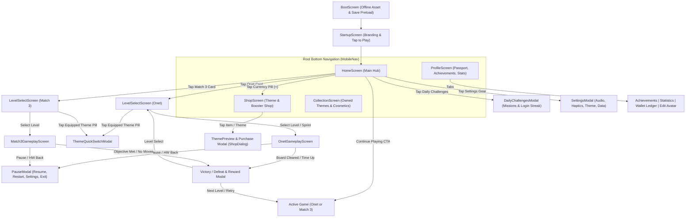

# Connectify Android — Mobile UI/UX Specification

**Document ID:** `UI_UX_SPECIFICATION.md`  
**Author:** Agent 08 — Senior Mobile Game UI/UX Engineer (`@ui-eng`)  
**Source Repository (Read-Only):** `/root/.gemini/antigravity/scratch/connectify-new`  
**Target Android Repository:** `/root/.gemini/antigravity/scratch/connectify-android`  
**Target Platform:** Android (Capacitor + React 18 + TypeScript + Tailwind CSS v4)

---

## 1. Executive Summary & Visual Identity

**Connectify Android** transforms the multi-game web portal in `connectify-new` into a cohesive, 100% offline-first, native-feeling Android puzzle game collection featuring **two flagship puzzle modes**:
1. **Onet Connect** (Classic & Daily Sprint tile-matching pathfinder puzzle)
2. **Match 3 Puzzle** (Grid-based swap, cascade, special-tile & objective puzzle)

Both games share a single unified meta-game:
- **Shared Player Profile & XP Rank Progression** (`Level 1` to `Level 50+` with club rank titles)
- **Shared Economy** (**Permen / Connect Coins** wallet, transparent transaction ledger, login streak rewards, daily/weekly missions, and tiered achievements)
- **Shared Theme & Cosmetic Ecosystem** (Unlockable and purchasable tile sets, board surfaces, match burst particle effects, and avatar portraits/frames usable across both Onet and Match 3)

### 1.1 "Connectify Play Club" Tactile Design Language
We preserve and elevate the signature **Connectify Play Club** neo-brutalist tactile aesthetic established in `connectify-new/src/index.css`, `club-v3.css`, and `game-hub.css`:
- **Surfaces & Ink Palette (Light & Dark Mode ready):**
  - Warm Paper Background (`--club-paper`: `#fffaf5` light / `#101b2b` dark) with subtle radial dot grid texture
  - Crisp Card Surface (`--club-card`: `#ffffff` light / `#1d2b3e` dark)
  - Deep Navy Ink Outlines & Text (`--club-ink` / `--club-line`: `#172337` light / `#f0f4f8` & `#62778f` dark)
  - Signature Club Accents:
    - **Rose / Coral Pink** (`--club-pink`: `#ffb9cd` / `#FF6B8A`) — Onet signature & primary energetic CTAs
    - **Mint Green** (`--club-mint`: `#c4efd9` / `#38c189`) — Match 3 signature, affirmative/win/claim actions
    - **Sunny Butter Yellow** (`--club-butter`: `#ffe6a7` / `#FFD84D`) — Currency, stars, hints, and reward highlights
    - **Sky Blue** (`--club-sky`: `#c8e7fa` / `#8FD3FF`) — Shuffle boosters, timers, and secondary actions
- **Tactile Geometry & Micro-Interactions:**
  - `2px` to `3px` solid ink borders (`border-2 border-[var(--club-line)]`)
  - Hard-edge offset drop shadows (`shadow-[3px_3px_0_var(--club-line)]` for cards/buttons, `shadow-[5px_5px_0_var(--club-line)]` for modals/heroes)
  - Active press physics: translating `2px` X / `3px` Y while collapsing shadow to `1px 2px 0` and scaling to `0.96` (`motion/react` spring `damping: 25, stiffness: 320`)
- **Typography:**
  - **Display & Numerals:** `'Fredoka', sans-serif` (weights 500–700) for headers, level numbers, scores, and button labels
  - **UI Body & Telemetry:** `'Outfit', sans-serif` (weights 500–800) for mission descriptions, eyebrows, and tabular-numeral HUD timers (`font-variant-numeric: tabular-nums`)

---

## 2. Frontend Audit of `connectify-new`: Reuse, Adaptation & Removal Matrix

### 2.1 Game Modes & Screens to Remove from Navigation
To deliver a tight, polished Android puzzle experience focused exclusively on **Onet** and **Match 3**, the following legacy game modes, screens, and dependencies from `connectify-new` **must be removed from navigation, routing, and build bundles**:

| Removed Feature / Mode | Source Files in `connectify-new` | Reason & Replacement Strategy |
| :--- | :--- | :--- |
| **Block Puzzle & Block Infinity** | `src/game/block-puzzle/**` (`BlockPuzzleScreen.tsx`, `MultiplayerBlockPuzzleGameplay.tsx`, `hooks/useBlockPuzzle.ts`, `core/levels.json`, `core/pcg.ts`, `core/dda.ts`) | Out of scope for Connectify Android. Note: UI patterns from `BlockPuzzleHeader.tsx` (3-star objective strip) and `BlockResults.tsx` (star objective breakdown) are adapted into the new Match 3 HUD and Result Modal. |
| **Memory Flip** | `src/game/minigames/MemoryGame.tsx` | Out of scope minigame; remove from `GAME_ORDER`, `DestinationScreen`, `StatistikScreen`, and mission/achievement pools. |
| **Triple Match (7-Slot Stack Collector)** | `src/game/minigames/TripleGame.tsx`, `src/game/minigames/useMiniRound.ts` | Replaced by the full grid-based **Match 3** puzzle game (`Match3Screen.tsx`). Remove `triple` stack-tray minigame. |
| **Infinity / Star Patrol (Space Shooter)** | `src/game/star-patrol/**` (`StarPatrolScreen.tsx`, `StarHangarScreen.tsx`, `StarArena.tsx`, `StarScene.ts`), `src/core/starPatrol.js`, `phaser` & `matter-js` | Arcade shooter is out of scope. Removing `star-patrol` also eliminates the heavy `phaser` and `matter-js` bundle dependencies. |
| **Online Multiplayer Rooms** | `src/screens/MultiplayerScreen.tsx`, `src/game/MultiplayerGameplay.tsx`, `src/core/hooks/useMultiplayer.ts`, `MultiplayerBankEngine.ts` | Replaced by 100% offline-first single-player progression and Daily Challenges. Remove "Main bareng" tile from Home Screen. |
| **Mandatory Cloud Login Gate** | `src/screens/LoginScreen.tsx` | Android players must never hit a mandatory username/password wall on boot. The app boots directly into local persistent profile (`BootScreen` -> `StartupScreen` -> `HomeScreen`). |

### 2.2 Existing UI Components & Screens Audit (Reuse vs. Adaptation)

| Component / Screen in `connectify-new` | Status | Target Role in `connectify-android` | Required Adaptations |
| :--- | :--- | :--- | :--- |
| `src/App.tsx` | **Adapt** | Root App Container & Safe Area Shell | Remove `login`, `block-puzzle`, `memory`, `triple`, `star-patrol`, `star-hangar`, `multiplayer`. Add hardware back-button listener hook and `level-select` / `match3` routes. |
| `src/GameContext.tsx` | **Adapt** | Navigation Stack & Active Game State | Restrict `GameId` to `'onet' \| 'match3'`. Maintain an explicit navigation history stack (`Screen[]`) to power Android hardware back-button pops. |
| `src/screens/BootScreen.tsx` | **Adapt** | Offline Asset Preloader & Save Hydrator | Remove Supabase `onAuthStateChange` network wait; preload core fonts/icons and hydrate local storage profile deterministically in `< 800ms`, then navigate to `startup` or `home`. |
| `src/screens/StartupScreen.tsx` | **Reuse / Adapt** | Splash / Tap-to-Play Audio Unlocker | Keep floating `connectify_logo`, "Ketuk Untuk Bermain" pill, version badge, and quick mute button. Unlocks Web Audio & transitions to `home`. |
| `src/MainLobby.tsx` | **Adapt** | `HomeScreen.tsx` (Primary Hub) | Replace 5-game Poki grid + Multiplayer card with: Top Bar, `AccountProgress` XP bar, prominent **Continue Playing CTA**, **Onet Connect Card**, **Match 3 Card**, **Login Streak Card**, and **Daily Challenges Strip**. |
| `src/screens/GameHubScreen.tsx` | **Adapt** | `LevelSelectScreen.tsx` (Per-Game Hub & Level Map) | Transform per-game hub into the **Level Select Screen** featuring a scrollable level grid/map with 1–3 star ratings per level, equipped theme indicator pill, and pre-level objective briefing. |
| `src/game/GameplayScreen.tsx` | **Adapt** | `OnetGameplayScreen.tsx` | Enforce mobile-first portrait layout (`OnetHeader`, `OnetBoard`, `OnetFooter` booster dock), add current objective/star progress bar, and connect to unified Victory/Defeat modal. |
| `src/game/components/OnetBoard.tsx` | **Reuse** | Onet Interactive Grid & SVG Path Layer | Preserve tile rendering, selection states (`selected`, `hinted`, `invalid`), SVG 3-segment lightning/path drawing, `TileBurst` particles, and floating combo text. Ensure `>=48dp` touch ergonomics. |
| `src/game/components/OnetHeader.tsx` & `OnetFooter.tsx` | **Adapt** | Unified Mobile In-Game HUD (`GameHeader`, `BoosterDock`) | Standardize pause button (`48x48dp`), level badge, live score, tabular countdown timer, star threshold bar, and thumb-zone booster buttons with stock counts. |
| `src/game/components/OnetModals.tsx` & `BlockResults.tsx` | **Merge & Adapt** | `GameResultModal.tsx` & `PauseModal.tsx` | Combine the best of `OnetModals` and `BlockResults`: 1–3 star sequential animation, `VictoryBurst` confetti, earned XP + `Permen` coin breakdown, objective checkmarks, and in-pause audio/haptic toggles. |
| `src/components/ShopPanel.tsx` & `ShopDialog.tsx` | **Adapt** | `ShopScreen.tsx` & `ThemePreviewModal.tsx` | Filter catalog strictly to Shared/Onet/Match 3 themes, board effects, avatar cosmetics, and Onet/Match 3 boosters. Preserve `theme-full-preview` 4x4 tile inspection grid in `ShopDialog`. |
| `src/screens/ThemeScreen.tsx` & `CollectionScreen.tsx` | **Merge & Adapt** | `CollectionScreen.tsx` (Owned Collection & Theme Equip) | Allow equipping owned themes globally (both games) or per-game (Onet / Match 3), plus viewing/equipping match burst effects, avatars, and booster inventory. |
| `src/screens/ProfileScreen.tsx` & `EditAvatarScreen.tsx` | **Adapt** | `ProfileScreen.tsx` & `EditAvatarModal.tsx` | Keep `PlayerPortrait`, `AccountProgress`, `XP_RANKS` rank journey, and avatar/color picker. Add inline offline nickname editing; remove cloud sync outbox dependency. |
| `src/components/AchievementPanel.tsx` & `StatistikScreen.tsx` | **Adapt** | Achievements & Stats Views | Filter strictly to `hub`, `onet`, and `match3` achievements and statistics. Remove `memory`, `triple`, `block`, and `star` stats. |
| `src/screens/LedgerScreen.tsx` | **Reuse** | `LedgerScreen.tsx` (Permen Wallet History) | Reuse transaction log (`all`, `in`, `out`) and receipt modal for economy transparency. |
| `src/screens/SettingsScreen.tsx` | **Adapt** | `SettingsModal.tsx` / `SettingsScreen.tsx` | Convert into a modal/sheet accessible both from Home/Profile and from the In-Game Pause menu. Include BGM/SFX toggles & sliders, Android Haptics toggle, Dark Mode toggle, and safe local data reset. |
| `src/components/MobileNav.tsx` | **Adapt** | Root Bottom Navigation Bar | 4 thumb-friendly root tabs: `Home` (`home`), `Toko` (`toko`), `Koleksi` (`koleksi`), `Profil` (`profile`). Hidden during `level-select` and active gameplay. |
| `src/designs/KineticComponents.tsx` & `KineticPopups.tsx` | **Reuse** | Shared UI Primitives | Reuse `KineticButton`, `KineticCard`, `CurrencyPill`, `ProfileComponent`, `KineticModal`, `KineticBottomSheet`, `KineticDialog`, `KineticToggle`, and `VictoryBurst`. |

---

## 3. Complete Mobile Screen Architecture

### 3.1 Screen Hierarchy & Navigation Flow


---

### 3.2 Home Screen (`HomeScreen.tsx`)
Designed to fit comfortably within a mobile portrait viewport (`360x640dp` to `430x932dp`) with clean vertical scrolling and immediate one-tap access to gameplay.

#### Layout Zones (Top to Bottom):
1. **Top App Bar (`56dp` height, sticky):**
   - **Left:** Connectify Brand Mark (`36x36dp` `/art/premium/brand/mark.webp`) + stacked wordmark (`CONNECTIFY` in `Fredoka` `18sp` bold, `PLAY CLUB` eyebrow in `Outfit` `8sp` tracking `2px`).
   - **Right Cluster:**
     - **Currency Pill (`data-testid="home-balance"`):** Displays `permen` icon (`22x22dp`), formatted coin balance (`Outfit` `14sp` bold), and a `+` badge (`20x20dp` purple/mint circle). Tapping opens `ShopScreen` (`min-height: 48dp` touch target).
     - **Settings Button (`data-testid="home-settings"`):** `48x48dp` `.round-button` with `Settings` gear icon; opens `SettingsModal`.
     - **Player Portrait Button (`data-testid="home-profile"`):** `48x48dp` framed avatar button (`PlayerPortrait`); opens `ProfileScreen`.
2. **Player Level & XP Bar (`AccountProgress`, `data-testid="home-xp"`):**
   - Compact tactile card (`border-2 border-[var(--club-line)] rounded-2xl p-3 shadow-[3px_3px_0_var(--club-line)]`).
   - Shows shield/badge with current `Account Level` (`Fredoka` `22sp` on `--club-butter`), Rank Title (e.g., *Anggota Baru*, *Penjelajah Puzzle*, *Master Connectify*), XP progress fraction (`current / needed XP`), and animated mint fill bar (`height: 8dp`).
3. **Primary "Continue Playing" Hero CTA (`data-testid="home-continue-cta"`):**
   - Prominent full-width card (`min-height: 108dp`, `rounded-[22px]`, `border-2`, `shadow-[4px_4px_0_var(--club-line)]`) dynamically styled with the last played game's accent palette.
   - **If an active mid-round save exists:** Shows *"LANJUTKAN RONDE AKTIF"* eyebrow, Game Name + Level + Remaining Time/Moves, and a `Lanjut Main Sekarang` button with `Play` icon.
   - **If no mid-round save exists:** Defaults to the player's next unlocked level in their most recently played game (e.g., *"Onet · Level 14"* or *"Match 3 · Level 8"*), showing the equipped theme tile preview and a 1-tap `Main Level X` button.
4. **Game Mode Selection Cards (2-Column or Stacked Hero Grid, `data-testid="hub-games"`):**
   - **Onet Connect Card (`data-testid="hub-game-onet"`):**
     - **Palette:** Warm Rose (`--g-soft: #ffd3df`, `--g-accent: #ff7a9c`, `--club-paper: #fff0f3`).
     - **Visual Cover:** Tilted collage of 4 tiles from the player's equipped Onet theme with subtle float animation.
     - **Telemetry:** `Level X` badge, Total Stars earned (`★ 42`), and Ready Mission/Achievement notification badge (`poki-badge`) if rewards are waiting.
     - **Action:** Tapping opens `LevelSelectScreen` for `onet`.
   - **Match 3 Puzzle Card (`data-testid="hub-game-match3"`):**
     - **Palette:** Fresh Mint & Berry (`--g-soft: #c9f2dd`, `--g-accent: #38c189`, `--club-paper: #eefaf2`).
     - **Visual Cover:** Dynamic 3x3 mini-grid illustration with special bomb/rainbow tile badges and cascading sparkles.
     - **Telemetry:** `Level Y` badge, Total Stars earned (`★ 38`), and Ready Mission/Achievement badge.
     - **Action:** Tapping opens `LevelSelectScreen` for `match3`.
5. **Daily Challenges & Login Streak Section (`data-testid="home-daily-section"`):**
   - **Daily Login Streak Strip (`LoginRewardCard`):** 7-day horizontal reward track (`Day 1` to `Day 7` Permen grants) with a single `Klaim +X Permen` button (`min-height: 48dp`).
   - **Daily Challenges Preview Card (`data-testid="home-daily-challenges"`):** Shows today's 3 active daily challenges across Onet & Match 3 (e.g., *"Menangkan 2 level Onet"*, *"Buat 5 combo di Match 3"*, *"Mainkan Onet Sprint Harian"*), progress bar (`2/3 selesai`), reset countdown timer, and instant `Klaim` or `Buka Misi` action.

---

### 3.3 Level Select Screen (`LevelSelectScreen.tsx`)
When a player taps the **Onet Card** or **Match 3 Card** on the Home Screen, they enter that game's dedicated **Level Select Screen**.

#### Layout & Components:
1. **Top Header Bar (`gp-bar`):**
   - **Back Button (`data-testid="level-select-back"`):** `48x48dp` `.round-button` (`ArrowLeft`) -> returns directly to `home`.
   - **Game Identity:** Game icon (`38x38dp`) + Title (`Onet Connect` or `Match 3 Puzzle`) + Total Stars pill (`★ 42 / 150`).
   - **Currency Pill (`data-testid="shell-balance"`):** Current `Permen` balance (tappable to open Shop).
2. **Equipped Theme & Daily Mode Sub-Header:**
   - **Equipped Theme Indicator Pill (`data-testid="level-select-theme-pill"`):**
     - Displays 3 mini tile icons from the currently equipped theme + `"Tema: [Theme Name]"` + `Ganti` button (`Palette` icon, `min-height: 48dp`).
     - Tapping opens a quick bottom sheet (`ThemeQuickSwitchModal`) allowing the player to preview and switch among owned themes (or jump to the Theme Shop) without leaving Level Select.
   - **Daily Sprint Banner (Onet) / Endless Challenge Banner (Match 3):**
     - Secondary horizontal card (`min-height: 56dp`) to launch the 90-second Daily Board (`mode: 'daily'`).
3. **Scrollable Level Grid / Winding Chapter Map (`data-testid="level-select-grid"`):**
   - Levels are organized into themed **Chapters** (20 levels per chapter, e.g., *Chapter 1: Summer Breeze*, *Chapter 2: Sakura Garden*, *Chapter 3: Sweet Bakery*).
   - **4-Column Responsive Tactile Grid** (`grid-template-columns: repeat(4, minmax(0, 1fr))`, `gap: 12px`, `padding: 16px`).
   - Auto-scrolls smoothly on mount so the player's `currentUnlockedLevel` is centered in the viewport.
   - **Level Node Specifications (`min-height: 68dp`, `min-width: 68dp`, `border-radius: 18px`):**
     - **Completed Level Node (`state="completed"`):**
       - White/soft-tinted card with `2px` ink border and `3px 3px 0` shadow.
       - Displays Level Number (`Fredoka` `20sp` bold) and a **3-Star Row** below (`Star` icons `14dp`: gold `#FFB800` filled for earned stars, muted outline for unearned stars).
     - **Current Frontier Level Node (`state="current"`):**
       - Accent-filled card (`--club-pink` for Onet, `--club-mint` for Match 3) with `2.5px` ink border, `4px 4px 0` shadow, and subtle pulsing ring.
       - Displays Level Number + `"MAIN"` pill badge.
     - **Locked Level Node (`state="locked"`):**
       - Muted paper background (`opacity: 0.6`, dashed `1.5px` border, no offset shadow), `Lock` icon + level number.
4. **Pre-Level Briefing Bottom Sheet (`LevelBriefingSheet.tsx`):**
   - Tapping any unlocked level node opens a fast spring bottom sheet (`KineticBottomSheet`) showing:
     - **Header:** `LEVEL X` + Difficulty tag (*Santai*, *Normal*, *Menantang*, *Master*) + Best Score & current Star rating (`★★★`).
     - **Level Objectives Card:**
       - *Onet:* Board dimensions (e.g., `8×12`), tile pairs count, time limit (`120 dtk`), and special mechanics (e.g., *Gravity Shift*, *Split Mega-Tiles*).
       - *Match 3:* Move limit (e.g., `24 Langkah`), primary objective (e.g., *Capai 3.500 Skor* or *Kumpulkan 15 Tile Berry & Pecahkan 8 Es*), and 1/2/3-star score thresholds.
     - **Booster Loadout Strip:** Shows current stock of Hints, Shuffles, Hammers/Bombs with `+` quick-topup buttons.
     - **Primary CTA:** Full-width `Mulai Level X` button (`min-height: 54dp`, `pop-button mint`).

---

### 3.4 In-Game HUD (`OnetGameplayScreen.tsx` & `Match3GameplayScreen.tsx`)
Gameplay screens lock to `100dvh` with `overflow: hidden` and `user-select: none` so touch gestures (tap and swipe) never trigger browser scrolling or text selection.

#### 3.4.1 Top HUD Bar (`mobile-game-header` / `block-hud` unified)
| HUD Element | Onet In-Game HUD (`OnetHeader`) | Match 3 In-Game HUD (`Match3Header`) |
| :--- | :--- | :--- |
| **Pause Button** | Top-left `48x48dp` `.round-button` (`data-testid="onet-pause"`). Freezes timer & opens `PauseModal`. | Top-left `48x48dp` `.round-button` (`data-testid="match3-pause"`). Blocks board input & opens `PauseModal`. |
| **Level & Mode Title** | `ONET · LEVEL X` (or `SPRINT HARIAN`) + difficulty sub-label. | `MATCH 3 · LEVEL X` + chapter/mode sub-label. |
| **Score & Star Bar** | Live score (`tabular-nums`) + 3-star progress bar showing star threshold pins (`★` `★★` `★★★`) filling in real time. | Live score (`tabular-nums`) + 3-star progress bar with live star unlock pop animations when passing 1★, 2★, and 3★ thresholds. |
| **Primary Constraint Indicator** | **Countdown Timer Pill (`data-testid="onet-timer"`):** `Timer` icon + seconds remaining (`120s`). Color states: Normal (`--club-sky`), Warning `<=30s` (`--club-butter`), Urgent `<=15s` (`--club-pink` + `1s` pulse animation). | **Moves Remaining Box (`data-testid="match3-moves"`):** Prominent bordered badge (`--club-butter`) showing large `Moves` numeral + `langkah` label. Pulses coral pink when `moves <= 5`. |
| **Objectives / Remaining Sub-Bar** | Compact status bar below header: **`X sel tersisa`** + current **Combo Multiplier badge** (`Combo ×3` + combo decay mini-bar). | **Objective Chips Row (`data-testid="match3-objectives"`):** 1–3 compact pills showing target icons + live progress (`12/15` tiles, `4/4` ice, or target score) that turn mint green with a `Check` icon when met. |

#### 3.4.2 Center Playable Board Viewport
- **Safe Bounds:** Flex-1 container (`min-height: 0`) centered between the Top HUD Bar and Bottom Booster Dock with `12dp–16dp` horizontal padding.
- **High-Contrast Board Frame:** `border-2 border-[var(--club-line)] rounded-2xl bg-[var(--club-card)]/90 p-2 shadow-[4px_4px_0_var(--club-line)]` ensuring tile artwork remains 100% legible regardless of the equipped background theme.
- **Onet Board Specifics (`OnetBoard.tsx`):**
  - Outer 1-cell invisible pathfinding border preserved for outside-edge connections (`<= 2 turns / 3 segments`).
  - Tile states: Default (`2px` ink border + `1.5px 2.5px 0` shadow), Selected (`3.5px` amber outline `#f59e0b` + scale `1.04`), Hinted (`3.5px` emerald pulsing outline `#10b981`), Invalid (`3.5px` red shake `#ef4444`), and Matched (`TileBurst` particle shatter + SVG path lightning overlay).
- **Match 3 Board Specifics (`Match3Board.tsx`):**
  - `7×7` or `8×8` responsive square grid where each cell is `>= 44dp–48dp` on standard 360dp+ phones.
  - Supports both **Tap-to-Select + Tap-Adjacent-to-Swap** and **Direct Touch-Drag / Swipe** (`pointerdown` -> `pointermove` threshold `>= 18px` in 4 cardinal directions).
  - Distinct visual overlays for Special Tiles:
    - **Line Blaster (4-match):** Horizontal/Vertical glowing directional arrows on tile.
    - **Cross / Area Bomb (L/T-match):** Pulsing golden star-bomb frame.
    - **Rainbow / Prism Tile (5-match):** Iridescent animated border and prismatic icon.

#### 3.4.3 Bottom Booster & Hint Dock (`mobile-game-footer`)
Pinned to the bottom thumb zone (`padding: 12px 16px calc(14px + env(safe-area-inset-bottom))`), containing 3 large tactile buttons (`min-height: 52dp`, `border-radius: 14px`, `border-2 border-[var(--club-line)]`, `shadow-[3px_3px_0_var(--club-line)]`):

- **Onet Booster Dock:**
  1. **Acak / Shuffle (`data-testid="onet-shuffle"`):** Sky blue (`pop-button sky`), `Shuffle` icon, label `"Acak"`, stock count badge (`profile.shuffles`). Immediately rearranges all remaining board tiles into a guaranteed solvable configuration.
  2. **Petunjuk / Hint (`data-testid="onet-hint"`):** Butter yellow (`pop-button butter`), `Lightbulb` icon, label `"Petunjuk"`, stock count badge (`profile.hints`). Highlights a valid connectable pair until matched.
  3. **Tambah Waktu / +15s (`data-testid="onet-add-time"`, optional 3rd slot or Theme chip):** Mint green (`pop-button mint`), `Clock` icon, adds `+15 dtk` when timer is low (or displays quick-buy modal if stock is `0`).
- **Match 3 Booster Dock:**
  1. **Petunjuk / Hint (`data-testid="match3-hint"`):** Butter yellow (`pop-button butter`), `Lightbulb` icon, highlights a valid high-value swap.
  2. **Palu / Hammer (`data-testid="match3-hammer"`):** Sky blue (`pop-button sky`), `Hammer` icon. Toggles active targeting mode (`aria-pressed="true"`, amber ring around board + helper prompt *"Ketuk 1 tile di papan untuk dipecahkan"*); tapping any tile destroys it and triggers gravity cascades.
  3. **Acak / Shuffle (`data-testid="match3-shuffle"`):** Coral pink (`pop-button pink`), `Shuffle` icon. Reshuffles the board while guaranteeing at least 3 valid matches and zero pre-existing cascades.
- **Zero-Stock UX:** If a player taps a booster with `0` stock, a compact confirmation popover offers an instant purchase using `Permen` (e.g., *"Beli 1 Petunjuk (15 Permen)?"*) if they have sufficient balance, or shows a non-intrusive toast if insufficient.

---

### 3.5 Victory, Defeat & Reward Celebration Modals (`GameResultModal.tsx` & `PauseModal.tsx`)

#### 3.5.1 Victory & Reward Celebration Modal (`gameState === 'won'`)
1. **Celebration Layer:** Full-screen `VictoryBurst` confetti/star particles (`z-index: 300`, respects `prefers-reduced-motion` and equipped victory effect cosmetic).
2. **Modal Card (`result-card`):** Centered `max-width: 380px`, `border-2 border-[var(--club-line)]`, `rounded-[25px]`, `shadow-[6px_6px_0_var(--club-line)]`, spring entrance (`scale: 0.92 -> 1`).
3. **3-Star Rating Header:**
   - 3 large Star slots (`36x36dp` each) that pop in sequentially (`150ms`, `300ms`, `450ms` delay) with gold fill (`#FFB800`) and scale bounce (`0 -> 1.25 -> 1`).
   - Eyebrow: `"KERJA BAGUS!"` (or `"REKOR BARU!"` if high score beaten) + Title: `"Level X Selesai!"`.
4. **Score & Objectives Summary:**
   - Large score display (`40sp` `Fredoka`) + completed objective checklist with green checkmarks.
5. **Reward Celebration Pill Box (`result-rewards`):**
   - **Coins Earned (`data-testid="result-earned-coins"`):** `Permen` icon + **`+X Permen`** (base level clear reward + first-time star bonus + daily mission bonus).
   - **XP Earned (`data-testid="result-earned-xp"`):** `Sparkles` icon + **`+Y XP`**.
   - **Level-Up Banner (`level-up-notice`, conditional):** If account XP crosses a level threshold, displays a mint celebration banner: *"Naik Level! Sekarang akunmu Level Z ([Rank Title])"*.
6. **Thumb-Zone Action Buttons:**
   - **Primary CTA (`data-testid="result-next-level"`):** `Lanjut Level X+1` (`pop-button mint`, `min-height: 52dp`, auto-focused).
   - **Secondary Row:** `Main Lagi` (replay for 3 stars) and `Pilih Level` (`text-button`, `min-height: 48dp`).

#### 3.5.2 Defeat Modal (`gameState === 'lost'` / `'gameover'`)
1. **Header:** Encouraging eyebrow `"HAMPIR SELESAI!"` + Title: `"Waktu Habis!"` (Onet) or `"Langkah Habis!"` (Match 3).
2. **Progress Summary:** Shows final score, how close the player got (e.g., *"Tinggal 2 pasangan lagi!"* or *"12/15 Target tercapai"*), and consolation XP (`+10 XP tetap tercatat`).
3. **Actions:**
   - **Primary CTA (`data-testid="result-retry"`):** `Coba Sekali Lagi` (`pop-button pink`, `min-height: 52dp` with `RefreshCw` icon).
   - **Secondary CTA (`data-testid="result-level-select"`):** `Kembali ke Pilih Level` (`text-button`, `min-height: 48dp`).

#### 3.5.3 In-Game Pause Modal (`PauseModal.tsx`)
Triggered by tapping the HUD Pause button, pressing the Android hardware Back button during active gameplay, or when the app returns from background (`App.addListener('pause')`):
1. **Header:** `"ISTIRAHAT SEJENAK"` eyebrow + `"Permainan Dijeda"` title.
2. **Quick Settings Strip (Inline):**
   - 3 icon toggle pills (`min-height: 48dp` each): **Musik (BGM)**, **Efek Suara (SFX)**, and **Getar (Haptics)** so players can mute/unmute mid-game in 1 tap.
3. **Level Rules / Objective Reminder:** Brief reminder of current level goal and active theme name.
4. **Actions (`gap: 10px`):**
   - `Lanjutkan Permainan` (`pop-button mint`, `min-height: 52dp`, `Play` icon)
   - `Ulangi Level Ini` (`pop-button butter`, `min-height: 48dp`, `RotateCcw` icon)
   - `Keluar ke Pilih Level` (`text-button`, `min-height: 48dp`)

---

### 3.6 Theme Shop & Preview Modal (`ShopScreen.tsx` & `ShopDialog.tsx`)
Accessible from the Root Bottom Nav (`Toko`), the Home Currency Pill, or Level Select.

#### Layout & Features:
1. **Shell Header:** Title `"Toko Klub"`, Eyebrow `"TEMA, EFEK & BANTUAN"`, and live `Permen` balance pill.
2. **Category Filter Tabs (`simple-shop-tabs`, `min-height: 48dp`):**
   - **`Tema Tile` (`theme`):** Complete tile sets usable in both Onet and Match 3 (e.g., *Summer Club*, *Meadow Atelier*, *Ocean Friends*, *Forest Tales*, *Candy Parade*, *Cosmic Trip*, *Sakura Atelier*, *Petite Bakery*, *Midnight Galaxy*, *Fruit Market*, plus Seasonal themes).
   - **`Gaya & Efek` (`cosmetic`):** Board surfaces (`ceramic`, `wood`, `jelly`, `mint`), match burst particle animations (`confetti`, `stars`, `orbit`, `mochi`), and avatar frames.
   - **`Bantuan` (`item`):** Consumable puzzle boosters (`Petunjuk / Hint`, `Acak / Shuffle`, `Palu / Hammer`, `Bom / Bomb`) with current inventory stock badges.
3. **Search & Shortcut Bar:** Search input (`min-height: 48dp`) + `Buka Koleksi` shortcut button (`min-height: 48dp`).
4. **2-Column Mobile Product Grid (`simple-products`):**
   - On mobile (`< 768px`), renders a clean 2-column grid (`grid-template-columns: repeat(2, minmax(0, 1fr))`, `gap: 14px`).
   - Each card displays:
     - **Tappable Art Preview (`product-preview-button`):** 3–4 sample tile images on the theme's background palette + a `"Lihat 16 gambar"` magnifier cue.
     - **Metadata:** Rarity/Category tag (`Standar`, `Premium`, `Edisi Hadiah`), Theme Name (`Fredoka` `18sp`), Compatibility badge (`Onet & Match 3`), and Action Button (`min-height: 48dp`):
       - If unowned: `Beli · [Price] Permen` (`Candy` icon + bold price).
       - If owned: `Dimiliki ✓` (tapping equips or opens Collection).
5. **Theme Preview & Purchase Modal (`ShopDialog.tsx`):**
   - Tapping any theme card opens `ShopDialog` (`role="dialog"`, `aria-modal="true"`):
     - **Full Tile Set Grid (`theme-full-preview`):** 4×4 grid displaying all 15–18 high-resolution tile sprites in the theme so the player can inspect every icon before buying.
     - **Board Accent Preview:** Shows how the theme's background tint and border accent look on an Onet / Match 3 board.
     - **Wallet & Atomic Purchase CTA:** Displays `"Saldo: X Permen · Bisa dipakai di Onet & Match 3"` and a full-width `Beli Tema · Y Permen` button (or `"Permen belum cukup"` warning if `balance < price`).

---

### 3.7 Owned Collection Screen (`CollectionScreen.tsx`)
Accessible from the Root Bottom Nav (`Koleksi`) or Profile.

#### Layout & Features:
1. **Collection Banner (`club-page-banner`):** Shows total unlocked items (`X / Y Terbuka`) with `collection` artwork.
2. **Category Filter Tabs (`club-filter-tabs`, `min-height: 48dp`):**
   - `Tema Tile` | `Gaya & Animasi` | `Avatar` | `Lencana` | `Item Bantuan`
3. **Equip Workflow (`Tema Tile` Tab):**
   - Displays all themes (with a toggle for `Milikku` vs. `Hadiah Perjalanan` unlockable via milestones/achievements).
   - Each owned theme card has an instant **`Pakai` (`Equip`)** button (`min-height: 48dp`).
   - Players can equip a theme for **Both Games** (default unified theme) or use the game-scope pill (`Semua Game` | `Khusus Onet` | `Khusus Match 3`) so their preferred tile set is immediately reflected in the Level Select and In-Game boards.
   - Reward themes (`type === 'reward'`, e.g., *Sakura · Edisi Hadiah*) display their exact unlock requirement and live progress bar (`artRewardLabel` & `artRewardProgress`).

---

### 3.8 Player Profile, Achievements & Stats Screen (`ProfileScreen.tsx`)
Accessible from the Root Bottom Nav (`Profil`) or Home top-right avatar button.

#### Layout & Sub-Views:
1. **Identity Passport Header (`simple-profile-identity`):**
   - `88x88dp` `PlayerPortrait` with `Edit3` floating badge (opens `EditAvatarScreen` to pick unlocked avatars and background colors).
   - Player Display Name (`Fredoka` `24sp`) with inline edit modal (100% local, no server round-trip required).
   - Account Rank Title & Level (`Level X · [Rank Title]`) + `AccountProgress` XP bar + collapsible **Rank Journey (`XP_RANKS`)** list showing all club ranks and unlock levels.
2. **Segmented Sub-Navigation Tabs (`min-height: 48dp`):**
   - **Tab 1: `Pencapaian` (`AchievementPanel`):**
     - Displays tiered achievements (`Tier 1/3` to `3/3`) filtered by `Semua`, `Klub (Hub)`, `Onet`, and `Match 3`.
     - Ready-to-claim achievements sort to the top with a highlighted mint border (`quest-card ready`) and a `Klaim` button (`min-height: 48dp`) that grants `Permen`, boosters, or exclusive themes.
   - **Tab 2: `Statistik` (`StatistikScreen`):**
     - **Global Summary Grid (2×2 on mobile):** Total Rounds Played, Total Wins, Highest Score, Best Combo (`×N`), and Total Play Time (`Xj Ym`).
     - **Per-Game Stat Cards:**
       - **Onet Connect Card:** Highest Level, Rounds Played, Wins, High Score, Total Pairs Matched, Daily Sprint Wins.
       - **Match 3 Card:** Highest Level, Total Stars Earned (`★`), Rounds Played, Wins, High Score, Total Special Tiles Created.
   - **Tab 3: `Dompet Permen` (`LedgerScreen`):**
     - Current `Permen` balance card, daily economy meter, and filterable transaction log (`Semua`, `Pemasukan`, `Pengeluaran`) with tap-to-view transaction receipts.

---

### 3.9 Settings Modal (`SettingsModal.tsx`)
Converted from a standalone page into a universally accessible modal (`KineticModal` / `SettingsScreen`) reachable from the Home top bar, Profile screen, and In-Game Pause modal.

#### Controls & Sections (All interactive controls `>= 48dp` height):
1. **Audio & Sound Mixer:**
   - **Efek Suara (SFX) Toggle Switch:** `56x32dp` pill switch (`aria-pressed`) + volume range slider (`0%–100%`) with `48dp` touch track height.
   - **Musik Latar (BGM) Toggle Switch:** `56x32dp` pill switch + volume range slider (`0%–100%`).
   - **Dengarkan Efek Button:** Plays sample combo chime to test audio output.
2. **Haptics & Visual Comfort:**
   - **Getaran / Haptics Toggle (`data-testid="settings-haptics-toggle"`):** Enables/disables Android native vibration feedback on tile tap, match, combo, and invalid move.
   - **Tema Layar (Terang / Gelap) (`ModeToggle`):** Switches between Warm Paper Light Mode and Deep Space Dark Mode (`data-mode="dark"`).
   - **Kurangi Animasi (Reduced Motion) Toggle:** Disables screen shake and heavy particle bursts for battery saving or motion sensitivity.
3. **Penyimpanan Lokal & Data Permainan:**
   - **Status Penyimpanan:** Shows `"100% Tersimpan di Perangkat (Offline-Ready)"` with last auto-save timestamp.
   - **Reset Data Permainan (`data-testid="settings-reset"`):** Danger button (`pop-button pink`) protected by a 2-step confirmation dialog (`KineticDialog`) warning that resetting clears local coins, levels, and themes.

---

## 4. Mobile Ergonomics, Touch Targets, Safe Areas & Android Back-Button Rules

### 4.1 One-Handed Ergonomics & Thumb-Zone Mapping
Mobile puzzle players predominantly play portrait with one hand (thumb reach arc). Every screen in `connectify-android` is structured into three vertical ergonomic zones:

```
+-----------------------------------------+  <- Top Safe Area Inset (env(safe-area-inset-top))
| [Pause/Back]   Title / Score   [Coins]  |  <- ZONE 1: Top Telemetry & Escape (Top 12% - 15%)
| [Objectives / Star Bar / Timer / Moves] |     Read-heavy, low-frequency taps (Pause/Back/Settings)
+-----------------------------------------+
|                                         |
|                                         |
|          PLAYABLE PUZZLE BOARD          |  <- ZONE 2: Primary Visual & Direct Manipulation (Middle 60%)
|         (Onet Grid / Match 3 Grid)      |     Centered in natural thumb sweep arc; high contrast
|                                         |
|                                         |
+-----------------------------------------+
|   [Booster 1] [Booster 2] [Booster 3]   |  <- ZONE 3: High-Frequency Thumb Dock (Bottom 20% - 25%)
|    [Home]  [Toko]  [Koleksi]  [Profil]  |     Primary CTAs, Boosters, Continue Playing, Bottom Nav
+-----------------------------------------+  <- Bottom Safe Area Inset (env(safe-area-inset-bottom))
```

- **Rule 1:** Primary action buttons in modals (`Lanjut Level Berikutnya`, `Coba Lagi`, `Klaim`, `Beli`, `Mulai Level`) are always placed at the **bottom** of the modal card, never the top.
- **Rule 2:** In-game boosters (`Hint`, `Shuffle`, `Hammer`, `Bomb`) are always docked in the **bottom footer** directly beneath the puzzle board, never in a top header or desktop right sidebar on mobile viewports.

### 4.2 Touch Target Sizes (`>= 48x48dp` Android Accessibility Standard)
We strictly enforce Android Material and Google Play accessibility touch target guidelines across all CSS classes:
1. **Icon & Round Buttons (`.round-button`, `.gp-exit-icon`):**
   - Upgraded from `36x36px` / `40x40px` in `connectify-new` to **`min-width: 48px; min-height: 48px; width: 48px; height: 48px;`** across all mobile breakpoints (`@media (max-width: 767px)`).
2. **Primary & Secondary Buttons (`.pop-button`, `.product-action`, `.quest-action`, `.text-button`):**
   - Minimum height **`48px`** (`52px–56px` for primary hero/modal CTAs and in-game booster dock buttons).
3. **Navigation Tabs (`.mobile-nav button`, `.simple-shop-tabs button`, `.club-filter-tabs button`):**
   - Minimum height **`48px`–`52px`** with full-cell hitboxes.
4. **Puzzle Board Tiles (`.onet-cell`, `.match3-cell`):**
   - **Match 3 (`7×7` or `8×8` grid):** On a `360dp` wide screen with `16dp` outer padding (`328dp` board width), an `8×8` grid yields `~40dp` visual cells; we bind touch/pointer hit detection to the full grid cell including gap (`41dp×41dp` on `8×8`, `46dp×46dp` on `7×7`) plus generous `18px` directional swipe tolerance so fat-finger swaps never misfire.
   - **Onet Connect:** Board auto-scales to fill available width/height while clamping maximum grid density on mobile portrait (e.g., orienting rectangular grids as `rows >= cols`, such as `10 rows × 6 cols` or `12 rows × 8 cols` in portrait rather than wide landscape `8 rows × 12 cols`) so every tile maintains a comfortable **`>= 42dp–48dp`** tap target in portrait orientation!

### 4.3 Safe Area Insets & Display Cutouts
Android devices feature status bars, camera punch-holes/notches, rounded screen corners, and gesture navigation bars.
1. **Viewport Meta Tag (`index.html`):**
   ```html
   <meta name="viewport" content="width=device-width, initial-scale=1.0, maximum-scale=1.0, user-scalable=no, viewport-fit=cover" />
   ```
2. **Root App Stage & Fullscreen Overlays:**
   - Root `.app-stage` and fixed overlays (`.dialog-backdrop`, `.play-screen`, `.game-page`, `.game-shell`) apply safe area variables:
     ```css
     :root {
       --safe-top: env(safe-area-inset-top, 0px);
       --safe-bottom: env(safe-area-inset-bottom, 0px);
       --safe-left: env(safe-area-inset-left, 0px);
       --safe-right: env(safe-area-inset-right, 0px);
     }
     ```
   - Top headers (`.poki-bar`, `.gp-bar`, `.shell-header`, `.mobile-game-header`) include `padding-top: calc(12px + var(--safe-top))`.
   - Bottom bars (`.mobile-nav`, `.mobile-game-footer`, `.gp-tabbar`, `.club-sheet`) include `padding-bottom: calc(10px + var(--safe-bottom))`.

### 4.4 Android Hardware Back-Button Navigation Stack Rules
In `connectify-new`, pressing the Android hardware back button or swiping from the screen edge exits the WebView immediately because navigation state is stored only in React state (`const [screen, setScreen] = useState<Screen>('boot')`).

In `connectify-android`, `GameContext` + `@capacitor/app` (`App.addListener('backButton', ...)`) must implement the following **deterministic 6-level priority stack**:

| Priority | Current UI State | Hardware Back-Button Action | Rationale |
| :---: | :--- | :--- | :--- |
| **1 (Highest)** | **Any Modal, Dialog, or Bottom Sheet is open** (`SettingsModal`, `ShopDialog`, `LevelBriefingSheet`, `DailyChallengesModal`, `ReceiptDialog`, `ConfirmDialog`) | Closes the topmost open modal/sheet (`onClose()`). Does **not** change the underlying screen. | Standard Android dialog dismissal behavior. |
| **2** | **Active Gameplay (`play-onet` or `play-match3`) AND `gameState === 'playing'` AND `!isPaused`** | Sets `isPaused = true` (opens `PauseModal` and pauses timers/animations). | **Never** abruptly abort an active puzzle round on an accidental edge-swipe or back press. |
| **3** | **Active Gameplay AND `PauseModal` is open** | Sets `isPaused = false` (dismisses `PauseModal` and resumes gameplay). To leave the round, the player explicitly taps `"Keluar ke Pilih Level"` inside the Pause Modal. | Prevents accidental double-back from losing round progress. |
| **4** | **Active Gameplay AND `ResultModal` (`won` or `lost`) is open** | Navigates to `level-select` for the current game (`onet` or `match3`). | Round is already finished and persisted; back returns to the level map. |
| **5** | **Sub-Screen or Main Destination Screen** (`level-select`, `toko`, `koleksi`, `profile`, `prestasi`, `statistik`, `ledger`, `edit-avatar`) | Pops the navigation history stack: sub-screens (`edit-avatar`, `ledger`, `statistik`, `prestasi`) return to `profile`; root destinations (`level-select`, `toko`, `koleksi`, `profile`) return to `home`. | Predictable hub-and-spoke back navigation. |
| **6 (Lowest)** | **Home Screen (`home`) or `startup` with no open modals** | Opens a lightweight `"Keluar dari Connectify?"` confirmation dialog (`KineticDialog`). Confirming calls `CapacitorApp.exitApp()`; cancelling stays on `home`. | Prevents accidental app termination while allowing clean exit when desired. |

---

## 5. Required `data-testid` Contract for Automated QA Verification

To support deterministic automated UI and E2E testing in Phase 4 (`@qa-verifier`), all screens and modals must expose these standardized `data-testid` attributes:

- **Home Screen:** `main-lobby`, `home-brand-mark`, `home-balance`, `home-settings`, `home-profile`, `home-xp`, `home-continue-cta`, `hub-game-onet`, `hub-game-match3`, `login-reward`, `login-reward-claim`, `home-daily-challenges`
- **Bottom Navigation:** `mobile-navigation`, `nav-home`, `nav-toko`, `nav-koleksi`, `nav-profile`
- **Level Select Screen:** `level-select-screen`, `level-select-back`, `level-select-theme-pill`, `level-select-grid`, `level-node-{level}`, `level-stars-{level}`, `level-briefing-start`
- **Onet In-Game HUD & Board:** `onet-game-screen`, `onet-pause`, `onet-level`, `onet-score`, `onet-timer`, `onet-remaining`, `onet-board`, `onet-shuffle`, `onet-shuffle-count`, `onet-hint`, `onet-hint-count`
- **Match 3 In-Game HUD & Board:** `match3-game-screen`, `match3-pause`, `match3-level`, `match3-score`, `match3-moves`, `match3-objectives`, `match3-board`, `match3-cell-{r}-{c}`, `match3-hint`, `match3-hammer`, `match3-shuffle`
- **Pause & Result Modals:** `pause-modal`, `pause-resume`, `pause-restart`, `pause-exit`, `result-dialog`, `result-stars`, `result-final-score`, `result-earned-coins`, `result-earned-xp`, `result-next-level`, `result-retry`, `result-level-select`
- **Shop & Collection:** `shop-panel`, `shop-tab-theme`, `shop-tab-cosmetic`, `shop-tab-item`, `shop-product-{id}`, `product-preview-dialog`, `theme-full-preview`, `purchase-confirm`, `collection-screen`, `collection-equip-{id}`
- **Profile, Achievements, Stats & Settings:** `profile-passport`, `profile-edit-avatar`, `achievement-panel`, `achievement-claim-{id}`, `stats-game-onet`, `stats-game-match3`, `settings-modal`, `settings-sfx-toggle`, `settings-music-toggle`, `settings-haptics-toggle`, `settings-mode`, `settings-reset`
